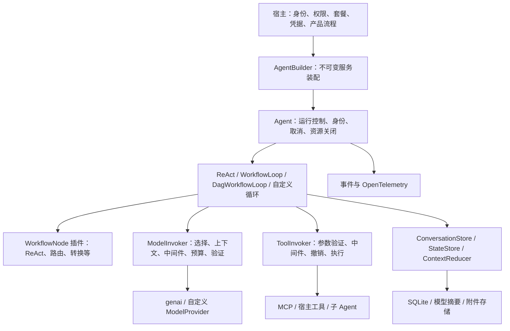

# Agent Framework

独立于宿主业务的 Rust Agent Framework。Framework 定义执行抽象，插件实现协议与基础设施；Tron 和其他宿主通过适配层接入。



## 架构导航与默认装配

- [架构总览](docs/architecture.md)：分层、装配、执行链和默认行为。
- [扩展点与实现清单](docs/plugins.md)：抽象、注册入口、数量约束及现有实现。
- [Middleware 与 Hook](docs/extensions.md)：执行拦截和生命周期通知的独立机制。
- [DAG 工作流](docs/dag-workflows.md) / [可观测](docs/observability.md)：具体接入方法。
- [用户问答与审批](docs/interactions.md)：默认 ask_user、SQLite 持久化和回答后恢复。
- [AG-UI 事件与 SSE](docs/agui.md)：注册、事件映射、运行控制与容量处理。
- [执行约束](docs/execution-contracts.md) / [验证证据](docs/implementation-status.md)：行为保证与验证范围。

| 自动装配 | 已提供，需要显式选择 |
|---|---|
| ReAct | WorkflowLoop、DagWorkflowLoop、自定义执行器 |
| 空工具集、空固定上下文、NoopEvents | 静态工具、MCP、自定义上下文与事件 sink |
| 单模型时自动固定选择、连接默认保守 token 估算 | 阶段/回退模型策略、自定义估算器 |
| Middleware 和 Run Hook 列表为空 | TelemetryPlugin、ToolOutputOffloader、自定义拦截器与 Hook |
| 不自动创建模型连接或持久化后端 | genai、SQLite、模型摘要、附件存储 |

默认 ReAct 需要配置模型及存储；`SqliteStoragePlugin::new("agent.sqlite")` 提供全部 SQLite 存储。DAG 是框架已提供的执行实现，通过插件显式选择；
SQLite 和 OTel 都不属于 Framework 的强制依赖。

## 分层与插件

| Crate | 职责 |
| --- | --- |
| `agent-plugin-kernel` | 类型服务、依赖排序、装配回滚、异步关闭及 Drop 兜底 |
| `agent-framework` | 消息、模型/工具调用、上下文、预算、执行状态、交互与运行控制 |
| `agent-model-genai` | 固定使用 genai `0.7.0-beta.21` 的协议桥接，共享认证与多模型目录 |
| `sqlite-extensions` | 平台识别、sqlite-simple / sqlite-vec 原生扩展及连接初始化；独立于 Framework |
| `agent-storage-sqlite` | 默认 SQLite 存储组合插件，统一文件与连接关闭 |
| `agent-tools-human` | 默认 ask_user 工具，结构化提问与答案校验 |
| `agent-state-sqlite` | SQLite 事务、checkpoint、session head、CAS 与租约 fencing |
| `agent-tools-mcp` | 官方 rmcp `3.2.0` 的 stdio / Streamable HTTP 工具客户端 |
| `agent-memory` | SQLite 会话、长期记忆存储、检索块和显式记忆工具 |
| `agent-context` | 模型摘要及持久化复用、不可变附件、工具结果转存和分页读取 |
| `agent-observability` | 注入式 OpenTelemetry `0.32.0` tracing / metrics |
| `agent-agui` | AG-UI 事件转换、独立有界通道、SSE 编码 |

Kernel 和 Framework 不定义 Space、Platform、`ScopeKind`、配置继承或套餐归属。宿主解析业务配置后装配运行实例。模型协议、存储驱动、遥测 exporter 可以独立替换。

`provide(T)` 注册唯一服务角色，`contribute(T)` 注册同一角色的多个贡献。多个供应商通过 `ModelConnectionService` 贡献注册；唯一的 `ModelStrategyService` 负责从整个目录选择模型。唯一角色也可以由一个组合实现协调多个内部组件。

## 模型接入与选择

```text
ModelConnection("subscription")
  ├─ 一个 ModelProvider：共享客户端、地址和认证
  ├─ ModelDescriptor("planner")
  ├─ ModelDescriptor("executor")
  └─ TokenEstimator：该连接的模型/协议估算

StageModelStrategy
  ├─ plan    → subscription/planner
  └─ execute → RoutingStrategy([subscription/executor, backup/executor])
```

目录中的模型是数据项，不需要逐个创建客户端或插件。多模型目录必须配置显式策略。内置策略支持固定选择、阶段选择和有序故障回退；自定义策略可以读取当前历史、工具、生成选项、阶段与尝试信息。连接凭据不进入序列化结构。

`ModelInvoker` 统一处理上下文、中间件、超时、重试、预算预留与结果验证。模型已输出增量后不自动重试；不确定的失败按预留额度保守计入预算。`ModelNext` 不允许中间件更换调用目标或新增未授权工具定义。

`GenerationOptions` 支持温度、top-p、输出上限、停止序列和 JSON Schema 输出。描述符可声明工具、多模态、结构化输出能力及自定义元数据；`None` 表示未知。JSON Schema 校验禁止远程和本地文件引用。

`ModelConnection::with_token_estimator` 将模型估算用于上下文组装、最终请求检查与用量预留。默认按字节保守估算；没有估算值的媒体默认拒绝。ConversationStore 提供原始快照，ContextAssembler 负责窗口裁剪，见[会话与上下文窗口](docs/context-windows.md)。

`Model` / `ModelPlugin` 是简单接入的兼容入口，会映射为 `legacy/default`。新循环使用 `AgentServices.models`，无需依赖 genai 类型。

## 执行方式

| 能力 | 默认 ReAct | WorkflowLoop | DagWorkflowLoop |
| --- | --- | --- | --- |
| 执行结构 | 工具循环 | 串行 ReAct 阶段 | 可插拔节点、并行、条件分支和汇合 |
| 模型选择 | `model_stage` | 按阶段选择 | 每个 ReAct 节点独立阶段配置，共享模型目录 |
| 工具并发 | `parallel_safe` 工具有界并发 | 安全工具可显式并行 | 节点可并行；工具安全标记和并发上限跨节点生效 |
| 用户输入 | 持久化问题、答案与恢复 | 持久化交互与恢复位置 | 按交互 ID 恢复对应节点 |
| 工具审批 | 支持 | 支持 | 内置 ReAct 节点支持 |
| 崩溃恢复 | StateStore | StateStore | StateStore，含节点结果、路由和嵌套工具记录 |
| 文本 steering | 支持 | 支持 | 拒绝未指定节点的 steering；使用节点交互 |

DAG 使用 `petgraph` 校验拓扑和环，Tokio `JoinSet` 管理节点任务；调度、持久化和恢复语义由 Framework 实现。`WorkflowNodePlugin` 可以贡献多个节点类型，`AgentLoopPlugin` 可以替换整个执行器。使用方法见 [DAG 工作流](docs/dag-workflows.md)。

自定义 `AgentLoop` 可以复用相同的 `ModelInvoker`、`ToolInvoker` 和运行控制接口。循环需要明确声明模型、状态和审批等要求，避免插件装上了却未被执行。

`Agent::start` 返回可订阅事件、steer、cancel、revoke_tools 的 `RunHandle`；`run` 等待结果。
在 `wait()` 前调用 `handle.control()` 可取得可克隆的 `RunControl`，用于在另一任务等待结果时
继续 steer、cancel、revoke_tools 和查询 budget_usage。丢弃控制句柄不会取消运行；
丢弃 `RunHandle` 或它的 `wait()` future 会取消该次运行。用法见[运行中追加指令](docs/architecture.md#运行中追加指令)。
同一 Agent 的同一 Session 同时只有一个 Run；SQLite 会话与持久化工作流分别通过各自租约协调多个实例。

`Agent::run_child(request, parent_context)` 创建独立子运行，继承根身份、取消、剩余时间和更严格的委派限制。父运行先预留子运行的完整额度，结束后按子账本结算；并发子任务不能重复花费同一份容量。父运行退出时取消并等待已登记的子运行清理。子运行的持久化恢复由宿主显式协调；该 API 拒绝隐式重新挂接已有的 resume。

工具在执行前校验参数，经过执行拦截器后，在真正派发时再次检查撤销状态。`ToolEffect::RevokeTools` 和 Handle 的撤销接口禁止尚未派发的调用；已开始的外部副作用不能回滚。结果处理在副作用发生后失败，会标记为 `Indeterminate`，不能冒充未执行。

## 历史、上下文与持久化

源 transcript、模型输入投影和执行 checkpoint 是不同的数据。投影可以裁剪或摘要，不能改写源 transcript。工具调用及其结果必须成组保存，模型专用 continuation 绑定准确的模型引用。

`ContextContributor` 区分可信指令和不可信数据，按每次调用重新收集。必需内容先预留容量，各块按显式布局分配独立预算，不借用其他块剩余额度。`ContextReducerPlugin` 同时接入 ReAct 和 WorkflowLoop。

`ModelCompressor` 使用配置的摘要模型，经过同一调用链和运行预算；摘要增量不会混入用户答案。它保留最新完整用户轮次、工具结果和签名数据。摘要为空、格式错误、超预算或无法有效缩小时返回错误。摘要分批使用摘要连接的估算器；可注入 SQLite 或自定义摘要存储，按来源范围和版本增量复用。摘要不保证语义无损。

`ToolOutputOffloader` 同时检查 content 和 structured 的大小，先完整存储原始 `ToolOutput`，再将 content 替换为预览和资源引用、清空内联 structured，并设置 result_reference。is_error 和交互效果保留。`FileArtifactStore` 使用目录能力、随机 ID、不可覆盖的原子发布、fsync 和有界分页读取；宿主负责目录访问范围与保留策略。

```text
模型工具意图 → Planned → 审批（可选）→ Started → 外部调用 → Finished
                                              │
                                      进程崩溃 / 响应丢失
                                              ▼
                                       RecoveryRequired
                                              │
                         宿主核对后 Record 结果，或显式 Retry
```

SQLite 将 checkpoint、transcript、journal 事件写入同一事务；更新使用 revision CAS、租约所有者和 fencing generation。恢复取得租约后重新读取和校验状态。已 Finished 的调用复用结果；Started 的不确定调用不会自动重做。终态可以在模型和工具离线时重放。

同一次租约持有期间，`run_id`、`owner`、`generation` 保持不变。续租返回的 `expires_at_unix_ms` 是时间快照；`StateStore` 必须以存储端的有效期和时钟判断是否过期，接受此前的时间快照。重新取得租约必须提升 generation，使旧执行者失效。

模型和子 Agent 的额度在远端调用前持久化预留。取消 SQLite 的 await 不代表 SQL 已回滚，宿主必须读取状态核对未知写入结果。外部副作用的 exactly-once 仍需要工具系统的幂等支持。

子 Agent 确定未派发时会归还本地预算和名额；若预留写入已确认成功，启动被拒绝后还会持久化归还结果。预留写入失败或中断时不猜测写入结果，恢复时可能仍看到保守预留。已派发但用量不确定的子任务继续按预留额度记账。

## 事件、遥测与生命周期

事件身份是 `(run_id, scope, sequence)`。`EventScope::Live { execution_id }` 区分每次执行/恢复尝试；`Journal` 是持久化日志。实时流是有界、尽力交付的观察通道，消费者需要处理 `Lagged`。checkpoint journal 是另一条序列，不能用实时流序号作为恢复游标。

`EventSink::on_diagnostic` 同步观测上下文和最终发送元数据；实现必须快速且不进行 I/O。TelemetryPlugin 用它在对应 span 结束前写入统计。

`EventSink` 的普通事件最多等待 `cleanup_timeout` 排空，随后停止普通回调，对每个 sink 并发尝试一次终态回调，各自额外获得 `min(cleanup_timeout, 1 秒)` 的处理时间。积压和其他 sink 的异步阻塞不会跳过这一机会；超时或异常的 sink 仍可能处理失败。可靠完成状态应读取 `RunHandle::wait()` 或持久化 checkpoint。

`RunResult.usage` 是循环返回的用量；`RunHandle::budget_usage` 包含已计入和在途的保守预留，两者都不是供应商账单。`TelemetryPlugin` 使用宿主注入的 tracer/meter provider，记录 run/node/model/tool、关联、时延、结果和用量，默认不输出提示词、参数、结果、session 或错误正文，也不更换全局 provider。DAG 的模型和工具 span 归属当前节点；节点 attempt 身份随检查点保存，恢复后可以关联前一次执行。错误以 `agent.error` span 事件输出结构化报告，宿主可显式安装文本脱敏器。详见[节点观测与恢复身份](docs/observability.md)。

`PluginContext::on_shutdown` 登记异步关闭，`on_cleanup` 登记同步兜底。`ResourceScope` 按反向顺序执行，收集错误、panic 和超时；超时逐个回调生效。`ToolLease` 的资源由内置循环交给 RunContext，受控取消也会等待关闭。自定义循环可以调用 `RunContext::own_resources`。

执行和清理同时失败时，`AgentError::WithCleanup` 保留两者，`primary()` 返回原始执行错误；取消分类仍依据原始错误。租约释放遇到存储错误时，在同一个清理期限内最多重试一次，重复释放返回 `LeaseLost` 视为已释放。持续失败会回传调用方，受控清理结束后不再启动隐藏的后台重试。

`Agent::close` 关闭所有克隆的新运行入口，等待运行清理后关闭插件，并返回 `ShutdownReport`。取消某个 close 等待者不会丢弃已经启动的关闭任务。硬进程终止只能依赖持久化恢复，Drop 无法等待异步远端确认。

显式共享的 SQLite store、MCP client、OTel provider 仍由宿主关闭；关闭一个 Agent 不应关闭其他 Agent 共享的服务。`McpToolsPlugin::owned` 则拥有自己创建的连接及其关闭责任。

## 验证与示例

当前验证环境为 Rust/Cargo 1.95.0，edition 2024；尚未独立验证最低 Rust 版本。

```sh
cargo fmt --all -- --check
cargo test --workspace --all-targets
cargo test --workspace --doc
cargo clippy --workspace --all-targets -- -D warnings
RUSTDOCFLAGS="-D warnings" cargo doc --workspace --no-deps
cargo run -p agent-framework --example standalone -- 19 23
```

离线算术示例是明确的协议 fixture，读取传入的数字并经过实际工具执行，不代表语言模型推理。可跨进程运行审批示例：

```sh
cargo run -p agent-state-sqlite --example durable_approval -- start /tmp/approval.db 17
# 使用上一步返回的 run_id 和 interaction.id：
cargo run -p agent-state-sqlite --example durable_approval -- answer /tmp/approval.db <run-id> <interaction-id> true
```

以下示例只有手工运行时访问真实服务：

```sh
# MODEL_ENDPOINT、MODEL_API_KEY、MODEL；其余使用默认实现
cargo run -p agent-model-genai --example minimal
# 相同环境变量；显式配置上下文块预算和拼接顺序
cargo run -p agent-model-genai --example context_blocks
# MODEL_ENDPOINT、MODEL_API_KEY、PLANNER_MODEL、EXECUTOR_MODEL
cargo run -p agent-model-genai --example shared_connection
# MCP_URL；可选 MCP_TOKEN
cargo run -p agent-tools-mcp --example discover
```

验收证据和限制见 [implementation-status](docs/implementation-status.md) 与 [执行约束](docs/execution-contracts.md)。本地测试包含真实 HTTP/SSE、MCP stdio/HTTP、SDK exporter、SQLite 竞争和强制终止执行器进程。

## 适配边界

- genai 固定在 `=0.7.0-beta.21`。已通过本地 signed-thinking 工具历史、媒体输入、生成选项及流式协议测试；尚无真实 Anthropic 账户验证，正式版升级仍需重新校验。
- genai 的 Developer 映射到 System；当前上游工具结果接口只接受文本，媒体工具结果明确报错。普通 resource 引用需要显式解析，工具结果中的资源引用则作为结构化文本保留。
- MCP 插件提供工具发现和调用，不承诺覆盖所有 MCP 能力。分页、解码后结果、SSE event 和并发受配置限制；stdio/普通 HTTP JSON 的解码峰值内存仍受 SDK 实现影响。远端失败保留 `is_error`，不确定响应不自动重试。
- 账号级限流、套餐账单、跨实例额度、凭据轮换、业务权限、RAG 数据源和分布式子任务协调由宿主或专门插件实现，不能用单次 Run 的 token 限额替代。

## Hook 与 Middleware

Plugin 可以分别贡献生命周期 Hook 和执行 Middleware。Run、节点、模型、工具的
Middleware 都采用 `intercept + next` 包装执行；`RunLifecycleHook` 只接收开始/结束通知，
不持有 next，也不修改运行结果。二者的注册类型与调用入口分开，详见
[扩展机制](docs/extensions.md)。

持久化会话、长期记忆、分块预算、摘要和附件读取的组合示例：
[memory_context.rs](crates/agent-memory/examples/memory_context.rs)，使用方式见[会话与上下文窗口](docs/context-windows.md)。

用户问答、工具审批与跨进程恢复见[交互文档](docs/interactions.md)。
默认存储与 Tron 原生扩展适配见[SQLite 存储](docs/sqlite-storage.md)。
