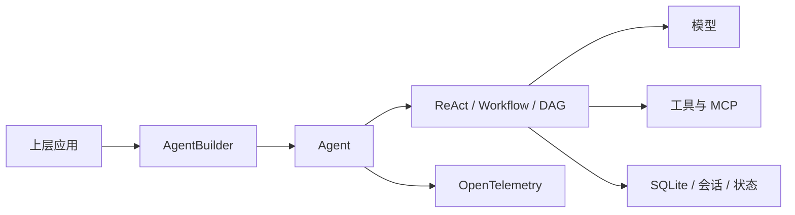

# eliteforge-agent-framework

EliteForge Agent Framework 是一个可扩展的 Rust Agent 框架：Framework 负责装配、执行和生命周期管理，Plugin 提供模型、工具、存储和可观测能力，上层应用保留身份、权限和业务流程。

所有插件只配置到 `AgentBuilder`，应用通过构建后的 `agent` 实例操作：启动、控制、获取输出、调用模型、处理问答和关闭资源。
业务能力可以用 `#[extension_point]` 和 `#[capability(...)]` 声明，再由应用显式选择能力包自动装配。
能力包也可携带 Skills、工具、模型绑定和普通 Plugin；复杂资源初始化仍放在 Plugin 生命周期中。
依赖配置、完整入门示例和场景选择见[插件开发指南](docs/plugins.md)。

多个插件可以打成包，一次配置到 Agent：

```rust
use eliteforge_agent_framework::AgentBuilder;
use eliteforge_agent_official_capability_pack::EliteForgeOfficialCapabilityPack;

let agent = AgentBuilder::new()
    .capability_pack(EliteForgeOfficialCapabilityPack::new("agent.sqlite"))
    .build().await?;
```

官方包默认装配 8 个进程内插件：Genai、SQLite、用户问答、Agent 协作工具、Skills、AGUI、MCP 和 OTel。
MCP 未配置服务器时工具集为空；OTel 在构建时读取上层应用的全局 provider。
官方和业务插件组合统一使用 `CapabilityPack`；直接 `.plugin(...)` 装配仍然保留。

文件与命令也可通过官方包的 `.read_only_filesystem(config)`、`.write_filesystem(config)`、
`.system_commands(config)` 显式启用，具体实现都在宿主进程内。

业务能力、插件组合和外部安装包统一使用 `.capability_pack(...)`；只装配显式选中的包及其 `.include(...)` 子包：

~~~rust
use eliteforge_agent_core::CapabilityPackBuilder;

let agent = AgentBuilder::new()
    .capability_pack(CapabilityPackBuilder::new("shop", shop_config))
    .build()
    .await?;
~~~

发布来源与加载方式分别判断。宿主通过 Cargo 依赖和 features 选择编译的 Rust 实现，运行时再显式启用；
官方和第三方 Rust 插件只要编译进宿主，都在进程内装配。
通过安装器选择的能力包声明 `backend`，且选用了扩展实现、插件或页面时，使用独立进程和 RPC，
即使它由官方发布。未声明后端的 Skills、静态页面或资源包不启动能力包后端。
签名用于验证来源和内容，不改变执行方式。MCP stdio 和系统命令启动的程序由对应插件管理。
动态安装、签名、版本和空闲重配见[动态能力包](docs/dynamic-capability-runtime.md)、[迁移说明](docs/dynamic-capability-migration.md)和[验收矩阵](docs/dynamic-capability-acceptance.md)。

能力声明、配置工厂、共享实例和依赖规则见[能力包与自动装配](docs/capability-packs.md)。



## 快速上手

### 1. 准备环境

需要 Rust/Cargo、Rust 工具链和 C 编译工具。先执行环境检查，再拉取锁定依赖：

```sh
make doctor
make install
```

### 2. 连接真实模型

Framework 默认启用 Genai。真实模型验证放在与 `crates/` 平级的 [integration-tests](integration-tests/README.md) 项目中，配置模型名和凭据后显式运行：

```sh
export MODEL="your-model"
export OPENAI_API_KEY="your-api-key"
cargo run -p eliteforge-agent-integration-tests --features live-model --bin default_model
```

代理服务可额外设置 `MODEL_ENDPOINT` 和 `MODEL_API_KEY`。完整代码和其他模型协议见[快速上手](docs/quickstart.md)。

## 支持的特性

| 分类 | 主流 Agent 常见特性 | 本框架状态 | 当前范围 |
| --- | --- | --- | --- |
| 运行 | ReAct 对话、流式输出与工具循环 | ✅ 已支持 | 文本与推理增量、工具错误回传、步骤和工具调用上限 |
| 运行 | 阶段工作流与 DAG 编排 | ✅ 已支持 | 固定阶段、并行节点、条件分支、汇合、恢复和自定义节点 |
| 模型 | 多供应商、多连接与模型选择 | ✅ 已支持 | 多连接选择；Chat Completions、Responses、原生 Gemini 与 Embedding |
| 内容 | 多模态输入与结构化输出 | ✅ 已支持 | 文本、图片等内容块、结构化回复和大型结果引用 |
| 工具 | 工具调用、Schema 校验与并发 | ✅ 已支持 | 调用前参数校验、显式安全的并发、撤销、取消和结果持久化 |
| 工具 | 目录范围文件、文本补丁、目录和代码搜索 | ✅ 已支持 | 可选文件系统能力包提供 `fs_*` 与 `search_*` 工具；所有路径限制在上层应用配置的根目录内 |
| 工具 | 系统命令执行（Linux、macOS、Windows） | ✅ 已支持 | 可选通用能力包提供 `system_exec`；超过 10 秒返回任务 ID，可用 `system_exec_task_read` 续读状态和输出、用 `system_exec_task_stop` 停止；Agent 关闭时清理任务；能力包显式安装后可直接执行程序，也可按上层应用配置限制程序名；不隐式调用 Shell |
| 工具 | 编辑器工具 | 🧩 可扩展 | 由上层应用的 `ToolProvider` 或 MCP Server 提供 |
| 工具 | Web 搜索与抓取 | ✅ 可选插件 | 宿主配置搜索后端、HTTP(S) 域名策略和限额；返回来源信息 |
| 工具 | 浏览器自动化 | 🧩 可扩展 | 上层应用或 MCP 提供；本轮 P2 暂缓 |
| 工具 | 本地图片／PDF 与工具发现 | ✅ 可选插件 | 图片媒体块、PDF 分页文本；授权 Provider 的 Schema 按需公开 |
| 安全 | 工具权限、审批与策略 | 🧩 可扩展 | `ToolPolicy`、中间件和用户审批可组合；具体权限模型由上层应用定义 |
| 安全 | 沙箱执行 | 🏠 上层应用负责 | 框架传递取消、超时和策略；隔离运行环境由上层应用或工具实现 |
| 规划 | Plan Mode / 只读计划 | 🧩 可扩展 | 通过自定义 `AgentLoop`、`ToolPolicy` 和工具暴露策略实现 |
| 任务 | Todo、任务图与长期任务跟踪 | 🧩 可扩展 | 具备状态持久化、DAG 和恢复基础；未提供内置 Todo 或任务图产品模型 |
| 上下文 | 上下文窗口、压缩与 token 预算 | ✅ 已支持 | 按块组装、模型容量检查、历史裁剪和模型摘要 |
| 记忆 | 会话记忆、长期记忆与检索 | ✅ 已支持 | 可插拔接口、SQLite 后端、检索上下文和可选记忆工具 |
| 连续性 | 会话持久化、checkpoint 与恢复 | ✅ 已支持 | 原子 checkpoint、恢复身份、工具结果日志和中断后续跑 |
| 人机协作 | 用户问答与工具审批 | ✅ 已支持 | `AwaitInput`、持久化问题、允许/拒绝和跨进程恢复 |
| 运行控制 | 追加指令、取消与子执行额度 | ✅ 已支持 | Steering、取消、父子执行身份和预算隔离 |
| 集成 | MCP 工具与资源 | ✅ 已支持 | 官方 SDK transport、工具发现与分页、资源列表／模板／读取、内容保留和取消传播；资源工具按服务器声明启用 |
| 集成 | AG-UI 事件协议 | ✅ 已支持 | SSE、文本、推理、工具、状态、活动、交互恢复、子 Agent 和 Thread 生命周期事件 |
| 扩展 | Plugin 与能力包 | ✅ 已支持 | 声明式扩展点、全部 install 后 ready、回滚、异步关闭、Skills 聚合和 `#[capability]` / `#[capability_factory]` 自动装配 |
| 扩展 | Middleware、Hook 与自定义执行器 | ✅ 已支持 | Run、模型、工具、节点中间件；生命周期 Hook；自定义 `AgentLoop` |
| 扩展 | Skills 系统 | ✅ 已支持 | 官方文件系统插件兼容 Agent Skills；能力包可内嵌 `skills/`、引用目录或声明 Provider，统一聚合后按需读取资源 |
| 扩展 | 能力包安装与版本管理 | ✅ 已实现 | 本地 ZIP／HTTPS 导入、签名校验、不可变版本、依赖解析与回滚选择；在线商店未提供 |
| 多 Agent | 子 Agent / 专家 Agent | ✅ 已支持 | 官方 `agent_spawn` 工具；继承父运行取消、deadline、lineage、预算和深度 |
| 多 Agent | 独立 Threads 与会话协作 | ✅ 已支持 | 官方 `thread_create/send/answer/wait/read/list/close` 工具；默认进程内 bounded registry，跨进程持久化由上层 runtime 提供 |
| 多 Agent | 后台执行、队列与 Worktree 隔离 | 🏠 上层应用负责 | 需要部署队列、进程管理和 Git 工作树管理 |
| 多 Agent | Agent Team 协作 | 🧩 可扩展 | 可用 DAG、子执行、Threads 和事件接口编排；未提供固定团队决策协议 |
| 产品接口 | 终端 UI、REPL、Slash Commands、Headless HTTP | 🏠 上层应用负责 | Framework 提供运行时和事件；UI、CLI、HTTP 与命令路由由上层应用构建 |
| 产品接口 | 文件历史、Diff 与 Rewind | 🏠 上层应用负责 | 可作为工具或存储能力接入；框架不管理 Git 或目录文件 |
| 配置 | 项目级 / 用户级配置 Profile | 🏠 上层应用负责 | AgentBuilder 接收已解析配置；读取、合并和安全存储由上层应用负责 |
| 可观测 | OpenTelemetry、事件与指标 | ✅ 已支持 | 运行、节点、模型和工具 span；指标、错误事件和可注入 exporter |

各项的使用方式与约束见：[架构总览](docs/architecture.md)、
[上下文窗口](docs/context-windows.md)、[DAG 工作流](docs/dag-workflows.md)、
[交互与审批](docs/interactions.md)、[插件开发指南](docs/plugins.md)、
[能力包](docs/capability-packs.md)、[AG-UI](docs/agui.md) 和
[可观测](docs/observability.md)。

与 Codex CLI、Claude Code、Hermes、Gemini CLI、Qwen Code 的工具清单对照、语义差距和补齐顺序，
见[工具能力核查](docs/tool-capability-audit.md)和[实现进度](docs/tool-capability-progress.md)。
命令清单、交互式输入和 PTY 见[本地命令工具](docs/local-command-tools.md)，资源接入见[MCP 资源](docs/mcp-resources.md)。
补丁和搜索见[文件工具](docs/local-file-tools.md)，发现、Web 和媒体见[可选工具插件](docs/optional-tool-plugins.md)。

## Crates 组织

```text
crates/
├── framework/     公共契约、Agent 执行、插件内核、能力声明和外部包运行时
├── plugin/        具体实现与配套实现库
│   ├── tool/      本地文件与命令、问答、Agent 协作、MCP、工具发现、Web、媒体
│   ├── model/     模型连接
│   ├── observe/   遥测
│   ├── protocol/  AG-UI
│   ├── skill/     Skills
│   ├── context/   上下文压缩与附件
│   ├── memory/    会话与长期记忆
│   └── storage/   SQLite 存储及扩展
├── capability/    随仓库提供的 Rust 能力包装配入口
├── testing/       测试支持与跨 crate 样例
└── tools/         能力包开发宿主
```

完整 Crate 清单、官方能力配置示例和进程边界见 [crates/README.md](crates/README.md)。
`capability/` 是源码组织目录；外部安装包存放在包管理器根目录下的 `packs/<id>/versions/<version>`。

| Crate | 作用 |
| --- | --- |
| `eliteforge-agent-framework` | Agent 装配、循环调度、模型和工具执行 |
| `eliteforge-agent-core` | 公共类型、能力接口、CapabilityPack API 和 Plugin 契约 |
| `eliteforge-agent-capability-tools` | 选择与配置文件、搜索、补丁、系统命令和原生 PTY 能力包 |
| `eliteforge-agent-capability-external` | 装配外部 Agent 模型阶段、CLI/JSON 服务桥及作用域绑定的会话恢复 |
| `eliteforge-agent-official-plugin-tools-local` | 进程内文件、命令和 PTY 实现；命令超过 10 秒返回 ID，提供读取与停止工具 |
| `eliteforge-agent-official-plugin-model-external` | Codex/OpenCode CLI 与配置式 JSON 服务桥的公共执行、流解析、取消和原生会话续传 |
| `eliteforge-agent-official-plugin-skills` | Agent Skills 标准文件系统发现、渐进式加载和可替换 Provider |
| `eliteforge-agent-official-plugin-tools-agents` | 子 Agent 委派与独立 Thread 协作工具 |
| `eliteforge-agent-plugin-core` | 服务注册、依赖排序和资源关闭 |
| `eliteforge-agent-capability-macros` | 编译时生成能力与扩展点注册代码，嵌入 Skills 资源 |
| `eliteforge-agent-capability-runtime` | 安装包管理、独立后端进程、RPC、页面会话和后端 SDK |
| `eliteforge-agent-capability-dev-host` | 开发时主动运行的调试宿主、示例后端和 MCP 服务；应用使用 Framework 无需启动它 |
| `eliteforge-agent-official-capability-pack` | 官方插件组合，一次配置到 Agent |
| `eliteforge-agent-official-plugin-*` | Genai、SQLite、MCP、AG-UI、OTel 等官方实现 |

## 文档

- [快速上手](docs/quickstart.md)：按场景运行 Agent，并查看完整 Rust 代码。
- [架构总览](docs/architecture.md)：分层、装配、执行链和生命周期。
- [插件与扩展开发指南](docs/plugins.md)：引入依赖、实现 Provider、按业务场景选择扩展点。
- [能力包与自动装配](docs/capability-packs.md)：声明扩展点、显式选包、配置工厂、Skills 成员和生命周期。
- [Skills](docs/skills.md)：目录约定、渐进式加载、技能选择和自定义 Provider。
- [扩展点参考](docs/plugin-extension-reference.md)：接口、注册类型、调用时机与多实例规则。
- [模型插件](docs/model-plugins.md)：Genai 配置、协议、模型选择与多模态扩展。
- [DAG 工作流](docs/dag-workflows.md)：节点、并行、分支和恢复。
- [交互与审批](docs/interactions.md)：用户问答、工具审批和跨进程恢复。
- [Agent 协作](docs/collaboration.md)：子 Agent 委派、独立 Threads 和协作边界。
- [可观测](docs/observability.md)：事件、OpenTelemetry 和恢复身份。

## 常用命令

```sh
make format  # 格式化
make lint    # 格式、Clippy、编译和 Rustdoc 检查
make test    # workspace 测试和文档测试
make build   # 构建 release 产物
```
