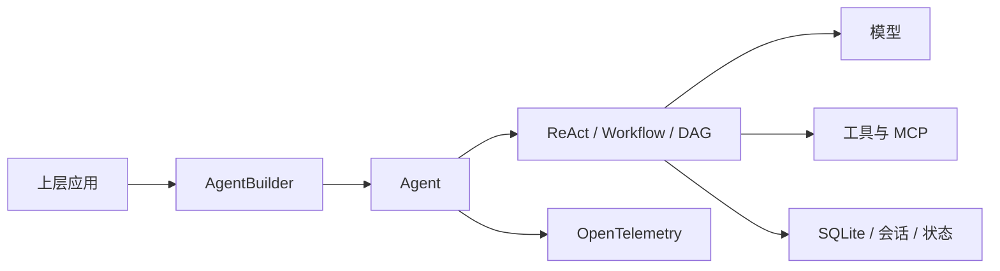

# eliteforge-agent-framework

EliteForge Agent Framework 是一个可扩展的 Rust Agent 框架：Framework 负责装配、执行和生命周期管理，Plugin 提供模型、工具、存储和可观测能力，上层应用保留身份、权限和业务流程。

所有插件只配置到 `AgentBuilder`，应用通过构建后的 `agent` 实例操作：启动、控制、获取输出、调用模型、处理问答和关闭资源。
自定义插件通过 `agent.execute(request)` 暴露能力。依赖配置、完整入门示例和场景选择见[插件开发指南](docs/plugins.md)。

多个插件可以打成包，一次配置到 Agent：

```rust
use eliteforge_agent_framework::AgentBuilder;
use eliteforge_agent_official_plugin_pack::EliteForgeOfficialPluginPack;

let agent = AgentBuilder::new()
    .plugin_pack(EliteForgeOfficialPluginPack::new("agent.sqlite"))
    .build().await?;
```

官方包默认包含项目里的全部 6 个官方插件：Genai、SQLite、用户问答、AGUI、MCP 和 OTel。
MCP 未配置服务器时工具集为空；OTel 在构建时读取宿主的全局 provider。业务组合可实现自己的 `PluginPack`。



## 快速上手

### 1. 准备环境

需要 Rust/Cargo、Rust 工具链和 C 编译工具。先执行环境检查，再拉取锁定依赖：

```sh
make doctor
make install
```

### 2. 连接真实模型

Framework 默认启用 Genai。真实模型验证放在与 `crates/` 平级的 [integration-tests](integration-tests/README.md) 项目中，配置模型名和凭据后显式运行：

```sh
export MODEL="your-model"
export OPENAI_API_KEY="your-api-key"
cargo run -p eliteforge-agent-integration-tests --features live-model --bin default_model
```

代理服务可额外设置 `MODEL_ENDPOINT` 和 `MODEL_API_KEY`。完整代码和其他模型协议见[快速上手](docs/quickstart.md)。

## 能力概览

- 执行：默认 ReAct、分阶段 Workflow、可并行和分支的 DAG。
- 扩展：模型、工具、MCP、用户问答、上下文、存储和 OpenTelemetry 均通过 Plugin 接入。
- 运行控制：流式事件、追加指令、取消、工具撤销和资源清理。
- 持久化：SQLite 会话、checkpoint、长期记忆、上下文摘要和中断恢复。
- 宿主边界：身份、权限、凭据、套餐和业务流程由上层应用管理。

## 关键 Crate

| Crate | 作用 |
| --- | --- |
| `eliteforge-agent-framework` | Agent 装配、循环调度、模型和工具执行 |
| `eliteforge-agent-core` | 公共类型、能力接口和 Plugin 契约 |
| `eliteforge-agent-plugin-kernel` | 服务注册、依赖排序和资源关闭 |
| `eliteforge-agent-official-plugin-pack` | 官方插件组合，一次配置到 Agent |
| `eliteforge-agent-official-plugin-*` | Genai、SQLite、MCP、AG-UI、OTel 等官方实现 |

## 文档

- [快速上手](docs/quickstart.md)：按场景运行 Agent，并查看完整 Rust 代码。
- [架构总览](docs/architecture.md)：分层、装配、执行链和生命周期。
- [插件与扩展开发指南](docs/plugins.md)：引入依赖、实现 Provider、按业务场景选择扩展点。
- [能力包与自动装配设计](docs/capability-packs.md)：框架宏声明能力、应用显式选包、内部自动装配；尚未实现。
- [扩展点参考](docs/plugin-extension-reference.md)：接口、注册类型、调用时机与多实例规则。
- [模型插件](docs/model-plugins.md)：Genai 配置、协议、模型选择与多模态扩展。
- [DAG 工作流](docs/dag-workflows.md)：节点、并行、分支和恢复。
- [交互与审批](docs/interactions.md)：用户问答、工具审批和跨进程恢复。
- [可观测](docs/observability.md)：事件、OpenTelemetry 和恢复身份。

## 常用命令

```sh
make format  # 格式化
make lint    # 格式、Clippy、编译和 Rustdoc 检查
make test    # workspace 测试和文档测试
make build   # 构建 release 产物
```
