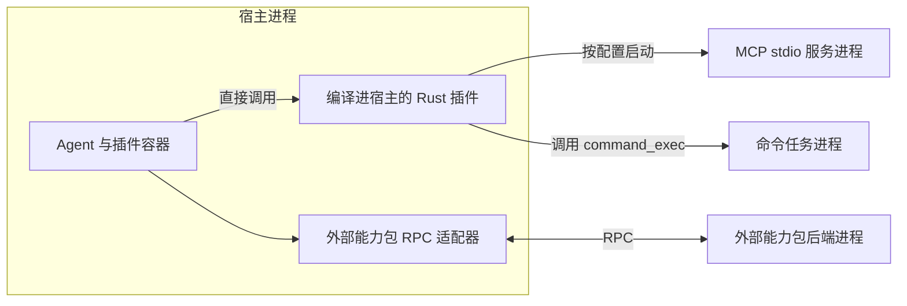

# Crates 组织与插件运行方式

按职责查找代码：`framework` 定义运行时和契约，`plugin` 提供具体实现，`capability` 负责选择和组合能力。
目录只说明源码职责。发布者、交付方式和运行进程需要分别判断。

## 目录

```text
crates/
├── framework/                          契约、执行、装配与动态包基础设施
│   ├── eliteforge-agent-core
│   ├── eliteforge-agent-framework
│   ├── eliteforge-agent-plugin-core
│   ├── eliteforge-agent-context-contracts
│   ├── eliteforge-agent-capability-macros
│   └── eliteforge-agent-capability-runtime
├── plugin/                             按能力类型分类的 Rust 插件与配套实现库
│   ├── tool/
│   │   ├── eliteforge-agent-official-plugin-tools-local
│   │   ├── eliteforge-agent-official-plugin-tools-human
│   │   ├── eliteforge-agent-official-plugin-tools-agents
│   │   ├── eliteforge-agent-official-plugin-tools-mcp
│   │   ├── eliteforge-agent-official-plugin-tools-discovery
│   │   ├── eliteforge-agent-official-plugin-tools-web
│   │   └── eliteforge-agent-official-plugin-tools-media
│   ├── model/
│   │   └── eliteforge-agent-official-plugin-model-genai
│   ├── agent/
│   │   └── eliteforge-agent-official-plugin-agent-external
│   ├── observe/
│   │   └── eliteforge-agent-official-plugin-otel
│   ├── protocol/
│   │   └── eliteforge-agent-official-plugin-agui
│   ├── skill/
│   │   └── eliteforge-agent-official-plugin-skills
│   ├── context/
│   │   └── eliteforge-agent-context
│   ├── memory/
│   │   └── eliteforge-agent-memory
│   └── storage/
│       └── eliteforge-agent-official-plugin-storage-local
├── capability/                         随仓库提供的 Rust 能力包装配入口
│   ├── eliteforge-agent-official-capability-pack
│   ├── eliteforge-agent-capability-tools
│   ├── eliteforge-agent-capability-external
│   └── eliteforge-agent-capability-personai
├── testing/                            测试专用支持与跨 crate 装配样例
│   ├── eliteforge-agent-test-support
│   └── eliteforge-agent-capability-test-fixture
└── tools/                              可执行开发工具
    └── eliteforge-agent-capability-dev-host
```

安装包由 `CapabilityPackManager` 写入宿主指定根目录下的 `packs/<id>/versions/<version>`。

## 三层各做什么

| 层 | 内容 | 例子 |
| --- | --- | --- |
| Framework | 定义接口、调度执行、校验参数并管理插件安装和关闭；提供外部包协议与 SDK | `ToolProvider`、`PluginContext`、`FrameworkBuilder`、`CapabilityPackManager` |
| Plugin | 实现接口，管理连接、工具或存储，并在结束时清理资源 | `GenaiPlugin`、`LocalStoragePlugin`、`SystemCommandPlugin` |
| Capability | 组合实现和配置，供应用选择；工厂负责创建配置和插件 | `EliteForgeOfficialCapabilityPack`、`local_tools_pack(config)` |

`plugin/context` 和 `plugin/memory` 提供上下文与记忆能力；它们依赖存储契约。
`plugin/storage` 实现本地持久化，包含 SQLite 连接、文件附件和可选 SQLite 原生扩展。
高层 Framework 门面可以依赖官方默认实现；`eliteforge-agent-core` 和插件内核只负责接口职责。

## 基础 Crate 与开发工具

| Crate | 什么时候起作用 | 具体职责 |
| --- | --- | --- |
| `eliteforge-agent-plugin-core` | 构建和关闭插件容器时 | 提供 `Plugin`、服务注册表、扩展点、依赖排序、安装／ready、失败回滚和资源关闭；不包含 Agent 业务契约 |
| `eliteforge-agent-core` | 声明和装配 Agent 能力时 | 定义模型、工具、会话等 Agent 契约，提供 `CapabilityPack` 与原生声明的发现、校验和工厂调用 |
| `eliteforge-agent-capability-macros` | Rust 编译时 | 实现 `#[extension_point]`、`#[capability]`、`#[capability_factory]`，生成注册描述和适配代码；提供 Skills 嵌入与构建跟踪宏 |
| `eliteforge-agent-capability-runtime` | 安装、选择和调用动态能力包时 | 管理清单、签名、版本、实例、后端进程、RPC、远程扩展适配、页面会话与后端 SDK |
| `eliteforge-agent-capability-dev-host` | 插件开发者主动运行时 | 提供本地调试宿主、示例后端和示例 MCP 服务，验证安装、调用、页面和重配 |

`capability-macros` 是设置了 `proc-macro = true` 的编译工具库。Rust 要求过程宏放在专用的宏 crate 中，
因此应用通常通过 `eliteforge-agent-core` 重导出的宏来声明能力。宏生成声明和工厂；原生装配流程在选中能力包后创建实例。
宏不会在编译时安装插件，也不会启动能力包后端。

`capability-runtime` 提供动态包运行所需的基础设施，不包含默认插件，也不负责执行所有原生能力。
`agent-core` 解析原生 Rust 能力的声明，`plugin-core` 安装这些能力。对于动态包，管理器会创建适配器并接入相同的生命周期，
然后根据清单启动后端。宿主和后端分别使用该库提供的管理 API 与 SDK。

`capability-dev-host` 放在 `tools/`，因为它是供开发者运行的程序；
`plugin/tool/` 则存放供 Agent 调用的工具插件。
这个 crate 设置 `publish = false`，包含 `capability-host`、`capability-backend` 和 `capability-mcp`
三个可执行文件。正常应用使用 Framework 不需要依赖或启动它；应用通过 runtime API 管理自己的安装包。
开发宿主的启动和调试方式见[示例与开发宿主](../docs/动态能力包运行时设计.md#示例与开发宿主)。

## 官方能力如何启用

`EliteForgeOfficialCapabilityPack::new(database, artifact_root)` 默认装配以下进程内能力：

| 分组 | 默认插件 | 默认配置 |
| --- | --- | --- |
| model | Genai | 模型连接 |
| storage | local-first | SQLite 保存结构化数据，文件系统保存附件正文 |
| tool | Human、Agents、MCP | 用户问答、子 Agent／Thread 工具；MCP 初始没有服务器 |
| skill | Skills | Skills Provider 与按需读取 |
| protocol | AG-UI | 输出事件协议 |
| observe | OTel | 构建时读取宿主全局 providers |

文件、搜索、写入和命令通过同一个官方包显式配置：

```rust,ignore
use eliteforge_agent_framework::{FrameworkBuilder, AgentSelection};
use eliteforge_agent_official_capability_pack::{
    EliteForgeOfficialCapabilityPack,
    tools::{FileSystemToolsConfig, SystemCommandConfig},
};

let pack = EliteForgeOfficialCapabilityPack::new("agent.sqlite", "agent-artifacts")
    .read_only_filesystem(FileSystemToolsConfig::new("workspace"))
    .write_filesystem(FileSystemToolsConfig::new("workspace"))
    .system_commands(SystemCommandConfig::new());

let framework = FrameworkBuilder::new().capability_pack(pack).build().await?;
let agent = framework.agent(AgentSelection::default()).build().await?;
```

## 进程边界

### 来源、交付方式和执行方式

| 维度 | 判断依据 | 作用 |
| --- | --- | --- |
| 官方／第三方 | 发布来源；安装包的签名及受信公钥 | 判断由谁发布、是否可信 |
| 内置／安装包 | 宿主 Cargo 依赖，或 `CapabilityPackManager` 安装与选择 | 决定加载路径 |
| 进程内／独立进程 | 原生 Rust 装配，或安装包的 `manifest.backend` 与贡献选择 | 决定执行方式 |

官方可以发布外部安装包，第三方 Rust 插件也可以由宿主编译进应用。
安装包已有通用 Ed25519 验签和受信密钥管理，宿主可将签名密钥关联到发布者。


### 谁决定编译和启用

宿主在构建时通过 `Cargo.toml`、Cargo features 和 Rust 依赖，选择要编译和链接的实现。
应用启动时再通过 `.capability_pack(...)`、`.include(...)` 或 `.plugin(...)` 选择装配内容。
未选中的声明式能力不会调用工厂；运行时启用能力也不会临时编译或链接新的 crate。

`EliteForgeOfficialCapabilityPack` 和 `CapabilityPackBuilder` 用原生 Rust 代码组合能力并创建 Plugin。
`CapabilityPackManager::select(...)` 返回 `ManagedCapabilityPack`，并根据安装清单创建运行时适配器。
两种方式都通过 `.capability_pack(...)` 接入；具体加载方式由传入的能力包实现决定。
安装包不会自动编译进宿主；要改为原生装配，宿主开发者必须添加 Rust 依赖并重新构建。

### 加载规则

| 加载方式 | 实际运行位置 |
| --- | --- |
| 宿主编译、链接的 Rust Plugin 或能力包，包括官方默认实现和第三方实现 | 在宿主进程内直接调用 trait 方法 |
| 安装包声明 `backend`，且选用了扩展实现、插件或页面 | 独立后端进程，宿主通过 RPC 调用；官方与第三方使用相同规则 |
| 未声明 `backend` 的 Skills、静态页面或资源包 | 不启动能力包后端；页面由宿主挂载 |
| MCP stdio／系统命令 | 外部服务或命令进程；负责它们的 Plugin 仍在原进程内 |
| MCP Streamable HTTP | 连接远端服务，不启动本地 MCP 进程 |



