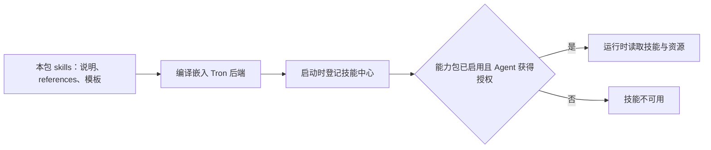

# EliteForge Agent Development 能力包

包 ID：`eliteforge.agent-development`。本包位于 Framework 的 `crates/capability/eliteforge-agent-capability-development`，三个开发技能在本目录统一维护：

- [Framework 对接](skills/eliteforge-agent-framework-integration/SKILL.md)：Rust Agent、插件、工具和能力包开发，包含订单助手模板。
- [Agent UI 对接](skills/eliteforge-agent-ui-integration/SKILL.md)：React/Vue npm 包、宿主 adapter/transport 和运行控制。
- [Agent UI 主题](skills/eliteforge-agent-ui-theme/SKILL.md)：公共主题变量、样式挂点和 React/Vue 外观。

Tron 将整个 `skills/` 目录编译进后端，默认安装并启用本包。启动时按内容哈希展开技能资源，登记到技能中心；无需手动导入，也无需 Framework/UI 源码 checkout。禁用后，技能中心保留包归属记录，三个技能停止提供；Agent 使用权限沿用技能中心的授权规则。

Framework 或 Agent UI 接口变化时，在对应代码改动中同步本目录，更新受影响技能的 `metadata.version`，并核对 `agents/openai.yaml`。Framework 根目录 `skills/` 与 Agent UI 仓库只保留维护指引，不保留技能副本。引用中的 Framework/UI 源码路径均相对于各自仓库根目录；npm 和 Git 版本基线仍以技能正文为准。

在 Framework 根目录执行 `make development-capability-check` 校验技能并编译能力包；Tron 通过能力包依赖完成默认装配，在 Tron 根目录执行 `make be-check` 检查宿主接入。不需要新增测试代码。
