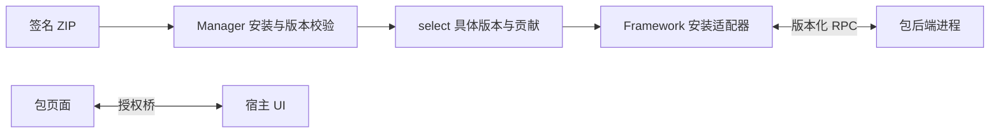

# 进阶能力接入

以下各节按独立场景使用。`builder`、`official`、`framework`、`agent` 分别表示入门程序中的构建器、官方包、Framework 和 Agent。额外 crate 均使用同一 Git URL 和 `tag = "1.0.0"`。

## 1. 持续执行一个目标

一次 `run` 执行一轮任务；需要框架判断是否继续时，安装 `GoalPlugin`：

```rust
use eliteforge_agent_framework::*;
let builder = builder.plugin(GoalPlugin);
```

构建后创建真实 Session/Goal，再启动目标执行：

```rust
use std::sync::Arc;

let session = framework.sessions()?.create(SessionRecord::new("订单审查")).await?;
let goal = framework.goals()?.set(GoalRecord::new(
    &session.id, "核对订单信息并给出有依据的处理结论",
)).await?;
let mut request = RunRequest::new(&session.id, "开始核对");
request.limits.max_model_calls_per_step = Some(3);
request.limits.max_total_tokens = 60_000;
request.limits.max_steps = 20;
let last_run = agent.run_to_goal(
    request, &goal.id, Arc::new(ModelGoalPolicy::default()),
).await?;
let goal = framework.goals()?.get(&goal.id).await?;
println!("goal={:?}, last_run={:?}", goal.status, last_run.status);
```

目标是否完成看持久化 Goal 状态，不只看最后一轮输出。多轮共享原始预算和截止时间；等待用户、失败或预算耗尽会暂停。宿主如需自定义完成条件，实现 `GoalPolicy`，不要用看到某个关键词就无限重跑的外层循环。

## 2. 固定流程与自定义 Loop

`1.0.0` 的公开源码提供默认 `ReactAgentLoop`、`ExternalAgentLoop` 和可实现的 `AgentLoop` 契约；没有可直接导入的 `WorkflowAgentLoop` / `DagAgentLoop`。不要根据旧说明编造这些类型。

简单的两阶段流程可以由宿主明确编排：

```rust
let analysis = agent.run(RunRequest::new("review-1", "分析订单异常，列出证据")).await?;
// 仅在 analysis 已正常完成时继续；等待交互/错误由“运行与交互”章处理。
println!("分析状态：{:?}", analysis.status);
```

宿主在校验状态后再提交下一阶段输入，同一 Session 保留前一阶段历史。这只是串行编排，没有自动 DAG 检查点、节点调度或分支恢复承诺。复杂任务应实现并安装自定义 `AgentLoop`，或使用宿主已有的工作流引擎。

只由业务服务执行、不调用模型/工具的 Loop 完整形状：

```rust
use async_trait::async_trait;
use eliteforge_agent_framework::*;

struct HostLoop;
#[async_trait]
impl AgentLoop for HostLoop {
    async fn run(
        &self, _: &RunRequest, context: &RunContext, _: &AgentServices,
    ) -> Result<RunResult, AgentError> {
        context.check_cancelled()?;
        // 此处替换成宿主实际的执行与结果映射，不伪造已完成状态。
        Err(AgentError::Run("尚未配置业务执行器".into()))
    }
}
```

安装 `.plugin(AgentLoopPlugin::named("host.loop", HostLoop))`，Agent 设置 `agent_loop: Some("host.loop".into())`。要在自定义 Loop 中调用模型、工具或支持持久恢复，需显式实现对应执行能力、预算、策略和检查点，不直接绕过运行服务调用工具。

## 3. 子 Agent 与独立协作会话

官方包默认安装 `tools.agents`，在 Agent 中选择才可使用：

```rust
let selection = AgentSelection {
    tool_providers: Some(vec!["tools.agents".into()]),
    ..Default::default()
};
let mut request = RunRequest::new("research-1", "请委派一个子任务检查订单约束");
request.limits.max_child_runs = 4;
request.limits.max_delegation_depth = 2;
```

| 工具/方式 | 使用情境 | 生命周期 |
| --- | --- | --- |
| `agent_spawn`，如 `{"task":"核对退款规则"}` | 当前任务需要一个子结论 | 等待返回，继承父取消/预算/深度 |
| `thread_create` | 独立可继续会话 | 返回 session_id，独立运行 |
| `thread_wait` / `thread_read` | 等待或查看协作结果 | 由 session_id 定位 |
| `thread_send` | 对已结束一轮的会话继续输入 | 不替代回答待处理交互 |
| `thread_answer` | 协作任务正在 AwaitingInput | 校验答案后恢复原 run |
| `thread_close` | 完成或暂停后释放容量 | 不应关闭仍活动的任务 |

默认运行时支持当前 Agent 的进程内协作，不含业务命名 Agent 目录。`agentCode` 需要宿主 `AgentCollaborationRuntime` 解析并校验授权；派发前清除已解析的 `request.agent_code`，通过目标 Agent 的公开 `run_child(request, parent)` 保留子执行关系；需要运行 ID、事件或取消控制时，使用 `start_child_owned(request, parent)`，持有返回的句柄并完成 `wait`。独立 Thread 默认 registry 不跨进程恢复；需要队列/恢复时由宿主实现持久任务管理。

`RunRequest.host_context` 可携带宿主身份/任务归属，但不自动转为提示词，也不是无需校验的授权凭据。自定义协作桥保留原始宿主上下文并收紧目标权限。

## 4. PersonAI

增加 `eliteforge-agent-capability-personai`。宿主负责登录、设备绑定、账号授权和凭据更新；能力包不替用户自动登录。

下面函数展示完整连接创建入口，参数类型明确：

```rust
use eliteforge_agent_capability_personai::{
    PersonAiConfig, PersonAiConnection, PersonAiContextProvider,
};
use std::sync::Arc;

async fn connect_personai(
    base_url: &str, account: Arc<dyn PersonAiContextProvider>,
) -> Result<Arc<PersonAiConnection>, String> {
    PersonAiConnection::connect(PersonAiConfig::new(base_url), account, None).await
}
```

`account.current()` 必须已有已认证的 `AccountContext`，`subscribe()` 提供账号变化。可用 `PersonAiContextHandle` 承载宿主登录结果，凭据变更发布更高 revision。`None` 表示不提供持久模型目录缓存；要缓存，传宿主的 `Arc<dyn ModelCatalogStore>`。

连接成功后，替换默认模型来源并安装包：

```rust
use eliteforge_agent_capability_personai::PersonAiCapabilityPack;
let builder = builder
    .default_models(false)
    .capability_pack(official.without_model())
    .capability_pack(PersonAiCapabilityPack::new(connection.clone()));
```

此处 builder 尚未安装 official；不要重复安装。选择已同步的真实模型 `ModelRef::new("personai", model_id)`；若用包内工具，选择 `framework.tools.discovery`，模型先调用 `tool_search` 查找 PersonAI 工具。

包支持 Chat、向量、重排、多媒体、语音、检测等绑定，具体目录取决于服务器和授权。默认工具含搜索、图片提交/查询和文本/图片检测。登录、签到、账户等客户端从 `connection.services()` 给宿主使用，不自动成为 Agent 工具。

首次 connect 必须联网同步成功。多个 Framework 可共享同账号的 Arc 连接，不能跨账号共享；先关闭 Framework，最后 `connection.close().await`。关闭单个 Agent 不关闭共享连接。已有统一 Discovery 时使用 `pack.tools()` 加入它，并安装 `pack.without_tools()`，避免重复 `tool_search`。

## 5. 自动模型路由

官方包导出 `auto_routing`。以下函数要求宿主提供授权候选数据源：

```rust
use eliteforge_agent_framework::{AutoRouteDataSource, AutoRouters};
use eliteforge_agent_official_capability_pack::auto_routing::{AutoRoutingCapabilityPack, OrderedAutoRouter};
use std::sync::Arc;

fn routing_pack(source: Arc<dyn AutoRouteDataSource>) -> AutoRoutingCapabilityPack {
    AutoRoutingCapabilityPack(AutoRouters {
        source: Some(source),
        chat: Some(Arc::new(OrderedAutoRouter)),
        text_generation: Some(Arc::new(OrderedAutoRouter)),
        embedding: Some(Arc::new(OrderedAutoRouter)),
        multimodal_embedding: Some(Arc::new(OrderedAutoRouter)),
        rerank: Some(Arc::new(OrderedAutoRouter)),
        ..Default::default()
    })
}
```

安装 `builder.capability_pack(routing_pack(source))`。source 的候选必须已注册且在当前用户授权范围内；算法不负责生成账号凭据。`StableAutoRouter` 用稳定作用域分配，`RunScopedFailoverAutoRouter` 记录运行内失败候选。PersonAI 的质量筛选/协议偏好用其专属策略，不根据模型名字推断质量。

显式模型、阶段规则和已有向量索引约束优先；向量路由不能悄悄改变已有 EmbeddingSpace。

## 6. 文档切片

官方包的 `chunking` 模块可独立使用，无需先运行 Agent：

```rust
use eliteforge_agent_framework::*;
use eliteforge_agent_official_capability_pack::chunking::built_in_chunk_strategies;

let document = ChunkDocument {
    id: "returns-policy-v1".into(),
    title: "售后政策".into(),
    blocks: vec![ChunkBlock {
        id: "p1".into(), text: "签收后七天内可以申请退款。".into(),
        kind: ChunkBlockKind::Paragraph, heading_path: vec!["退款".into()],
        boundary: None, table: None, location: serde_json::json!({"page": 1}),
    }],
};
let strategies = built_in_chunk_strategies();
let strategy_id = strategies.descriptors()[0].id.clone();
let plan = strategies.split(&strategy_id, &document, &ChunkingOptions::default())?;
for chunk in plan.chunks { println!("{}: {}", chunk.id, chunk.text); }
```

示例取目录第一项以展示调用；生产通过 descriptors 给用户选择并持久化策略 ID/版本。输入是宿主解析后的结构块；输出含 chunks、上下文、来源 spans 和 warnings。先处理 warnings，再发布索引。切片不会下载 PDF 或自动选择知识库。

## 7. 接入外部 Agent 引擎

增加 `eliteforge-agent-capability-external`。适合宿主已安装并授权的外部 CLI，不会自动下载安装程序：

```rust
use eliteforge_agent_capability_external::{
    external_agent_pack_with_loop, CliExternalAgent, ExternalCli, ExternalCliKind,
};
let adapter = CliExternalAgent::new(
    ExternalCli::new(ExternalCliKind::Dsh, "dsh", None), None,
);
let builder = builder
    .default_models(false)
    .capability_pack(external_agent_pack_with_loop(adapter, "host.external-loop"));
let selection = AgentSelection {
    agent_loop: Some("host.external-loop".into()),
    external_agent: Some("framework.external-agent".into()),
    ..Default::default()
};
```

builder 仍需存储；如果用官方包，关闭其默认模型。CLI 命令、参数、工作区、登录状态由宿主配置；保留外部原生会话 ID 与取消协议。Framework 不能重建外部引擎未暴露的内部工具状态，也不能把原生历史删除当作已支持功能。

## 8. 动态安装能力包

Rust 原生包编译进宿主；运行时 ZIP 包通过 `CapabilityPackManager` 选择和适配，不是 `dlopen` 一个 Rust 动态库。Framework 重导出相关类型。

```rust
use eliteforge_agent_framework::{CapabilityPackManager, InstallPolicy};

let manager = CapabilityPackManager::new("./agent-data/capabilities")?;
// public_key: 宿主已核验发布者的 Ed25519 公钥，类型 [u8; 32]。
manager.trust_key("publisher", public_key)?;
manager.install_file("./order-pack.zip", InstallPolicy::Signed)?;
let selected = manager.select(
    "company.orders", &"=1.0.0".parse()?, "customer-support",
    "config-v1", serde_json::json!({}),
)?;
let builder = builder.capability_pack(selected);
```

ZIP、包 ID、配置 schema 必须与实际发行包一致。`Signed` 验证来源，不自动授予贡献权限。可用 `contributions(CapabilityContributionSelection)` 限定插件/实现/页面/MCP/Skills；再按安装后的 ID 配置 AgentSelection。不要为了加载失败自动降成 Development。

包声明 backend 且选中需要它的贡献时启动独立后端；纯 Skills/静态资源不必有后端。页面通过受授权的宿主桥访问业务服务；不能把宿主密钥放进页面。



安装新版本不会修改当前 Framework。切换时构建候选 Framework、验证 Agent、排空旧执行后发布，再关闭旧 Framework。恢复任务需要旧包版本/pin 时保留它；代码回滚不自动回滚业务数据。

面向 Tron 提供菜单或包页面时，必须遵守主技能的菜单编码硬约束，并读取 [Tron 导航契约](tron-navigation.md)。通用能力包校验不会替代 Tron 对大写下划线编码、布局引用及资源重名的校验。

## 9. 可观测与界面

官方包的 OTel 默认使用宿主全局 provider；需要指定 provider 时：

```rust
use eliteforge_agent_official_capability_pack::telemetry::{TelemetryConfig, TelemetryPlugin};
// traces / metrics 分别是宿主初始化的 TracerProvider / MeterProvider。
let telemetry = TelemetryPlugin::new("app.telemetry", &traces, &metrics, TelemetryConfig::default())?;
let official = official.telemetry(telemetry);
```

exporter、采样和 SDK provider 生命周期由宿主负责；先关 Framework，再 flush/shutdown provider。不要记录密钥或未经授权的完整模型输入。需要采集/查询服务时另配 `official-plugin-otel-collector`，不是仅安装 TelemetryPlugin 就自动部署 collector。

A2UI 需增加 `eliteforge-agent-official-plugin-a2ui`。客户端确认支持对应版本和 catalog 后，装配和请求如下：

```rust
use eliteforge_agent_official_plugin_a2ui::{
    A2uiPack, A2uiRunOptions, A2uiClientCapabilities,
    A2UI_SKILL_NAME, VERSION, MINIMAL_CATALOG_ID,
};
let builder = builder.capability_pack(A2uiPack::new()?);
let selection = AgentSelection {
    tool_providers: Some(vec!["agent.a2ui".into(), "skills.default".into()]),
    context_sources: Some(vec!["agent.a2ui".into(), "skills.default".into()]),
    skills: Some(vec![A2UI_SKILL_NAME.into()]),
    ..Default::default()
};
let mut request = RunRequest::new("chat-1", "用表单收集订单反馈");
request.extensions.insert(A2uiRunOptions {
    capabilities: A2uiClientCapabilities {
        version: VERSION.into(), catalog_ids: vec![MINIMAL_CATALOG_ID.into()],
    },
    owner_agent_id: "support-agent".into(),
});
```

不要同时安装 A2uiPack 与同一 A2uiPlugin。上述能力声明必须来自真实客户端支持情况，不能为了让工具出现而伪造协商结果。前端通过宿主 API 展示 surface、提交 action；宿主校验归属、版本和重复提交。AG-UI 传输事件，A2UI 定义界面数据，两者都不会自动创建 HTTP 路由或前端页面。

## 10. Git 平台连接器

增加 `eliteforge-agent-connector` 和所需的 `official-plugin-connector-github/gitlab/gitee`。连接器是宿主可调用的远程平台能力；以 GitHub 为例：

```rust
use eliteforge_agent_connector::{Connection, Credential, ConnectorProvider};
use eliteforge_agent_official_plugin_connector_github::GitHubProvider;

// token_bytes 来自宿主已认证用户的秘密存储，类型 Vec<u8>。
let remote = GitHubProvider.connect(&Connection {
    id: "my-github".into(), provider: "github".into(),
    endpoint: "https://api.github.com".into(),
}, Credential::new(token_bytes)).await?;
remote.check().await?;
let repositories = remote.repositories();
```

具体 Reader/Writer 能力为 Option，先确认支持再调用。平台依赖、endpoint 与账号由宿主选择；GitHub 这一实现要求 GitHub.com API，不要用它连接任意 GitLab/Gitee 地址。若要开放给模型，使用连接器工具适配并绑定 `ConnectionResolver` 的访问控制；不把任意 URL/token 作为模型工具参数。

这些接口处理远端仓库、任务和评审，不替代本地 git、worktree、终端和文件工具。写请求结果不明时报告不确定并查远端状态，不能无条件重试创建操作。
