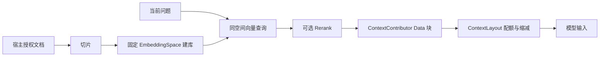

# 上下文、存储与记忆

本章默认 `use eliteforge_agent_framework::*;`，沿用入门程序已配置模型与存储的 `builder`。新增的类型依赖会在各节注明。

## 1. 固定系统指令

```rust
let builder = builder.plugin(ContextContributorPlugin::new(
    "shop.prompt",
    FixedInstructions::new("shop.instructions", "你是售后助手。用中文回答，不猜测订单状态。"),
));
let selection = AgentSelection {
    context_sources: Some(vec!["shop.prompt".into()]),
    ..Default::default()
};
```

`shop.prompt` 是注册插件 ID，`shop.instructions` 是来源块 ID。选择填前者。Instruction 来源合并进内置指令块，不再给每条系统指令配置独立布局槽。

## 2. 把检索数据放进上下文

最小的固定资料接入如下。它适合验证装配关系，生产中用动态 contributor 替换：

```rust
let builder = builder
    .plugin(ContextContributorPlugin::new(
        "shop.knowledge-provider",
        FixedContextContributor(ContextBlock::data(
            "shop.knowledge", "退款期限：签收后 7 天内可申请，具体条件以订单政策为准。",
        )),
    ))
    .plugin(ContextLayoutPlugin(ContextLayout(vec![
        ContextBlockConfig::new(INSTRUCTIONS_BLOCK, BlockBudget::tokens(1_000)),
        ContextBlockConfig::new(HISTORY_BLOCK, BlockBudget::tokens(8_000))
            .reduce_with(RecentConversation),
        ContextBlockConfig::new("shop.knowledge", BlockBudget::tokens(2_000)),
    ])));
let selection = AgentSelection {
    context_sources: Some(vec!["shop.prompt".into(), "shop.knowledge-provider".into()]),
    ..Default::default()
};
```

这段与上一节合用；没有 `shop.prompt` 时从选择中删去它。Data 来源需要对应 block_id 的预算和顺序，同时保留 `INSTRUCTIONS_BLOCK` 与 `HISTORY_BLOCK`。不要把用户上传文件、检索结果当 System 指令拼进去。

动态来源的完整模块如下，演示对宿主传入资料做关键词匹配；实际 RAG 将匹配部分替换为已授权索引查询：

```rust
use async_trait::async_trait;
use eliteforge_agent_core::*;

pub struct Knowledge(pub Vec<(String, String)>);

#[async_trait]
impl ContextContributor for Knowledge {
    fn block_id(&self) -> &str { "shop.knowledge" }
    async fn contribute(&self, input: &ContextInput<'_>) -> Result<ContextBlock, AgentError> {
        input.run.check_cancelled()?;
        let query = input.current_input.text();
        let matched = self.0.iter()
            .filter(|(keyword, _)| query.contains(keyword))
            .take(5)
            .map(|(_, text)| text.as_str())
            .collect::<Vec<_>>().join("\n");
        Ok(ContextBlock::data(self.block_id(), matched))
    }
}
```

用 `ContextContributorPlugin::new("shop.knowledge-provider", Knowledge(records))` 替换固定来源，保留同一布局。`records` 是宿主传入的 `Vec<(String,String)>`。默认 `kind` 是 Data；异步检索还要观察取消、限制返回量、绑定用户/知识库授权。

RAG 数据流：



框架提供切片/向量/重排契约及上下文装配；文档授权、索引写入和更新策略属于宿主，不会因注册 contributor 自动完成建库。

## 3. 配额与压缩怎么选

| 需要 | 配置 |
| --- | --- |
| 固定系统规则 | Instruction contributor + 指令块预算 |
| 最近若干轮历史 | 历史块 `.reduce_with(RecentConversation)` |
| 检索条目按相关性保留 | Data 来源返回有界结果，配置独立预算/自定义 reducer |
| 语义摘要 | `eliteforge-agent-context` 的 `ModelCompressor`，显式绑定摘要存储 |
| 动态借用空闲额度 | `ContextBudgetPolicy` 或 memory 包的预算策略 |
| 完全自定义布局/组装 | 实现 `ContextAssembler` 并选中，自己承担来源、预算和压缩 |

上下文窗口与累计 token 预算独立。`request.limits.max_context_tokens` 控制每轮输入；`max_total_tokens` 限制累计使用。`max_model_output_tokens` 也占用模型窗口，不能把整个窗口全部分给输入。

摘要是历史的投影，不替换原会话消息。持久化摘要必须关联来源版本、模型与压缩配置；删除轮次或来源变化要使缓存失效。没有明确接入 compressor 时，安装 SummaryStore 不会自动开始摘要。

增加同版本 `eliteforge-agent-context` 后，可把历史 reducer 换成模型压缩器：

```rust
use eliteforge_agent_context::{ModelCompressor, CompressionOptions};
// summary_model_id 是同一 Framework 已注册、已授权的摘要模型 ID。
let compressor = ModelCompressor::new(
    ModelRef::new("primary", summary_model_id), CompressionOptions::default(),
)?;
let history_block = ContextBlockConfig::new(HISTORY_BLOCK, BlockBudget::tokens(8_000))
    .reduce_with(compressor);
```

把 history_block 放入 ContextLayout 替换原历史槽。要跨调用缓存摘要，在移动 compressor 前调用 `.with_store(summary_store, "summary-policy-v1")?`；`summary_store` 类型是 `Arc<dyn SummaryStore>`，由宿主注入或插件装配阶段从存储服务解析。摘要模型和策略变化时更新 policy version。不要再额外注册一套独立 ContextReducerPlugin，避免两个历史压缩器冲突。

## 4. SQLite 及共享事务

官方包已经安装 LocalStorage，不要再 `.plugin(LocalStoragePlugin::new(...))`。需要共享宿主数据库时：

```rust
use eliteforge_agent_official_capability_pack::storage::{LocalStoragePlugin, SqliteDatabase};

let database = SqliteDatabase::open("agent-data/application.sqlite").await?;
let official = official.storage(
    LocalStoragePlugin::new("agent-data/application.sqlite", "agent-data/artifacts")
        .with_database(database.clone()),
);
```

业务仓库使用同一个 `SqliteDatabase` 实例。仅连接同一文件但另建连接池，不共享事务。注入数据库由宿主最终关闭；先关闭 Framework，再关闭数据库。

在已经使用该数据库构建的 `framework` 上创建会话和目标：

```rust
let sessions = framework.sessions()?;
let goals = framework.goals()?;
let session = framework.transaction(async {
    let session = sessions.create(SessionRecord::new("订单咨询")).await?;
    goals.set(GoalRecord::new(&session.id, "明确订单状态并回答客户")).await?;
    Ok(session)
}).await?;
```

宿主可在同一事务中写 session 到用户/工作区的关联。不要把模型调用或 `agent.run` 放在数据库事务内，也不要在事务中 spawn 一个等待同库的任务。

普通 SQLite 持久化不需要中文分词/向量原生扩展。确实需要这些扩展时才在 storage-local 依赖启用 `bundled-native`，配置 `ExtensionConfig` 并读取加载报告；`Required` 不可用要失败，`Preferred` 降级后不得继续假定扩展功能存在。不要为了普通聊天安装全部原生扩展。

## 5. 长期记忆

安装存储不等于自动保存所有对话为长期记忆。增加同版本 `eliteforge-agent-memory`；它提供 `MemoryContributor` 和 `MemoryTools`。

已有 `Arc<dyn LongTermMemory>` 时，装配函数可直接写成：

```rust
use eliteforge_agent_core::*;
use eliteforge_agent_memory::{MemoryContributor, MemoryTools};
use std::sync::Arc;

fn memory_pack(
    namespace: &str, memory: Arc<dyn LongTermMemory>,
) -> Result<CapabilityPackBuilder<()>, MemoryError> {
    Ok(CapabilityPackBuilder::new("app.memory", ())
        .plugin(ContextContributorPlugin::new(
            "app.memory.context",
            MemoryContributor::new("app.memories", namespace, memory.clone())?,
        ))
        .plugin(ToolProviderPlugin::new(
            "app.memory.tools", MemoryTools::new(memory, namespace)?,
        )))
}
```

`namespace` 来自宿主认证范围；`memory` 是宿主持有或插件安装阶段解析的存储实现，不从模型参数取得。调用 `builder.capability_pack(memory_pack(namespace, memory)?)`；Agent 选择 `app.memory.context` 和 `app.memory.tools`，布局增加 `ContextBlockConfig::new("app.memories", BlockBudget::tokens(2_000))`。

若使用官方存储服务，依赖存储的自定义插件可在 `install` 中解析 `LongTermMemoryService` 后注册上述两个服务；需要声明依赖 `storage.local`，不要在已完成构建的 Framework 上追加插件。

默认 MemoryTools 只提供 `memory_search` / `memory_get`。需要保存/删除才调用 `.allow_writes()` 并配置相应审批。保存记录提供稳定 ID 和来源；更新/删除带读取到的版本，冲突后重新读取，不覆盖他人的更新。
