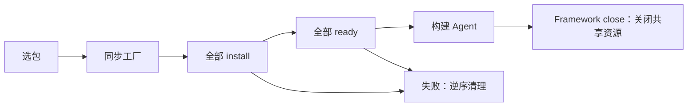

# 工具、插件与业务能力包

本章用订单查询演示完整扩展链。可复制文件在技能的 `assets/order-agent/` 中，所有源码都随技能分发。示例增加 `eliteforge-agent-core`（同 Git tag）、`async-trait = "0.1"` 和 `serde_json = "1"`。

## 1. 先选扩展形式

| 目标 | 首选写法 |
| --- | --- |
| 添加一个可调用操作 | 实现 `Tool`，用 `ToolBindingPlugin` 绑定描述 |
| 每个用户看到不同的工具集 | 实现 `ToolProvider::lease`，由宿主上下文限定目录 |
| 添加角色/业务指令 | `ContextContributor` 或 `FixedInstructions` |
| 多个实现作为一个产品功能复用 | `CapabilityPackBuilder` + `#[capability]` / `#[capability_factory]` |
| 创建连接、共享资源、启动后台任务 | 自定义 `Plugin::install/ready` |
| 调用前审批/禁止写入 | `ToolPolicy`，不在描述文字中模拟权限 |
| 拦截执行或记录耗时 | 对应 Run/Model/Tool Middleware |
| 宿主按钮直接调用业务功能 | 普通业务服务或 `AgentOperation`；不必让 LLM 生成工具调用 |

## 2. 定义模型可调用的工具

以下是一个完整工具模块，既能直接注册，也能作为能力包工厂的输出：

```rust
use async_trait::async_trait;
use eliteforge_agent_core::*;
use serde_json::{Value, json};
use std::{collections::BTreeMap, sync::Arc};

pub struct LookupOrder(pub Arc<BTreeMap<String, String>>);

#[async_trait]
impl Tool for LookupOrder {
    async fn call(&self, args: Value, context: &RunContext) -> Result<ToolOutput, ToolError> {
        if context.is_cancelled() {
            return Err(ToolError::Failed("订单查询已取消".into()));
        }
        let id = args["order_id"].as_str()
            .ok_or_else(|| ToolError::Failed("order_id 必须是字符串".into()))?;
        Ok(match self.0.get(id) {
            Some(status) => ToolOutput::text(format!("订单 {id}：{status}")),
            None => ToolOutput::error(format!("没有找到订单 {id}")),
        })
    }
}

pub fn order_plugin(orders: Arc<BTreeMap<String, String>>) -> ToolBindingPlugin {
    ToolBindingPlugin::new(
        "shop.orders",
        ToolBinding::new(
            ToolDescriptor::new(
                "shop.orders.lookup", "lookup_order", "根据订单号查询订单状态",
                json!({
                    "type": "object",
                    "properties": {"order_id": {"type": "string"}},
                    "required": ["order_id"],
                    "additionalProperties": false
                }),
            ).with_operation_kind(ToolOperationKind::Query),
            LookupOrder(orders),
        ),
    )
}
```

三个名字分别是：`shop.orders` 插件/Provider ID，`shop.orders.lookup` 工具内部 ID，`lookup_order` 模型调用名。三者不互换。

在现有 `FrameworkBuilder` 上 `.plugin(order_plugin(orders))` 安装，其中 `orders` 是宿主构造的 `Arc<BTreeMap<String,String>>`。Agent 必须选择：

```rust
let selection = eliteforge_agent_framework::AgentSelection {
    tool_providers: Some(vec!["shop.orders".into()]),
    tools: Some(vec!["shop.orders.lookup".into()]),
    ..Default::default()
};
```

输入“查询 A100”后，支持工具调用的模型可发出 `lookup_order({"order_id":"A100"})`；Framework 校验 schema、策略和预算，再调用 `Tool::call`，将结果交回模型继续生成答复。不能仅看最终自然语言就断定工具执行过，应从运行事件/历史确认工具调用与结果。

只读声明用 `Query`，写数据/启动进程用 `Command`；不标记默认为 `Unknown`。`ToolOutput::error` 是模型可见的业务失败；`ToolError` 表示调用本身未能可靠完成。真实 HTTP/数据库调用要响应 `context.cancelled()`、限制时间，并把账号权限绑定在宿主服务中。写工具使用业务幂等键；网络断开不能当成“肯定没执行”。

## 3. 将工具和指令封装为业务能力包

在上一节模块中追加如下配置和工厂（不要同时手工注册同一个 `order_plugin`）：

```rust
pub struct ShopConfig {
    pub name: String,
    pub orders: Arc<BTreeMap<String, String>>,
}

#[capability_factory(pack = "shop", id = "shop.orders", config = ShopConfig)]
fn orders_factory(config: &ShopConfig) -> ToolBindingPlugin {
    order_plugin(config.orders.clone())
}

#[capability_factory(pack = "shop", id = "shop.instructions", config = ShopConfig)]
fn instructions_factory(config: &ShopConfig) -> ContextContributorPlugin {
    ContextContributorPlugin::new(
        "shop.instructions",
        FixedInstructions::new(
            "shop.instructions",
            format!("你是{}的客服。查询订单必须调用 lookup_order。", config.name),
        ),
    )
}

pub fn shop_pack(config: ShopConfig) -> CapabilityPackBuilder<ShopConfig> {
    CapabilityPackBuilder::new("shop", config)
}
```

应用装配时：

```rust
let builder = builder.capability_pack(shop_pack(ShopConfig {
    name: "星河商店".into(),
    orders: Arc::new(BTreeMap::from([("A100".into(), "已发货".into())])),
}));
```

Agent 选择工具的同时加 `context_sources: Some(vec!["shop.instructions".into()])`。包是安装单元，不是权限单位。Cargo 引入 crate 只完成编译链接；调用 `.capability_pack(shop_pack(...))` 才选中并执行工厂。

要组合子包，用 `.include(other_pack)`。`depends_on` 只排序与校验依赖，不会自动启用子包。工厂必须是同步函数；异步连接建立放到返回插件的 `install`。

模板的 `orders.rs` 还演示了另一种写法：在 `ContextContributor` 的 impl 上直接加 `#[capability(pack = "shop", id = "shop.instructions", config = ShopConfig, factory = ShopInstructions::from_config)]`。这适合已有 trait 实现；`#[capability_factory]` 则适合工具描述、第三方类型和配置对象。两种方案选一种，不能给同一 ID 重复注册。

## 4. 创建自己的扩展接口

例如业务插件需要多个支付审核规则：

```rust
use eliteforge_agent_core::{extension_point, capability};

#[extension_point]
pub trait PaymentRule: Send + Sync {
    fn allow(&self, total_cents: u64) -> bool;
}

#[derive(Default)]
pub struct SmallPayment;

#[capability(pack = "shop.rules")]
impl PaymentRule for SmallPayment {
    fn allow(&self, total_cents: u64) -> bool { total_cents <= 10_000 }
}
```

应用选择 `CapabilityPackBuilder::new("shop.rules", ())`。消费插件在 `ready` 中用 `context.extensions::<dyn PaymentRule>()` 获取所有实现。唯一实现接口用 `#[extension_point(single)]`，读取用 `context.extension::<dyn PaymentRule>()`；重复唯一实现会在装配时失败。

## 5. 管理资源的 Plugin

下面的完整插件管理一个后台任务。示例额外需要 `tokio` 的 `sync` feature。

```rust
use async_trait::async_trait;
use eliteforge_agent_core::{Plugin, PluginContext, PluginError};
use std::sync::{Arc, Mutex};

pub struct WorkerPlugin;

#[async_trait]
impl Plugin for WorkerPlugin {
    fn id(&self) -> &str { "shop.worker" }

    async fn install(&self, context: &mut PluginContext<'_>) -> Result<(), PluginError> {
        let (stop, stopped) = tokio::sync::oneshot::channel::<()>();
        let task = tokio::spawn(async move {
            // 真实后台循环应在此监听 stopped，并在停止时结束 I/O。
            let _ = stopped.await;
        });
        let stop = Arc::new(Mutex::new(Some(stop)));
        let cleanup_stop = stop.clone();
        let abort = task.abort_handle();
        context.on_cleanup(move || {
            if let Ok(mut guard) = cleanup_stop.lock() {
                if let Some(stop) = guard.take() { let _ = stop.send(()); }
            }
            abort.abort();
        });
        context.on_shutdown(move || async move {
            if let Ok(mut guard) = stop.lock() {
                if let Some(stop) = guard.take() { let _ = stop.send(()); }
            }
            let _ = task.await;
            Ok(())
        });
        Ok(())
    }
}
```

`install` 注册服务并立即登记清理。`ready` 在所有插件安装结束后读取完整服务集合、校验消费者绑定，不能再注册新服务。正常关闭用异步 `on_shutdown`，构建失败/取消的兜底用同步 `on_cleanup`；不要依赖事件监听器释放资源。



## 6. 中间件

记录每次 Run 正常返回的耗时：

```rust
use async_trait::async_trait;
use eliteforge_agent_core::*;

pub struct Timing;
#[async_trait]
impl RunMiddleware for Timing {
    async fn intercept(
        &self, _: &RunRequest, _: &RunContext, next: RunNext<'_>,
    ) -> Result<RunResult, AgentError> {
        let started = std::time::Instant::now();
        let result = next.run().await;
        eprintln!("success={} elapsed={:?}", result.is_ok(), started.elapsed());
        result
    }
}
```

在 builder 上安装 `.plugin(RunMiddlewarePlugin::new("shop.timing", Timing))`。`next` 只能调用一次。ModelMiddleware 包围 Chat 调用；ToolMiddleware 包围工具调用。取消时 future 可被丢弃，普通后置代码不会保证执行；资源释放仍按插件生命周期处理。
