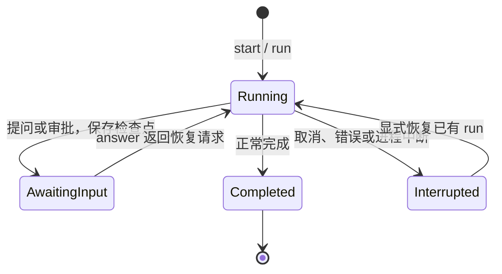

# 运行、交互与恢复

本章沿用已构建的 `agent`、`framework`，使用 `eliteforge_agent_framework::*`。`?` 片段位于返回 `Result` 的异步函数中。SSE 示例使用入门程序的官方包，JSON 示例增加 `serde_json = "1"`。

## 1. 普通请求与限制

```rust
let mut request = RunRequest::new("chat-1", "查询订单 A100");
request.limits.max_steps = 12;
request.limits.max_tool_calls = 20;
request.limits.max_parallel_tools = 1;
request.limits.max_context_tokens = 16_000;
request.limits.max_total_tokens = 60_000;
request.limits.max_model_output_tokens = 2_000;
request.limits.model_timeout = std::time::Duration::from_secs(60);
request.limits.tool_timeout = std::time::Duration::from_secs(30);
request.limits.run_timeout = std::time::Duration::from_secs(300);
let result = agent.run(request).await?;
println!("{:?}: {}", result.status, result.output);
```

这些值是应用示例，应按实际模型窗口和任务调整。计数的“无限”使用 `RunLimits::UNLIMITED_COUNT`；token 的“无限”使用 `RunLimits::UNLIMITED_TOKENS`。不要把 UI 的 0 当无限，`max_tool_calls = 0` 明确不允许工具。

同一 Agent 同一 Session 同时只运行一个请求，服务端排队或明确返回忙碌。不同 session_id 表示不同历史，但不等于不同访问权限。

## 2. 将 AG-UI 流送到前端

```rust
use eliteforge_agent_official_capability_pack::agui::AgUiStream;

let (handle, mut stream) = agent.start_with_output::<AgUiStream>(
    RunRequest::new("chat-1", "查询订单 A100"),
)?;
let send = async {
    while let Some(frame) = stream.recv_sse().await? {
        // frame 已是 SSE 格式；在 HTTP handler 中写到响应 body。
        print!("{frame}");
    }
    Ok::<(), eliteforge_agent_official_capability_pack::agui::ag_ui::Error>(())
};
let (result, sent) = tokio::join!(agent.wait(handle), send);
sent?;
let result = result?;
```

HTTP 层返回 `Content-Type: text/event-stream`，及时刷新。消费流和等待结果要并发进行。不能先完整 `wait` 再尝试消费有界通道；也不能只读流而丢弃 RunHandle。

页面断开是否取消任务由产品决定。需后台继续时，由后台任务持有 handle 并 `wait`，页面只持有 `handle.observe()` 返回的观察对象或宿主广播订阅；丢弃观察者不取消运行，丢弃拥有运行的 handle/wait future 会取消。

## 3. 原始事件流

不需要 AG-UI 时，使用框架事件：

```rust
use tokio::sync::broadcast::error::RecvError;

let mut handle = agent.start(RunRequest::new("chat-1", "你好"))?;
let mut events = agent.events(&mut handle)?;
let consume = async {
    loop {
        match events.recv().await {
            Ok(envelope) => if let AgentEvent::TextDelta(text) = envelope.event {
                print!("{text}");
            },
            Err(RecvError::Lagged(count)) => {
                eprintln!("有 {count} 条实时事件未收到，请用最终结果校正展示");
            }
            Err(RecvError::Closed) => break,
        }
    }
};
let (result, ()) = tokio::join!(agent.wait(handle), consume);
let result = result?;
```

第一次 `events(&mut handle)` 可取得启动时已缓冲事件；`subscribe(&handle)` 只订阅调用之后的新事件。它们都是实时通道，不保证永久回放。重连用持久历史或宿主实现的回放机制。

## 4. 追加指令与取消

```rust
let handle = agent.start(RunRequest::new("chat-1", "分析项目"))?;
let control = agent.control(&handle)?;
agent.steer(&control, "优先检查订单模块")?;
// 用户明确取消时调用：agent.cancel(&control)?;
let result = agent.wait(handle).await?;
```

服务端把 control 按 run/execution 存入内存表，让其他请求处理用户操作。`steer` 成功只表示入队，不中断已经发出的模型/工具调用。新执行或恢复需要新 control；取消不撤销已发生的业务副作用。

## 5. 人工问答

官方包已安装 Human 工具，Agent 在 `tool_providers` 中加入 `tools.human`。模型调用 `ask_user` 后，结果进入 `AwaitingInput`，交互已落库，本次 SSE 结束；等待期间无需保留模型请求。

宿主通过以下流程渲染和回答：

```rust
let pending = agent.pending_interactions("chat-1").await?;
// 根据 pending 中每项的 presentation / response_schema 渲染问题。
// interaction_id 与 answer_json 来自用户对该问题的实际提交。
let resume = agent.answer("chat-1", interaction_id, answer_json).await?;
let result = agent.run(resume).await?;
```

`interaction_id` 是保存的交互 ID，不是问题文案；`answer_json` 必须符合该交互的 schema。例如 ask_user 的选项回答为：

```json
{"answers":{"实际-question-id":{"option_id":"实际-option-id"}}}
```

自由输入用 `{"text":"用户答案"}`，跳过用 `{"skip":true}`，前提是该问题允许。先校验当前用户拥有 session 和 interaction，再调用 answer。不能把答案当新的普通 RunRequest 输入绕过原问题校验。

## 6. 写操作审批

下面完整策略针对内部工具 ID `shop.orders.update` 要求批准；其他工具正常放行：

```rust
use async_trait::async_trait;
use eliteforge_agent_core::*;

pub struct ApproveOrderWrite;
#[async_trait]
impl ToolPolicy for ApproveOrderWrite {
    async fn evaluate(&self, call: &ToolInvocationContext<'_>)
        -> Result<ToolPolicyDecision, AgentError>
    {
        Ok(if call.descriptor.id == "shop.orders.update" {
            ToolPolicyDecision::RequireApproval("确认修改订单？".into())
        } else {
            ToolPolicyDecision::Allow
        })
    }
}
```

安装 `.plugin(ToolPolicyPlugin::new("shop.approval", ApproveOrderWrite))`；Agent 可用 `tool_policies: Some(vec!["shop.approval".into()])` 明确选择。示例策略只有实际安装了对应写工具才会触发；订单模板只有查询工具。

审批提交 JSON 布尔值：

```rust
let resume = agent.answer("chat-1", interaction_id, serde_json::json!(true)).await?;
let result = agent.run(resume).await?;
```

批准绑定原始工具、参数和调用位置；恢复时仍检查工具与策略。拒绝用 `false`。不要用用户一句“同意”授权任意新工具调用。



## 7. 重启后恢复

保存 `start` 返回的 `handle.run_id`，重启时使用同一数据库和兼容的能力配置重建 Agent：

```rust
let mut request = RunRequest::new("chat-1", "");
request.resume = Some(ResumeRequest { run_id, ..Default::default() });
let result = agent.run(request).await?;
```

`run_id` 是之前保存的真实 ID。等待问题的运行用上一节的 `answer` 生成请求；单传 run_id 不提供用户答案。相同答案可幂等提交，不同答案冲突。旧运行存在有效执行租约时先处理其生命周期，不能靠换 session ID 强行恢复。

恢复沿用预算和执行记录。工具可能“已发出但结果未知”，此时检查外部状态或业务幂等记录，不重跑整个原始用户请求。已完成运行返回保存结果。

## 8. 历史、删除与诊断

```rust
let runs = framework.runs()?.list("chat-1").await?;
let events = framework.events()?.list("chat-1", 0, 100).await?;
```

先完成宿主授权再查询。持久事件用于状态查询，不等同于逐 token SSE 回放。

删除普通对话轮次：

```rust
let history = framework.history()?;
let version = history.context_revision("chat-1").await?;
let new_version = history.delete_turn("chat-1", root_run_id, &version).await?;
```

`root_run_id` 来自要删除的真实轮次。要求会话空闲并匹配版本；逻辑删除重建后续模型上下文、失效摘要，不撤销外部操作。外部 Agent 原生上下文不能通过这个入口重建。

| 现象 | 按顺序处理 |
| --- | --- |
| 模型看不见工具 | 确认安装 → tool_providers 插件 ID → tools 内部 ID → 当前运行授权 |
| 技能不可用 | 来源中存在 → skills 名称 → skills.default 工具与上下文均选择 |
| 构建报重复服务 | 检查官方包是否已安装同模型/唯一存储；改包配置替换 |
| 同名 Rust 类型不兼容 | `cargo tree -d` 检查混用 Git/path/registry 或不同 revision |
| Busy | 仍有运行、未消费 handle 或操作；先完成/取消并等待 |
| 上下文超限 | 检查模型窗口、输出预留、Data 块预算和历史 reducer |
| SSE 缺少事件 | 处理 Lagged，用最终结果与持久历史修正，不重放业务工具 |
| 关闭后后台任务还存在 | 核对 Framework close、插件 on_shutdown、外部进程 owner |
