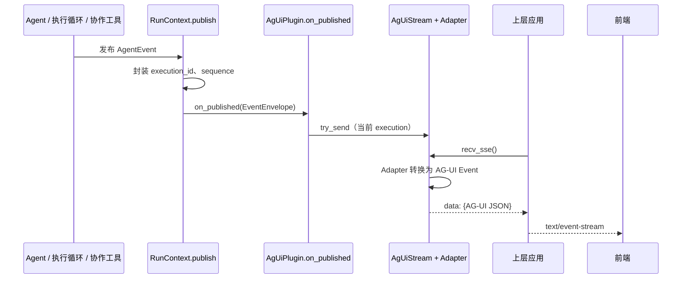
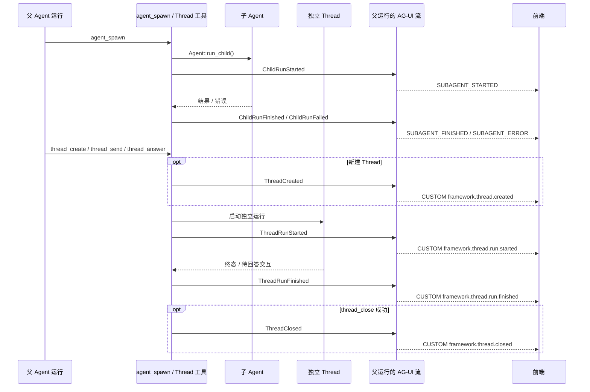

# AG-UI 事件协议设计

## 目标与边界

`eliteforge-agent-official-plugin-agui` 把当前执行的 Framework 实时事件转换为 AG-UI 事件，
并提供 SSE 编码。它是输出插件，不负责 HTTP 路由、鉴权、浏览器连接或事件回放。

[Framework 架构](框架架构总览.md)说明运行身份、执行生命周期和通用事件发布管线；本文只说明
AG-UI 如何接收、转换和输出这些事件。

## 接入

注册插件后，每次 `start()` 都可取得一个仅属于该 execution 的 `AgUiStream`：

```rust
use eliteforge_agent_official_plugin_agui::{AgUiPlugin, AgUiStream};
use eliteforge_agent_framework::RunRequest;

let agent = builder.plugin(AgUiPlugin::default()).build().await?;
let (handle, mut events) = agent
    .start_with_output::<AgUiStream>(RunRequest::new("chat-1", "分析项目"))?;

while let Some(frame) = events.recv_sse().await? {
    // 将 frame 写入 HTTP text/event-stream 响应体。
    print!("{frame}");
}

let result = agent.wait(handle).await?;
```

`recv()` 返回 SDK 的 `Event`；`recv_sse()` 返回 `data: {json}\n\n` 形式的 SSE 帧。应用需要
同时等待 `agent.wait(handle)`：它才是执行结果的权威来源。

## 从 Framework 到前端

`on_published` 只负责把已封装的 `EventEnvelope` 非阻塞地交给当前执行的通道。应用读取
`AgUiStream` 时，`Adapter` 才按发布顺序生成协议事件；`recv_sse()` 再编码 SSE。



因此，AG-UI 事件的顺序来自 Framework 的实时发布顺序，而非普通观察者 `on_event` 的处理顺序。
`RUN_STARTED` 在新运行的 `Agent::start()` 返回 `RunHandle` 前已发布；恢复运行会先读取 Checkpoint 的宿主身份，再发布开始事件。终态在执行器返回后发布。

## 事件映射

「发出方与时机」描述 Framework 的原始事件；AG-UI 事件均由读取流时的 `Adapter` 转换得到。
下表省略 `AgentEvent::` 和 `OutputEvent::` 前缀。

| Framework 事件 | 发出方与时机 | AG-UI 事件 | 关键字段 |
|---|---|---|---|
| `RunStarted` | 新运行同步准入并创建输出通道后；恢复运行读取原宿主元数据后 | `RUN_STARTED` | `threadId=session_id`；`runId=executionId` |
| `StepStarted / StepFinished` | `ModelInvoker` 开始一次模型调用；`AttemptStream` 在响应完成、取消或退出时关闭 | `STEP_STARTED / STEP_FINISHED` | `stepName` 含节点执行身份和步骤 ID |
| `WorkflowNodeChanged` | Workflow / DAG 调度器使节点进入 `Running` 或离开运行态时 | `STEP_STARTED / STEP_FINISHED`；`CUSTOM framework.node` | `nodeId`、`status` |
| `MessageStarted / TextDelta / MessageFinished` | `ModelInvoker` 开启模型流、收到文本、收束响应时 | `TEXT_MESSAGE_START / TEXT_MESSAGE_CONTENT / TEXT_MESSAGE_END` | `messageId`；`delta` 是本次追加内容 |
| `ReasoningDelta`、消息结束或中止 | `AttemptStream` 收到公开推理片段；消息关闭时收束 | `REASONING_START / REASONING_MESSAGE_START / REASONING_MESSAGE_CONTENT / REASONING_MESSAGE_END / REASONING_END` | 推理 ID 为 `{messageId}/reasoning` |
| `MessageFinished.tool_calls` | 模型给出完整响应和工具调用声明时 | `TOOL_CALL_START / TOOL_CALL_ARGS / TOOL_CALL_END` | `toolCallId=invocation_id`；ARGS 是完整参数 JSON |
| `ToolResult` | ReAct / Workflow 执行器完成工具批次并写入结果后 | `TOOL_CALL_RESULT` | 关联原 `invocation_id`；结果含内容、结构化数据和错误标记 |
| `RunResult` | 执行器正常返回后，由 `Agent` 在终态前作为输出发布 | 无独立事件；终态事件可携带 `result` | 用于补齐未流式输出的最终回复 |
| `Steered` | `agent.steer()` 写入追加指令后 | `CUSTOM framework.steered` | `value.text`；模型未必已处理该指令 |
| `Collaboration::ChildRunStarted` | `agent_spawn` 成功启动子 Agent 后，由父 `RunContext` 发布 | `SUBAGENT_STARTED` | `subagentRunId`；`name=agent_spawn` |
| `Collaboration::ChildRunFinished` | 子 Agent 返回结果后，由父运行发布 | `SUBAGENT_FINISHED`，或 `SUBAGENT_ERROR` | 成功、暂停和执行上限分别映射为对应结果；交互附在 `framework.subagent.interactions` |
| `Collaboration::ChildRunFailed` | 子 Agent 失败、取消，或完成守卫在异常退出时析构 | `SUBAGENT_ERROR` | `AGENT_RUN_FAILED` 或 `AGENT_CANCELLED` |
| `Collaboration::ThreadCreated` | `thread_create` 写入 Thread 记录后 | `CUSTOM framework.thread.created` | `threadId`、`title`、`status`、`latestRunId` |
| `Collaboration::ThreadRunStarted` | 新建、普通消息或 `thread_answer` 启动 Thread 运行后 | `CUSTOM framework.thread.run.started` | `threadId`、`runId`、`cause`、必要时 `interactionId` |
| `Collaboration::ThreadRunFinished` | Thread 运行结束、终态已确定后 | `CUSTOM framework.thread.run.finished` | `threadId`、`runId`、`status`、待处理 `interactions` |
| `Collaboration::ThreadClosed` | `thread_close` 删除记录并释放容量后 | `CUSTOM framework.thread.closed` | `threadId` |
| `RunFinished { Completed }` | 执行器成功返回后 | `RUN_FINISHED` | `outcome=success`；可带 `result` |
| `RunFinished { AwaitingInput }` | 执行器保存等待交互的状态后 | `RUN_FINISHED` | `outcome=interrupt`；含交互 ID、提示和响应 schema |
| `RunFinished { StepLimit / ToolCallLimit }` | 执行器因限制结束后 | `RUN_ERROR` | `code=AGENT_LIMIT_REACHED` |
| `RunCancelled / RunFailed` | 运行取消，或执行器返回非取消错误后 | `RUN_ERROR` | `AGENT_CANCELLED` 或 `AGENT_RUN_FAILED` |

## 协作事件的时序

子 Agent 属于父运行：父流只接收其生命周期，不接收子 Agent 的 token、消息或工具增量。
Thread 是独立运行，不是父运行的嵌套子 Agent；它使用 `framework.thread.*`，不会在父流中
伪装为第二个顶层 `RUN_STARTED`。



协作生命周期事件不携带委派任务正文、Thread 消息或用户答案。暂停交互只携带界面收集答案所需的
`InteractionRequest`。

## 注意事项

- 每次执行尝试都有独立的 AG-UI 通道；恢复会得到新的 `executionId` 和输出流。
- 通道溢出、事件超限或协议顺序错误会结束该 AG-UI 流并发送 `RUN_ERROR`，不会取消 Agent、重试工具或改变 `agent.wait(handle)` 的结果。
- `on_published` 必须快速，不得 I/O、等待或再次发布事件；普通 `on_event` 是尽力的异步观测，不能替代 AG-UI 输出。
- 此插件不实现 HTTP 端点、客户端工具执行、历史快照或 SSE 重连回放；这些能力由上层应用实现。


## 消息发送者

设置 `RunRequest.assistant_provenance` 后，消息开始时会产生 `framework.message.provenance`
CUSTOM 事件，value 为 `{ messageId, provenance, sessionId, runId }`。`provenance.sender` 包含
`kind` 以及可选的 `id / displayName / avatarUrl`，另有可选 `source / correlation`。
消息角色仍遵循 AG-UI；界面按 provenance 显示实际发言身份。事件 metadata 的
`framework.sessionId` 也携带会话范围。历史查询从 `HistoryMessage.provenance` 还原相同信息，
回放保留原 CUSTOM 事件；客户端应按会话和消息 ID 关联，不能让不同并行会话互相覆盖。
