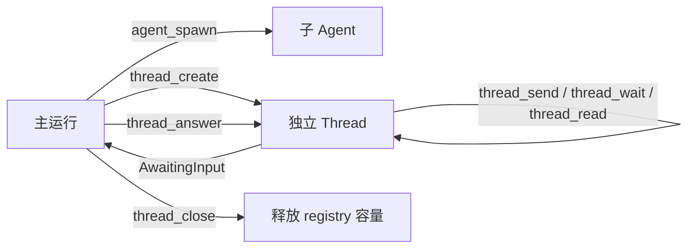
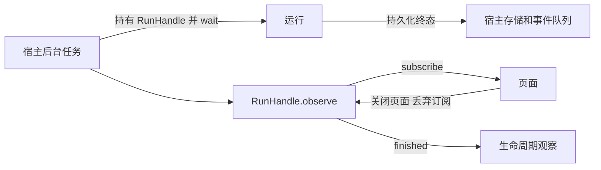
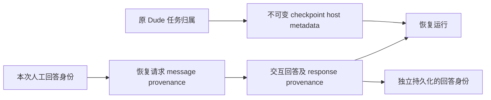

# Agent 协作设计：子 Agent 与独立会话

## 目标与边界

Framework 提供两种不同的协作方式，并通过官方工具暴露给模型。子 Agent 属于父运行的执行树；Thread 是可独立寻址的会话。应用可替换协作运行时，不需要修改工具 Schema 或模型适配器。



## 选择命名 Agent

`agent_spawn` 和 `thread_create` 接受可选 `agentCode`，例如
`{"task":"检查数据库迁移","agentCode":"database-reviewer"}`。省略时沿用当前 Agent。
编码必须非空、不带首尾空白且不超过 256 字节。

```text
ContextContributor 提供可选 Agent 目录
    → 官方工具把 agentCode 写入 RunRequest.agent_code
    → 宿主 AgentCollaborationRuntime 解析配置、校验当前调用者授权
    → 选定 Agent，清除 request.agent_code，调用 Framework 执行
```

Agent 目录、编码解析和授权属于宿主（例如 Tron），Framework 不读取业务配置。
宿主实现 `spawn_child` 时可调用目标 `Agent::run_child_with_id(request, parent)`，保留
取消、预算与 lineage；独立 Thread 使用目标 Agent 的 `start` / `wait`，并由宿主保存
thread_id 到目标 Agent 的绑定，后续 send、answer、read、wait 和 close 必须继续路由到该目标。
目录可见性不等于执行授权，每次派发和后续 Thread 操作都由宿主校验。

默认进程内运行时没有命名 Agent 注册表，带编码的请求会明确报错，不会退回当前 Agent。
直接执行 `Agent::start` / `run_child` 前也必须完成解析并清除编码，以免遗漏路由。
本接入不自动为 Tron 安装目录 Contributor 或业务解析器。

## 子 Agent

`agent_spawn` 适合一次性的专家委派：主运行给出一个聚焦任务，子运行完成后把结果同步返回。
它属于当前运行的执行树，继承父运行的取消、deadline、lineage、最大深度和预留 token 配额。
父运行可以直接使用返回结果继续推理；官方工具保留 `content`、`structured`、`interactions`、
精确状态、usage、步骤和工具调用统计，不把富内容压成纯文本。

委派工具不接受 `max_steps` 或工具调用次数参数。默认 runtime 沿用当前运行限制；
命名 Agent 的步数和工具次数由宿主从目标定义解析，不交给模型临时收紧。
可选 `max_total_tokens` 仍受父运行的 token 配额约束。

```text
主运行 ──等待──> agent_spawn(“只检查数据库迁移”) ──> 子结果 ──> 主运行继续
```

这也是应用代码直接调用 `Agent::run_child` 的模型可调用版本。它不是独立会话，不能脱离父运行
单独恢复，也不应该拿来承载长时间后台任务。

## Thread

`thread_create` 适合独立、可寻址、可继续的任务：主运行创建后立即拿到 `thread_id`，Thread
在自己的 session 中运行；之后可以用 `thread_wait` 等待本次运行、用 `thread_read` 读取上下文、
用 `thread_send` 发送下一条消息。`thread_list` 用来发现当前 Agent 创建的 Threads，完成后使用
`thread_close` 释放默认进程内 registry 的容量。

Thread 可以使用 `ask_user` 等交互工具。运行进入 `AwaitingInput` 时，`thread_wait` 返回完整的
`interactions`；主运行按其中的 `response_schema` 收集答案，再调用 `thread_answer`。该工具会通过
现有 `InteractionStore` 保存答案，并使用 `Agent::answer` 产生的 `ResumeRequest` 恢复原逻辑 run，
不是把答案当作一条普通新消息。处于 `AwaitingInput` 的 Thread 会拒绝 `thread_send`，避免绕过
响应 Schema 或遗留未完成的持久化 Interaction。

```text
Thread 调用交互工具 → AwaitingInput + interaction_id
                                 ↓
主运行收集答案 → thread_answer → 保存答案 → 恢复原 run
```

Thread 不继承父运行的取消、deadline 或 token 账本，因此主运行结束后它仍可继续。默认实现是
Agent 进程内的 bounded registry（最多 128 个 Thread）；它复用已安装的模型、工具、存储和策略，
但目前不把 Thread registry 元数据恢复到新进程。需要跨进程队列、租约、身份鉴权、持久化任务
状态或多个 Agent 实例协作时，上层应用应实现并注入 `AgentCollaborationRuntime`。
容量会在 `thread_create` 派发前预留；只有完成或暂停的 Thread 可以关闭。协作运行继承当前
运行的限制策略并建立独立账本；模型提供的 `max_steps` 和 `max_total_tokens` 只能继续收紧，
默认 runtime 还会再次限制 token ceiling，模型不能自行放大运行预算。

## 语义对比

| 能力 | 子 Agent | Thread |
| --- | --- | --- |
| 生命周期 | 随父运行结束 | 独立，可继续发消息 |
| 结果 | 同步返回给父运行 | 通过 ID 查询/等待/读取 |
| 资源语义 | 继承父取消、deadline、预算与深度 | 使用独立运行额度，由实现做配额 |
| 适合 | 专家判断、拆解一个短步骤、汇总前置结果 | 后台任务、长任务、多轮协作、并行工作 |
| 恢复 | 不能隐式恢复已有 child | 依赖 runtime 实现；默认仅进程内 |

简单判断：需要“现在就拿答案”，用 `agent_spawn`；需要“先派出去，之后继续沟通”，用
`thread_create`。

## 内部事件与 AG-UI

Framework 在发起协作的 `RunContext` 上发布 `AgentEvent::Collaboration`：

- 子 Agent：`ChildRunStarted / ChildRunFinished / ChildRunFailed`，包含子运行 ID、终态和待处理交互。
- Thread：`ThreadCreated / ThreadRunStarted / ThreadRunFinished / ThreadClosed`；启动原因明确区分创建、普通消息和 Interaction 回答。
- `thread_wait` 若在后续主运行中观察之前的 Thread 结果，会在当前运行补发对应终态，避免完成事件只留在已经结束的发起流中。

AG-UI 将子 Agent 映射为原生 `SUBAGENT_STARTED / SUBAGENT_FINISHED / SUBAGENT_ERROR`；独立
Thread 与父运行不是嵌套关系，因此映射为 `framework.thread.*` CUSTOM 事件。生命周期事件不含
任务正文、Thread 消息或用户答案；完整结果仍由工具结果承载，暂停所需的提示和响应 Schema
通过 Interaction 数据提供。详细字段见[AG-UI 事件](AG-UI事件协议.md#事件映射)。

## 装配方式

官方能力包默认安装协作工具；不需要时可以关闭：

```rust
use eliteforge_agent_framework::{FrameworkBuilder, AgentSelection};
use eliteforge_agent_official_capability_pack::EliteForgeOfficialCapabilityPack;

let framework = FrameworkBuilder::new()
    .capability_pack(
        EliteForgeOfficialCapabilityPack::new("agent.sqlite", "agent-artifacts")
            .agent_tools(false),
    )
    .build()
    .await?;
let agent = framework.agent(AgentSelection::default()).build().await?;
```

官方插件 crate 也可以单独安装：`eliteforge-agent-official-plugin-tools-agents`。
工具运行时通过当前 `RunContext` 的 `AgentCollaborationService` 查找协作实现，因此上层应用
可以替换默认实现，而不用修改工具 Schema 或模型适配器。

## 注意事项

- `agent_spawn` 会等待子 Agent 返回，不适合交给它承载长期后台任务。
- 默认 Thread registry 只在当前 Agent 进程内有效；跨进程恢复、身份授权和队列由上层应用实现。
- Thread 答案必须通过 `thread_answer` 提交，以保留原始交互校验和恢复位置。

## 宿主身份与后台观察

`Role::User` 是模型协议角色。发送者由宿主填写 `RunRequest.message_provenance`，执行者由
`assistant_provenance` 表示。两者写入 `HistoryMessage.provenance` 和原始 `Message.provenance`，
不会把 Dude 的委派伪装成人类输入。`MessageSender.kind`、来源和关联字段由宿主定义；它们用于
归属展示，访问权限仍由宿主验证。

宿主可把所有者、业务范围和任务关联写入 `RunRequest.host_context`。Framework 不解释这些
JSON 字段，也不把它们写入提示词。内置协作和 `run_child` 保留该值；自定义命名 Agent bridge
调用 `request.inherit_host_context(parent)`，再设置目标 Agent 的 `assistant_provenance`。
官方 ReAct、Workflow、DAG 和外部 Agent 运行将宿主元数据写入 Checkpoint；支持恢复的运行在
发出恢复的 `RunStarted`、执行 Hook 和工具前恢复原值。非序列化的宿主服务仍需重新装配。
自定义持久化 Loop 应使用 `Checkpoint::with_host_metadata(request)`。

后台宿主保留运行所有权，页面仅订阅：



`RunObservation` 可克隆；丢弃它、事件接收器或 `finished()` Future 都不会取消运行。
`subscribe()` 只返回后续事件，慢消费者可能 Lagged；重连使用历史或宿主的回放服务。
`finished()` 表示运行已释放，不取代 `agent.wait(handle)` 的权威结果。丢弃拥有者 `RunHandle`
或它的 wait Future 仍会取消运行，因此后台任务必须由宿主管理生命周期。

Thread 完成后，默认 runtime 仍向原 Context 发布协作终态；同步 `EventSink::on_published`
可以观察它，但必须快速且不能 I/O。已结束的父 AG-UI 流不再接受这些事件。需要持久化反馈时，
宿主的 `AgentCollaborationRuntime` 应直接保存 Thread 结果和 outbox，再唤醒所属业务会话；
不能把有界、尽力的观察回调当作持久化队列。默认 registry 仍不跨进程恢复。

平台级短期记忆用 `MemoryScope::platform(session)`；`kind()` 与普通命名范围不同，即使
命名范围叫 `platform` 也不会混淆。宿主持久化范围键和授权判断需要同时使用 kind 和 namespace。

### 恢复运行时的回答身份

恢复沿用 checkpoint 中的 `host_context` 和 `assistant_provenance`，保持原任务归属及执行者。宿主可以在恢复请求中明确传入新的 `message_provenance`，用于本次人工介入；缺省沿用原输入身份。原 checkpoint 的 `host_metadata` 保持不变。

交互回答的身份保存在 `HistoryInteraction.responseProvenance` 和 `InteractionRecord.response_provenance`，与回答一起由 SQLite InteractionStore 原子持久化。`answer_with_provenance` 接口支持一次提交身份及回答；兼容原 `agent.answer` 后附加身份的路径，未归因回答可以补充一次身份，已知身份及答案不可改写。自定义 InteractionStore 若需持久化身份，应实现该接口；默认实现保留现有 answer 兼容性。


