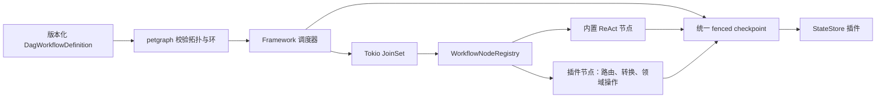

# DAG 工作流技术设计

`DagWorkflowLoop` 是 Framework 提供的默认 DAG 执行器，通过 `AgentLoopPlugin`
安装。Agent 不指定循环时仍使用普通 ReAct。整个执行器和单个节点类型均可由插件替换。

本文说明 DAG 定义、节点调度、状态提交、恢复及与上层应用的职责边界。节点内的模型和工具调用仍走 Framework 的统一调用链。



Framework 只依赖 StateStore 抽象，默认存储插件使用 SQLite。
[petgraph](https://docs.rs/petgraph/0.8.3/petgraph/algo/fn.toposort.html)
负责图结构和环检测，未承担工作流持久化语义。

## 定义和装配

```rust,ignore
let definition = DagWorkflowDefinition {
    id: "review".into(),
    version: 1,
    nodes: vec![
        DagNode::react(WorkflowStage::new("plan")),
        DagNode::react(WorkflowStage::new("security")),
        DagNode::react(WorkflowStage::new("quality")),
        DagNode::react(WorkflowStage::new("summarize")),
    ],
    edges: vec![
        DagEdge::new("plan", "security"),
        DagEdge::new("plan", "quality"),
        DagEdge::new("security", "summarize"),
        DagEdge::new("quality", "summarize"),
    ],
    max_parallel_nodes: 2,
};
let agent = AgentBuilder::new()
    .plugin(eliteforge_agent_official_plugin_storage_local::LocalStoragePlugin::new("agent.sqlite", "agent-artifacts"))
    .plugin(model_connection_plugin)
    .plugin(model_strategy_plugin)
    .plugin(AgentLoopPlugin::new(DagWorkflowLoop::new(definition)?))
    .build().await?;
```

`WorkflowStage` 的指令、生成选项、工具子集和阶段模型路由继续生效。
`DagWorkflowDefinition::from_stages(existing_definition)` 将串行阶段编译为链式 DAG。
旧 `WorkflowLoop` 保留原检查点格式；旧运行不会被隐式迁移成 DAG 格式。

节点 ID 必须稳定、唯一，不能用 petgraph 索引作为持久化身份。定义包含版本、节点配置、
边和并发上限；恢复时必须与安装的完整定义一致。环、重复边、悬空边、重复 ID、
缺失节点插件和无效配置会在执行前失败。

## 扩展节点与路由

实现 `WorkflowNode`，再通过
`WorkflowNodePlugin::new("plugin-id", implementation)` 注册。节点类型的 `kind()`
在一个 Agent 中必须唯一；`framework.react` 是保留的内置类型。

- `configuration_schema()` 供表单和配置校验使用，`validate()` 执行额外语义检查。
- `execute()` 接收当前请求、所选前驱的结果、前驱的完整 Content、节点配置、
  invocation ID 和此前的本地 checkpoint。
- 返回 `WorkflowNodeResult::completed(value)`，`value` 可以是任意 JSON。
  `content` 可保留媒体、资源引用等完整输出。
- `routes = None` 选择全部后继；`Some({"left"})` 仅选择该直接后继；空集合结束该分支。
  选择不存在的后继会失败，不会执行下游。
- `WorkflowNodeContext::save(value)` 将节点本地状态写入整个运行的同一个事务。
  存储失败必须停止执行，不能忽略错误继续产生副作用。
- 默认 `supports_resume() = false`。只有能够根据 checkpoint 安全恢复的实现才应声明 true。
  安装工具策略时，所有节点还必须声明 `supports_tool_policy()`：纯计算节点可声明 true，
  执行工具的节点必须落实策略、验证和撤销检查。

自定义节点是受信任的进程内代码，需使用框架 invoker、遵守预算及生命周期契约；
不能脱离节点任务另行启动不受管理的外部工作。

## 分支、汇合与输出

```text
             ┌─ left：Succeeded ────────────┐
route 选择 left                            ├─ join
             └─ right：Skipped → Skipped ──┘
```

默认 `WorkflowJoin::Selected` 等待所有前驱状态确定，再收集被选中边的成功结果。
未选中的分支逐层标记为 `Skipped`，不会留下等待通道，也不会阻塞汇合。
一个节点有多个入口时，只要至少一条入口被选中即可执行。
`WorkflowJoin::All` 要求所有入口都被选中，否则跳过该节点。

无入边节点都是入口。一个已完成节点没有选中的后继时，它的结果成为工作流输出之一：
单个输出直接返回其值和 Content；多个输出按节点 ID 返回 JSON 对象。
前驱结果按 ID 排序，与任务完成先后无关。ReAct 节点将前驱值与 Content 放入用户数据，
不会把它们提升为系统指令。

## 持久化、取消和恢复

`DagWorkflowState` 保存节点状态、invocation ID、最近 attempt 的执行身份、结果、路由、本地 checkpoint、
预算和整体结果。ReAct 的完整 WorkflowState、源 transcript 和工具日志嵌入所属节点。
并行节点的提交与预算保存经过同一个串行事务入口，不会互相覆盖。

节点在执行前持久化 `Running`。成功结果及路由持久化后，下游才能派发。
未知写入结果会阻止该执行尝试继续提交或派发；恢复必须重新读取真实存储状态。
完成节点直接复用结果。运行中断后，只有支持 `supports_resume()` 的节点可以从检查点继续；
其他未保存结果的节点会使运行失败。ReAct 节点遇到已开始但未保存结果的工具时同样失败。

失败或取消会终止并回收当前 JoinSet 中的任务。插件必须协作式让出执行权；
终止 future 不能撤销已经发生的远端副作用。失败或取消的运行进入终态，再次读取时返回原有错误。

输入和审批回复按 interaction ID 路由；多个节点等待时，可以逐个回答。
等待交互期间暂停新节点派发，已经运行的兄弟节点会先完成或记录自己的等待状态。
一旦出现错误，停止其他任务；不会为了得到完整结果而等待一个永久挂起的兄弟节点。

同一运行只有一个持有租约的调度器。续租保持 fencing 身份，重新接管提高 generation。
这不是分布式 worker 队列，也不承诺外部副作用 exactly-once；外部幂等和操作确认由
工具系统及上层应用协作完成。

## 预算、交互与上层应用边界

- 所有 ReAct 节点共享 token、逻辑模型步骤和工具调用次数限额；恢复保留已消耗或
  不确定的额度。模型重试和上下文压缩仍使用同一 token 账本。
- `max_parallel_nodes` 限制节点任务；`max_parallel_tools` 另外限制整个运行的工具调用。
  未标记 `parallel_safe` 的工具会与该运行的其他工具互斥，包括其他节点中的调用。
- 达到步骤或工具次数上限会以对应 RunStatus 结束，终态可直接重放。
- DAG 不接受未指定目标的实时文本 steering，以免多节点竞争同一条指令。
  交互通过明确的 interaction ID 恢复；普通 ReAct / WorkflowLoop 的 steering 保持原语义。
- UI 布局、表单体验、发布流程、权限和配置继承由上层应用负责。
  `Agent::workflow_node_descriptors()` 提供类型能力与配置 schema；
  `DagWorkflowDefinition::validate()` 提供结构校验；`WorkflowNodeChanged` 与
  `DagWorkflowState` 提供事件和权威状态。

持久化采用完整快照，节点历史和事件增长会增加提交成本，受 StateStore 的容量限制。
本实现没有循环边；节点内部可以运行 ReAct，复杂循环应由可替换执行策略显式定义。

## 可运行示例

```sh
cargo run -p eliteforge-agent-official-plugin-storage-local --example dag -- /tmp/dag-demo.db -7
cargo run -p eliteforge-agent-official-plugin-storage-local --example dag -- /tmp/dag-demo.db 7
```

示例完全离线，分别输出 7 和 14，并打印未选分支的 `Skipped` 状态。
正式回归测试位于 `eliteforge-agent-official-plugin-storage-local/tests/state_dag.rs` 和 `tests/crash_recovery.rs`。

## 节点中间件与可观测

`WorkflowNodeMiddlewarePlugin` 在节点执行入口安装有序包装器，覆盖内置 ReAct 和自定义节点，
每次恢复执行也会重新进入。`TelemetryPlugin` 利用这个契约创建 `agent.workflow.node`，
模型与工具作为当前节点的子 span；节点取消不依赖事件队列回调完成收尾。

`RunContext::node_execution()` 暴露当前节点的 invocation、attempt 和前次执行身份。
它们与 `Running` 在同一个事务中提交，详见[接入说明与隐私边界](可观测性设计.md)。
