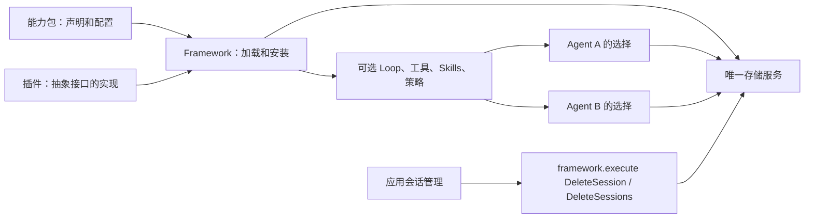

# Framework 共享装配

Framework 加载能力包、安装插件并拥有资源。Agent 从已经注册的能力中选择自己能用的 Loop、工具、Skills、模型和策略。AgentLoop 通过 Core 抽象访问这些能力。

“全局”指同一个 Framework 对象及其克隆共享的环境。不同用户、工作区需要隔离时，由应用创建不同 Framework，并配置不同数据库路径或后端命名空间；没有进程级的隐式全局存储。



## 注册规则

规则由 Core 的扩展点声明，不能由能力包覆盖。

| 声明 | Framework 注册 | Agent 使用 |
| --- | --- | --- |
| `#[extension_point(single)]` | 同接口一个实现；重复安装报错 | 自动共享，无选择项 |
| `#[extension_point(select)]` | 同接口多个候选；同候选 ID 重复报错 | 按注册插件 ID 绑定一个 |
| `#[extension_point]` | 多个贡献，保留安装顺序 | 组合执行或选择允许使用的集合 |

`ExtensionMultiplicity` 表示注册数量；`ExtensionBinding` 表示自动共享、选一个或组合。两者分别检查。

| 能力 | 规则 |
| --- | --- |
| SessionStore、StateStore、InteractionStore、ConversationStore、LongTermMemory、ModelCatalogStore、SummaryStore、ArtifactStore | 每种存储抽象全局唯一；本地存储组合插件统一提供这套实现 |
| AgentLoop、ExternalAgent、ModelSelectionStrategy、ContextAssembler、ContextBudgetPolicy、ContextReducer | Framework 注册多个，Agent 每类选一个 |
| 模型提供方 | 多个；按连接、模型 ID 和操作绑定，选择策略负责路由 |
| 工具来源、Skills、上下文来源、工作流节点 | 多个；Agent 选择允许使用的集合 |
| 中间件、ToolPolicy、生命周期钩子、事件与审计 | Framework 统一安装，按依赖和贡献顺序生效；Agent 不能移除安全策略 |
| 运行输出 | 多个；Agent 可选择输出插件集合，每次运行创建自己的输出对象 |

Loop 或策略已安装而 Agent 未指定时，使用 Framework 显式配置的默认项；没有默认项则报错。SDK 自动安装的默认 ReAct 是明确的默认 Loop。选用默认上下文组装器时，没有自定义预算和 reducer 就使用其内置行为。

自定义组装器整体管理自己的布局、预算和裁剪。显式选择自定义组装器时，未选择的独立预算/reducer 和布局不会注入；显式同时选用这些独立策略仍会报冲突。

插件 ID 和静态工具 ID／call_name 冲突在 Framework 构建时失败。`ToolProvider::descriptors()` 可返回静态工具清单；动态工具在取得运行租约后进行完整重复检查。所选 Loop 需要的存储、模型或交互缺失时，Agent 构建失败，不回退到内存存储。

## 使用

```rust
use eliteforge_agent_framework::*;
use eliteforge_agent_official_plugin_storage_local::LocalStoragePlugin;

// 应用先创建权限受控的 artifacts 目录。
let framework = Framework::builder()
    .plugin(LocalStoragePlugin::new("framework.sqlite", "artifacts"))
    .plugin(ReactPlugin)
    .plugin(ToolProviderPlugin::new("app.tools", app_tools))
    .defaults(AgentSelection {
        agent_loop: Some("builtin.react-loop".into()),
        ..AgentSelection::default()
    })
    .build().await?;

let reader = framework.agent(AgentSelection {
    tool_providers: Some(vec!["app.tools".into()]),
    tools: Some(vec!["read_document".into()]),
    ..AgentSelection::default()
}).build().await?;
let writer = framework.agent(AgentSelection {
    tool_providers: Some(vec!["app.tools".into()]),
    tools: Some(vec!["read_document".into(), "write_document".into()]),
    ..AgentSelection::default()
}).build().await?;
```

`AgentSelection` 不包含任何存储选项。`tool_providers` 使用注册插件 ID，`tools` 进一步按工具内部 ID 收窄；`skills` 使用技能名称；`model` 是默认 Chat 模型，单次 RunRequest 的显式模型优先。工具来源、Skills 和上下文来源默认是空集合；工作流节点默认只允许 SDK 自带节点；安装只是把能力加入候选库。

具备 Skills 工具权限时，也必须配置允许使用的 `skills`。需要模型看见技能元数据时，`context_sources` 同时选择 `skills.default`。Framework 把技能许可写入运行上下文，Skills 插件在发现、加载和读资源的链路中遵守许可。运行请求不能用自己的扩展覆盖 Agent 的许可。

通过 `AgentLoopPlugin::named`、`ExternalAgentPlugin::named`、`ContextAssemblerPlugin::named`、`ContextBudgetPolicyPlugin::named`、`ContextReducerPlugin::named`、`NamedModelStrategyPlugin::new` 注册多个候选。声明式 `#[capability]` 使用能力声明 ID 注册 `select` 候选。

## 生命周期与重配置

- `agent.close()`：取消并排空该 Agent 的运行和操作；其他 Agent、共享存储和插件继续工作。
- `framework.close()`：停止整个环境的新准入，取消管理操作，关闭全部 Agent，随后按逆序关闭插件。并发关闭只清理一次，调用者取消不会中断已启动的关闭任务。
- `agent.reconfigure(framework.agent(new_selection))`：只改变该 Agent 的能力绑定。运行中拒绝重配置；新选择失败保留原配置；不重装插件、不重开数据库、不改变其他 Agent。
- 能力包在 Framework 构建时绑定共享范围；任务仍保留版本保护与释放。新增 `CapabilityPack::for_framework_scope`，已有 `for_agent_scope` 实现通过兼容钩子继续工作。

Framework 暂不提供运行中替换整个插件环境的接口；需要调整安装集合时，应用先排空旧环境，再构建新环境。Agent 重配置不承担插件安装或卸载。

## 会话删除

```rust
framework.execute(DeleteSession(session_id)).await?;
let report = framework.execute(DeleteSessions(session_ids)).await?;
```

删除不再要求应用选择某个 Agent。每个会话独立处理，不建立跨批次事务；一个会话失败不阻止其他会话，返回 `report.failures`。仍需应用授权并停止相应的运行和后台写入；活动租约会使该会话返回 Busy。

共享存储不改变会话身份语义。多个 Agent 的独立执行应使用各自的 execution session ID；业务会话与这些执行 ID 的映射由应用管理。删除一个 ID 不隐式级联其他 ID，也不会自动删除共享长期记忆或工件文件。

## 旧入口兼容

`AgentBuilder::new().plugin(...).capability_pack(...).build()` 保留为创建私有单 Agent Framework 的兼容入口。插件资源实际属于这个私有 Framework，关闭 Agent 时一起关闭。历史文档中的此类示例使用这一模式。

新的共享入口使用 `FrameworkBuilder` 安装插件、能力包与工厂，使用 `framework.agent(AgentSelection)` 创建 Agent。在共享 AgentBuilder 上追加插件、工厂或能力包会明确报错，避免无意创建第二套存储。旧入口的完整装配重配置也只适用于私有环境。
