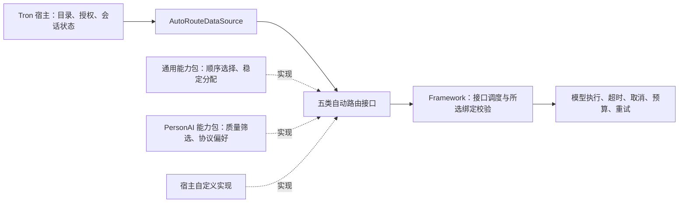

# PersonAI 能力包

`eliteforge-agent-capability-personai` 是可选包，不在官方默认能力包中。它把 PersonAI SDK 的模型调用接入 Framework，同时把 SDK 的业务客户端以类型化 `PersonAiServices` 交给宿主应用。搜索、图片生成、图片任务查询和 AIGC 文本／图片检测通过 `ToolProvider` 提供给 Agent；登录、账户、签到等业务接口继续由宿主直接调用。

| SDK 能力 | Framework 接入方式 |
| --- | --- |
| Chat Completions、Responses | `ChatModel`；Responses-only 模型因列表接口不可发现，须显式配置 |
| Rerank | `RerankModel`；通过 SDK 原生 `RerankClient` 调用 `/api/v1/rerank`，保留相关性分数和可选用量 |
| Embeddings | `EmbeddingModel`；模型 ID 由宿主显式配置 |
| 图片、视频 | 独立生成模型接口及任务查询；SDK 无远端取消接口时明确返回不支持 |
| 文件语音转写、实时转写 | 语音识别与实时会话接口；服务端选模型，对外只公布 `speech-auto`，不伪造指定模型路由 |
| AIGC 文本、图片检测 | `ContentDetectionModel` |
| Web 搜索、图片生成／查询、AIGC 检测 | `PersonAiToolProvider`，默认通过 Discovery 按需暴露 |
| 签到、用户信息、积分及其他业务服务 | `PersonAiServices` 中的 SDK 客户端，供宿主直接调用；不提供 `ToolProvider` |

## 连接的所有权

宿主负责登录、凭据刷新、设备绑定、账号隔离和业务授权。`PersonAiContextProvider` 同时提供当前账号与变更通知；凭据变化时应发布更高的 revision。

宿主先调用 `PersonAiConnection::connect(config, account_context, catalog_store).await`，等待首次联网同步成功，再将同一个 `Arc<PersonAiConnection>` 交给多个 `PersonAiCapabilityPack::new(connection.clone())`。其中 `catalog_store` 为宿主注入的 `Option<Arc<dyn ModelCatalogStore>>`。连接没有隐式全局单例，只能在相同服务端和同一账号上下文之间共享。

连接持有 SDK 服务、目录和唯一的同步器。每个 Agent 保留自己的模型运行时、其他提供方和选模配置，只订阅 PersonAI 分区。因此新建或克隆 Agent、执行 `run` 都不会重复启动同步器。关闭一个 Agent 只释放它自己的资源；宿主调用 `connection.close().await` 才会关闭共享连接，取消目录刷新并拒绝新的模型调用和任务查询。

通过 `connection.services()` 取得业务客户端；通过 `connection.sync().request_refresh()` 请求后台刷新，或等待 `refresh_now().await` 完成手动刷新。并发刷新共享同一轮请求。`sync().status().await` 返回各域同步状态。

## 自动路由

Framework 在 Core 中定义五类可替换接口，显示名称统一如下：

| 接口 | 名称 | 输入范围 |
| --- | --- | --- |
| `ChatAutoRouter` | 对话自动路由 | Agent 对话；由宿主提供候选，选中后校验调用兼容性 |
| `TextGenerationAutoRouter` | 文本生成自动路由 | 标题、摘要等直接 LLM 调用，独立于对话路由 |
| `TextEmbeddingAutoRouter` | 向量自动路由 | 纯文本向量输入 |
| `MultimodalEmbeddingAutoRouter` | 多模态向量自动路由 | 宿主或能力包提供可处理图文等内容的候选 |
| `RerankAutoRouter` | 重排自动路由 | 查询与候选文档 |

宿主通过 `AutoRouteDataSource` 提供已授权候选的快照和策略元数据，也可以自行实现任一接口。数据源只能限制或补充当前运行时模型的信息；Framework 拒绝未注册的候选以及候选范围以外的选择。凭据、数据库访问、账号切换和会话分配记录仍由宿主管理。



`eliteforge-agent-capability-auto-routing` 提供 `OrderedAutoRouter`、`StableAutoRouter` 和 `RunScopedFailoverAutoRouter`。顺序实现遵循候选顺序，稳定分配实现根据宿主作用域分配并保留仍可用的会话模型；运行级对话实现记录本轮失败候选，后续步骤继续使用成功模型，上下文恢复不会再次消耗候选。`AutoRoutingCapabilityPack` 可将选定实现安装到 Agent；官方能力包通过 `auto_routing` 模块导出这些实现。

PersonAI 能力包提供 `PersonAiAutoRouter`，可选择顺序或稳定分配，配置 `high_quality_only` 和 `prefer_responses`。启用质量筛选后，PersonAI 候选必须明确声明 `personai.quality = "High"` 或在 `personai.quality_tiers` 中包含 high；缺失质量信息不视为高质量。`personai.provider` 标记候选是否来自 PersonAI，宿主本地模型保留自身的授权规则。质量筛选默认关闭，由宿主明确启用。

```rust,ignore
let policy = Arc::new(PersonAiAutoRouter {
    high_quality_only: true,
    prefer_responses: true,
    ..Default::default()
});
let routers = AutoRouters {
    source: Some(tron_model_source), // 宿主实现 Arc<dyn AutoRouteDataSource>
    chat: Some(policy),
    text_generation: Some(Arc::new(PersonAiTextGenerationAutoRouter)),
    embedding: Some(Arc::new(PersonAiAutoRouter::default())),
    multimodal_embedding: Some(Arc::new(PersonAiAutoRouter::default())),
    rerank: Some(Arc::new(PersonAiAutoRouter::default())),
};
let pack = PersonAiCapabilityPack::new(connection).with_auto_routers(routers);
```

`ModelClient::text_generation(request, limits, stage)` 使用独立的文本生成路由，复用模型执行、预算、超时和取消能力，不创建 Agent 或会话。宿主也可先调用 `AutoRouters::select_text_generation`，再通过已有模型客户端执行选中的绑定。

`PersonAiTextGenerationAutoRouter` 与 `personai_text_generation_candidates` 只接收明确标为 `Middle` 或 `Low` 的 PersonAI 候选，优先中质量；高质量及质量未知的模型不进入该候选集。Tron 的标题生成等临时调用默认使用此路由；正式对话自动路由仅接收高质量候选。质量规则属于 PersonAI 能力包和 Tron，Framework 不解释这些档位。思考参数由各调用场景显式设置。

对话中的显式模型和已有选模策略，以及向量、重排操作的阶段规则和默认模型优先于对应自动路由。向量、重排观察调用在首次选定后固定运行时快照，再执行重试，因此目录更新不会使重试转到另一个账号的适配器。向量索引仍需保存完整 `EmbeddingSpace`，查询必须匹配模型、版本、维度和预处理规则；自动路由不能替换已有索引的向量空间。纯文本请求使用向量自动路由，包含媒体的请求使用独立的多模态向量自动路由；候选由宿主直接提供，供应商标签和候选筛选由对应能力包处理。Framework 核心不解释供应商标签、不按模态改写候选，仅在选中模型后校验调用契约。显式模型和索引空间仍遵循原有模型能力契约。宿主也可调用 `AutoRouters::select_multimodal_embedding` 为多模态索引的纯文本查询选择初始绑定，随后保存 `EmbeddingSpace`。

PersonAI 适配器通过 SDK 的 `EmbeddingsRequest` 支持文本、图片 URL、图片 Base64，以及同一条输入中的图片和说明文字；每条输入最多一张图片，不支持的块直接报错。宿主将已确认支持图文的模型填入 `PersonAiConfig.multimodal_embedding_models`，适配器才会注册 Text/Image 能力。模型列表返回生效 `tags` 与 `dimension`：`text_embedding` 对应文本向量，`multimodal_embedding` 对应图文向量。缺失标签不授予向量能力；宿主也可显式声明绑定。型号名称不参与能力判断。

Tron 的对话路由通过本地目录构造数据源，注入 PersonAI 策略，并保存会话选择；`with_auto_router` 可以替换该策略。向量和重排路由从宿主提供的可用目录中选择具体绑定。向量索引在首批调用前确定具体模型，后续批次、断点恢复和检索沿用同一模型；重排自动路由选择原生 rerank 模型，经 SDK 加密传输调用 `/api/v1/rerank`，保留上游相关性分数。

## 模型同步

PersonAI API 是模型列表真源。首次连接必须联网；任一必需域失败就返回初始化错误，缓存不能替代这次联网验证。初始化成功后默认每 5 分钟刷新一次。Chat 列表分别请求 low、middle、high 三档，保留完整 `provider_code/model_code`；图片、视频、语音、向量、原生重排和两类 AIGC 检测按域独立同步。已运行连接的某域返回真正的空列表时移除该域模型；请求失败或缺失、`null` 数据则保留该域上次成功结果，并标记过期。同步使用 SDK 公开的类型化对象接口区分空列表和无数据，模型标签和维度由 SDK 的公开模型类型传递。

每次更新只替换 PersonAI 自己的模型连接，不清除同一 Agent 的 Genai 等其他连接。模型描述、协议、适配器和当前授权上下文作为一份运行时快照发布；已开始的调用持有旧快照直到结束。下架模型拒绝新调用，已提交的视频任务在同一进程内仍用提交时的绑定查询；重启后若旧授权适配器无法重建，会明确返回不可用。账号切换时先撤下旧账号目录，旧账号迟到的同步结果不得覆盖新目录。

目录注册与发布使用同一同步边界，`refresh_now().await` 返回后，已经装配的 Agent 可以立即读到更新。每次发布还带有单调序号，因此后台通知与调用恢复同时发生时，迟到的旧更新不能覆盖新目录。

模型下架或账号退出时，默认模型和阶段规则不会阻止目录更新；后续选中失效规则会返回不可用。同步器会尝试更新所有已接入的 Agent，并保留最新发布版本，因此某个 Agent 的本地配置错误不会阻断其他 Agent 或后续接入的 Agent；更新错误仍会返回给宿主。

宿主可将 `storage-local` 提供的 `ModelCatalogStore` 注入连接，把模型元数据存入 SQLite。缓存键同时包含服务端地址、连接标识和账号作用域。冷启动可读取缓存作为恢复资料，但仍须完成首次联网同步后才对 Agent 发布目录。连接不会从某个 Agent 的插件容器取得缓存存储，因此共享连接的存储生命周期也由宿主管理。没有存储接口时目录仅在内存中维护。缓存不包含 Token、密码、登录会话或可执行的适配器对象。

## 服务端模型不可用时

快照保证一次调用中模型描述、协议、适配器和认证上下文一致，但不能保证服务端一直接受该模型。普通重试沿用同一快照，下一次模型调用读取新快照。

上下文压缩的摘要调用与该步骤的主调用使用同一快照。压缩期间发生账号切换时，旧账号绑定会在发送请求前拒绝调用，不会用新账号凭据发送旧会话内容。

提供方错误通过 `ModelError::Provider` 保留类别、HTTP 状态、业务码、错误类型、模型引用和原始消息。认证、权限和积分不足不会触发自动换模型。PersonAI 明确的模型不可用错误会通知连接刷新目录；普通 HTTP 404 不直接视为模型下架，也不会据此永久删除目录项。

默认向宿主返回失败，不自动选择其他模型。宿主可以安装以下插件，允许 Framework 在当前调用内恢复：

```rust
ModelRecoveryPlugin(ModelRecoveryPolicy {
    candidates: vec![ModelRef::new("personai", "provider/alternative")],
    allow_explicit_model_replacement: false,
})
```

恢复会等待一次目录刷新，按配置顺序检查仍可用的候选，并重新组装上下文。候选必须支持输入模态、工具和结构化输出要求。显式指定的模型默认不能替换；已输出文本或思考、账号切换、重试预算耗尽时也不恢复。刷新受取消和模型超时约束，后续调用继续计入原有调用预算。客户端可通过 `framework.model_recovery` 自定义输出事件观察替换。

恢复不会重新执行整个 `run` 或已经完成的工具。图片、视频提交不使用聊天恢复策略，结果不确定时不自动再次提交。已取得任务 ID 的查询使用提交时绑定，因此模型下架后仍可查询；宿主关闭整个连接后停止查询。

`PersonAiServices` 暴露登录、账户、签到、Chat、Responses、Embedding、Rerank、搜索、多媒体、语音、Skills、角色、仓库、站点、皮肤、文件、版权、通知、广告、反馈、版本和转发等 SDK 客户端。能取得客户端不等于 Agent 获得了调用权限；宿主自行决定哪些业务调用可以对用户或 Agent 开放，并继续执行鉴权、限流和审计。


## Agent 工具与 Discovery

`PersonAiCapabilityPack::new(connection)` 默认安装 `ToolDiscoveryPlugin`。Agent 初始只看到 `tool_search`，搜索 `personai` 后取得并激活下列工具；执行仍经过 Framework 的参数校验、宿主 `ToolPolicy` 和审计。

| 工具 | 输入 | 结果 |
| --- | --- | --- |
| `personai_search` | `query`，可选 `count`（1–20） | 标题、URL、摘要、来源 |
| `personai_generate_image` | `prompt`，可选 `model`、`size`、`quality`、`count`（1–10） | `task_id` 与 `job` |
| `personai_query_image` | `task_id` | `job` 中的状态、进度、图片 URL、错误 |
| `personai_detect_text` | `text`，可选 `model` | 模型引用与检测结果 |
| `personai_detect_image` | HTTP(S) `image_url`，可选 `model` | 模型引用与检测结果 |

生成和检测省略 `model` 时选择该操作目录中的首个模型；显式选择只能引用该操作已发现的模型。图片生成提交后立即返回任务，Agent 按需查询完成状态，工具不在内部循环等待。所有工具同时提供文本与 `structured` JSON 结果，供宿主展示。

宿主已有统一 Discovery 时，把原始 Provider 放进去，并关闭包内的工具注册，避免重复安装 `tool_search`：

```rust,ignore
let pack = PersonAiCapabilityPack::new(connection.clone());
let discovery = ToolDiscoveryPlugin::new()
    .provider(pack.tools()); // 可继续加入 Web、Media 等 Provider
let builder = Framework::builder()
    .capability_pack(pack.without_tools())
    .plugin(discovery);
```

每次 run 捕获当前账号凭据和对应目录。账号切换、退出或关闭连接后，旧 run 的后续工具调用明确失败；新 run 不会继承旧账号目录。任务 ID 由远端按当前账号授权，工具查询不会恢复其他账号的凭据。关闭 Agent 不关闭共享 PersonAI 连接。

Framework 提供远端通用工具；宿主负责登录、能力选择、权限、审计配置和结果展示。官方 Media 的本地图片／PDF 读取及 Web Fetch 的网页读取可与这些工具一起组合进统一 Discovery。
