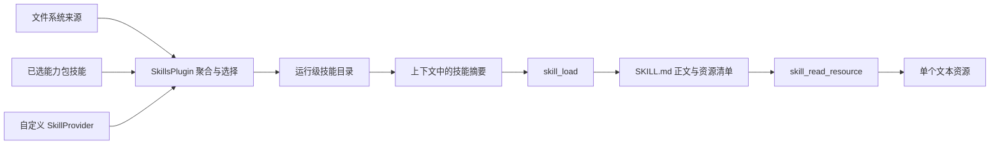
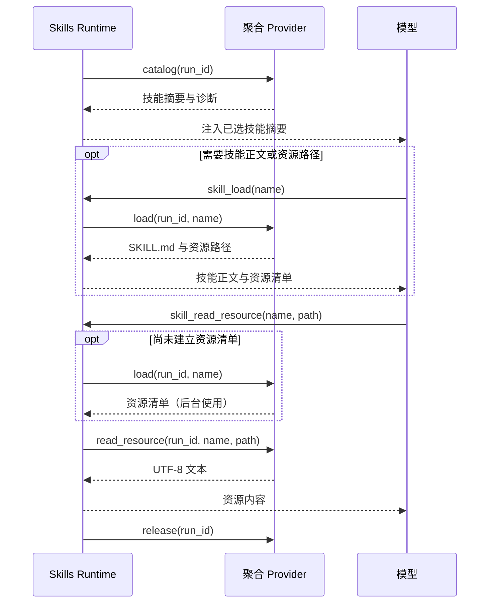

# Skills 插件技术设计

## 1. 目标与边界

Skills 插件按需向 Agent 提供技能说明和配套资源。它负责汇总来源、生成技能目录、按需加载说明文件和资源，并在一次逻辑运行结束时释放运行级状态。上层应用负责选择技能来源、配置目录与资源限制，并决定如何授权工具执行。

技能文件中的指令不会自动获得权限。技能可以说明“如何完成一项工作”，但工具能否执行仍由 Agent 已配置的工具、策略和审批流程决定。



## 2. 组件与职责

| 组件 | 职责 |
| --- | --- |
| `SkillProvider` | 定义技能目录发现、单技能加载、资源读取和运行结束清理接口，不依赖具体存储方式 |
| `FileSystemSkillProvider` | 从系统级和本地目录发现标准 Agent Skills 文件，并在每次逻辑运行内保持文件快照 |
| `SkillsPlugin` | 管理技能选择，聚合已注册 Provider，提供上下文、工具和运行结束清理 |
| `AggregatedSkillProvider` | 将多个 Provider 合并为一个目录，并把后续读取请求路由回技能所属 Provider |
| `CapabilitySkillsSourcePlugin` | 将已选能力包中的嵌入资源或应用管理目录转换为技能来源 |
| 技能工具 | 通过 `skill_load` 加载完整说明，通过 `skill_read_resource` 读取已列出的资源；有诊断时提供 `skill_diagnostics` |

官方能力包可以预置 `SkillsPlugin`。应用也可直接装配它，替换文件系统来源，或通过 `without_skills()` 关闭默认 Skills。能力包只有在被应用选中后，其技能来源才参与汇总；依赖 crate 本身不会自动启用技能。

## 3. Provider 接口与数据模型

Core 定义的 `SkillProvider` 有四个操作：

| 操作 | 输入 | 返回内容 |
| --- | --- | --- |
| `catalog` | 当前 `RunContext` | 技能摘要目录和非致命诊断 |
| `load` | 当前运行、技能名称 | 完整 `SKILL.md` 正文及可读取资源的相对路径和大小 |
| `read_resource` | 当前运行、技能名称、资源路径 | 单个 UTF-8 文本资源 |
| `release` | 当前运行 | 清理该逻辑运行的目录、缓存或临时状态 |

目录摘要包含技能名称、描述、来源、位置，以及可选的许可证、兼容性、元数据和 `allowed-tools`。Provider 可以来自文件系统、能力包、数据库或远端服务；框架不假设具体后端。

Provider 必须确保同一个 `run_id` 内目录和内容保持一致，并在 `read_resource` 中原样返回请求的技能名称和路径。运行级资源应在 `release` 时清理。跨进程恢复可能复用同一个逻辑 `run_id`，Provider 应据此恢复或重新构建必要的运行状态。

## 4. 文件系统技能格式与发现规则

默认扫描位置在创建 `FileSystemSkillsConfig` 时确定：

| 来源 | 默认目录 |
| --- | --- |
| 当前用户 | Unix/macOS：`$HOME/.agents/skills`；Windows：`%USERPROFILE%/.agents/skills`（缺少时回退到 `$HOME`） |
| 当前工作目录 | `<创建配置时的当前目录>/.agents/skills` |

每个技能放在独立子目录，入口文件必须是 `SKILL.md`：

```text
.agents/skills/
└── release-notes/
    ├── SKILL.md
    ├── references/
    │   └── style.md
    └── scripts/
        └── publish.sh
```

`SKILL.md` 必须以 YAML frontmatter 开始，至少包含 `name` 和 `description`。名称必须与目录名一致，长度为 1–64 个小写 Unicode 字母、数字或连字符；不能以连字符开头或结尾，也不能包含连续连字符。描述长度为 1–1024 个字符。可选字段包括 `license`、`compatibility`、字符串形式的 `metadata` 和 `allowed-tools`；兼容性字段长度为 1–500 个字符。

两个默认来源出现同名技能时，本地目录覆盖用户级目录。不存在的来源目录视为空目录；配置路径存在但不是目录、无法读取时会使发现失败。符号链接技能目录、入口文件和资源会被忽略并记录诊断，不会跟随链接越出配置目录。只有普通文件会进入资源清单，二进制资源虽可被列出，但 `skill_read_resource` 只返回 UTF-8 文本。

## 5. 文件系统配置项

```rust
let config = FileSystemSkillsConfig::new()
    .with_system_directory("/opt/company-skills")
    .with_local_directory("./.agents/skills")
    .with_max_skills(256)
    .with_max_frontmatter_bytes(64 * 1024)
    .with_max_skill_markdown_bytes(512 * 1024)
    .with_max_resource_bytes(2 * 1024 * 1024)
    .with_max_resources_per_skill(512)
    .with_max_resource_depth(8);
```

| 配置项 | 默认值 | 作用 |
| --- | --- | --- |
| `system_directory` | 当前用户的 `.agents/skills` | 设置用户级技能来源目录；`without_system_directory()` 关闭该来源 |
| `local_directory` | 创建配置时当前目录下的 `.agents/skills` | 设置工作目录内的技能来源；`without_local_directory()` 关闭该来源 |
| `max_skills` | 256 | 限制两个来源合并后的有效技能数；超过上限时发现失败 |
| `max_frontmatter_bytes` | 64 KiB | 限制读取 YAML frontmatter 的最大字节数 |
| `max_skill_markdown_bytes` | 512 KiB | 限制单个 `SKILL.md` 正文的最大字节数 |
| `max_resource_bytes` | 2 MiB | 限制单个文本资源的最大字节数 |
| `max_resources_per_skill` | 512 | 限制单个技能可列出的普通文件数量；超过上限时该技能无法纳入目录 |
| `max_resource_depth` | 8 | 限制资源目录递归深度；更深层目录会忽略并记录诊断 |

除 `max_resource_depth` 外，数值限制必须大于零，否则配置无效。`max_resource_depth` 为零时，只扫描技能根目录中的文件，不递归子目录。超出正文或资源大小限制时会返回错误，不会截断内容。

## 6. 技能来源与能力包资源

能力包可通过 `CapabilityPackBuilder::skills(...)` 提供两种来源：

- `CapabilitySkillSource::embedded(...)`：将技能资源编入能力包产物，适合随包发布的固定内容。
- `CapabilitySkillSource::directory(...)`：引用由应用管理的目录，适合本地开发或应用动态维护。

对于嵌入资源，技能 crate 在 `skills/` 下组织文件，并使用 Core 提供的宏生成资源清单：

```text
shop-capabilities/
├── build.rs
└── skills/
    └── order-review/
        ├── SKILL.md
        └── references/
            └── policy.md
```

```rust
// build.rs
use eliteforge_agent_core::capability_skills_build;

fn main() {
    capability_skills_build!();
}
```

```rust
use eliteforge_agent_core::{CapabilityPackBuilder, capability_skills};

let pack = CapabilityPackBuilder::new("shop", config)
    .skills(capability_skills!());
```

`build.rs` 的 `build-dependencies` 需声明 `eliteforge-agent-core`。自定义资源目录时，`capability_skills!("package-skills")` 与 `capability_skills_build!("package-skills")` 必须指向同一目录。

嵌入资源由应用指定的 `capability_skills_root` 准备到内容摘要目录，采用临时目录和原子发布；同一内容可复用，不同内容保留为不同版本。应用管理目录可由能力包直接引用，不会复制到该资源根目录。

### 宿主产品的技能注册表对接

Framework 运行时的 `SkillProvider` 目录和产品维护的技能注册表是两个独立边界。插件在运行时注册 `SkillProvider`，只说明 SkillsPlugin 可以发现和加载它；这不会自动在宿主的技能中心创建记录，也不会自动给 Agent 分配技能。只测试 `skill_load` 或上下文目录，无法证明技能已安装到产品注册表。

产品安装或启动能力包时，宿主应遍历每个实际安装的能力包，读取 `CapabilityPack::registry_skill_sources()`，将每个来源中的技能及配套资源同步到自己的注册表，并按既有规则处理来源、版本、禁用、更新、卸载和 Agent 分配。该方法默认返回 `skill_sources()`；普通能力包用 `.skills(capability_skills!())` 或目录来源即可同时提供运行时和登记来源。嵌套包也必须逐个遍历；不能只读取外层包。对外部分发包还要在 manifest 中声明技能目录，并验证打包产物中确实包含 `SKILL.md` 和被引用的资源。

如果插件已经提供动态 `SkillProvider`（例如 A2UI 需要动态生成协议资源），应单独实现 `registry_skill_sources()` 提供可登记的技能文件，不要再通过 `skill_sources()` 把同一技能加入第二个运行时 Provider，否则聚合时会因技能重名失败。注册表中的文件须与运行时 Provider 的技能名称一致；动态资源仍由该 Provider 负责。客户端能力协商影响技能是否适用于一次运行，不应成为产品安装登记或绕过 Agent 授权的条件。

对接验收至少覆盖：安装后产品注册表可查到技能和正确来源；分配后 Agent 的真实运行目录可见且可以加载；取消分配、禁用和重启后按宿主规则生效；重新同步不覆盖用户的分配变更。动态 Provider 还应验证资源读取和没有重复注册。检查产品数据库或产品 API 以及真实模型请求上下文，分别证明产品登记和运行时可见；不要把其中一项当作另一项的证据。

## 7. 聚合、选择与重复名称

Skills 插件在 `install` 阶段注册统一运行时、上下文 Provider、工具 Provider 和运行中间件；在 `ready` 阶段收集所有已注册的 `SkillProvider`，建立聚合 Provider。能力包技能来源也会参与该聚合，因此系统目录、工作目录、自定义 Provider 和选中能力包共用同一份技能清单及工具。

同一来源内部的文件系统目录使用“本地覆盖用户级”规则。不同 Provider 或能力包提供同名技能时，聚合阶段返回配置错误；框架不会替用户任意选择一个来源。

应用可通过 `only_skills(...)` 指定允许加载的技能：

```rust
let skills = SkillsPlugin::filesystem(FileSystemSkillsConfig::new())
    .only_skills(["release-notes", "order-review"]);
```

技能名称必须在本次运行发现的目录中。配置了未发现的名称会在模型调用前报错。传入空集合表示不暴露任何技能；`all_skills()` 恢复暴露所有有效发现结果。选择作用于聚合后的目录，对目录来源和自定义 Provider 一视同仁。

不使用文件系统来源、只接入能力包或自定义 Provider 时，可使用 `SkillsPlugin::sources_only()`，避免额外扫描默认目录。若应用完全不需要 Skills，应从官方能力包中显式关闭 Skills。

## 8. 渐进式加载与运行生命周期

一次逻辑运行按以下顺序使用技能：

1. 首次需要技能目录时调用所有 Provider 的 `catalog`，建立运行级快照。
2. 上下文只包含选中技能的名称、描述、来源和位置等摘要，不包含完整技能正文。
3. 模型需要技能正文或资源路径时，可以调用 `skill_load`，插件返回完整 `SKILL.md` 和资源清单。
4. 模型调用 `skill_read_resource` 时，插件按当前运行的权限和资源清单验证路径；如尚未建立清单，在后台按需加载，不将技能正文额外返回模型。
5. 运行完成或取消时，插件清理运行快照，并调用各 Provider 的 `release`。



每个 `run_id` 只发现一次目录。文件系统 Provider 会记录入口文件和资源的大小、修改时间及清单；加载或读取时若内容与发现快照不一致，会返回错误并要求开启新的逻辑运行。成功读取的正文和资源会在当前快照中缓存，因此同一次运行不会混用发现前后的文件内容。

同一 Agent 内暂停并恢复会复用运行快照。进程重建后，文件系统 Provider 会重新发现目录；框架不会承诺跨进程保存旧文件快照。恢复时的 `skill_read_resource` 会重新检查当前运行的技能权限和资源清单，无需此前成功调用 `skill_load`。

## 9. 工具行为与诊断

| 工具 | 行为 |
| --- | --- |
| `skill_load` | 仅加载本次运行中已选中的技能，返回摘要、完整正文和资源路径清单 |
| `skill_read_resource` | 无需先调用 `skill_load`；技能必须已启用，路径必须出现在其资源清单中；仅返回 UTF-8 文本 |
| `skill_diagnostics` | 在当前运行发现目录后，返回非致命发现问题；Skills 来源未报告诊断时该工具不公开 |

无效 YAML、frontmatter 不合规、名称与目录不匹配、符号链接或非普通文件等单项问题会作为诊断保留，并跳过受影响条目；不影响同一来源中的其他有效技能。目录不可读、配置目录类型错误、超出全局技能数上限或 Provider 返回重复技能名称会使该运行配置失败。

诊断可通过 `FileSystemSkillProvider::discover()` 供应用检查，也可由模型在工具列表包含 `skill_diagnostics` 时按需读取。`discover()` 会执行一次独立扫描，不会建立或替换某个运行的快照。

## 10. 注意事项

- 技能正文和资源都是模型可读取的指令或资料，应按不可信输入处理。安装或启用技能前，应用应确认来源可信并控制技能目录的写入权限。
- `allowed-tools` 作为技能元数据随摘要和正文返回，不会自动开放工具、绕过 `ToolPolicy` 或跳过审批。
- `scripts/` 等脚本只作为普通资源列出，不会因发现或加载而执行。执行脚本需要应用显式提供相应工具，并遵循工具权限、审批和隔离策略。
- 文件系统来源只允许普通相对路径；资源路径不能是绝对路径，也不能包含父目录跳转。符号链接不会作为技能或资源读取。
- 自定义 Provider 应验证自身来源返回的元数据和资源路径，并对读取实施访问控制。Skills 运行时会校验清单路径、名称和返回值一致性，但不能替代 Provider 的数据授权。
- 发现快照对文件变化采取失败关闭策略。更新技能后，应开始新的逻辑运行，避免同一运行中的模型看到不一致的目录、正文和资源。
