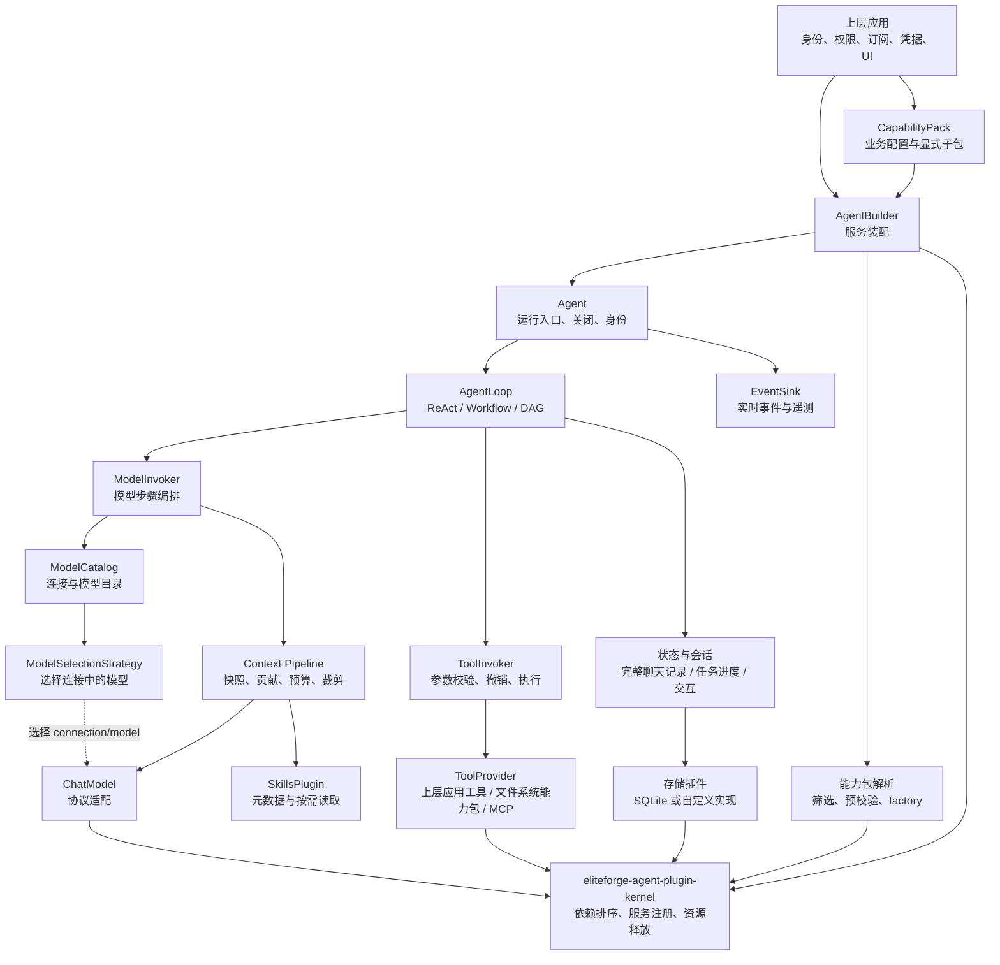
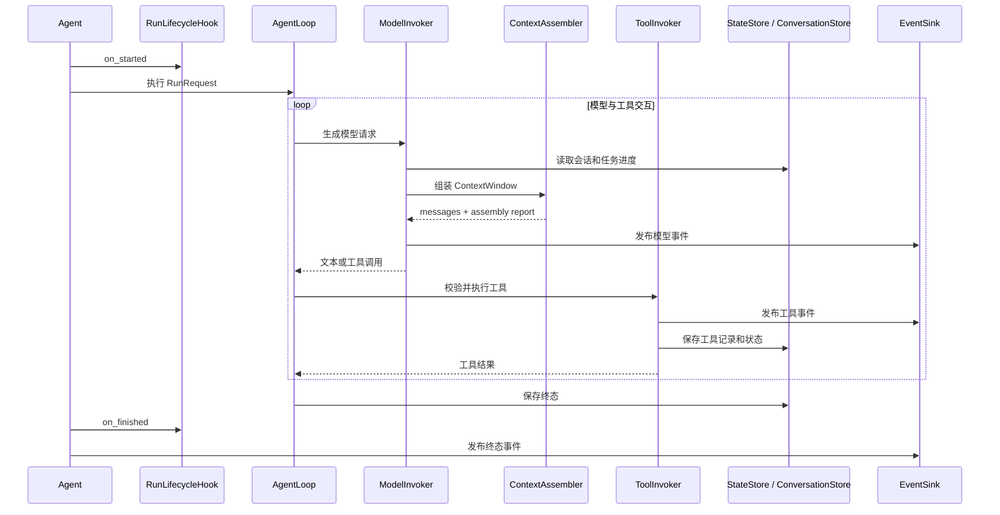
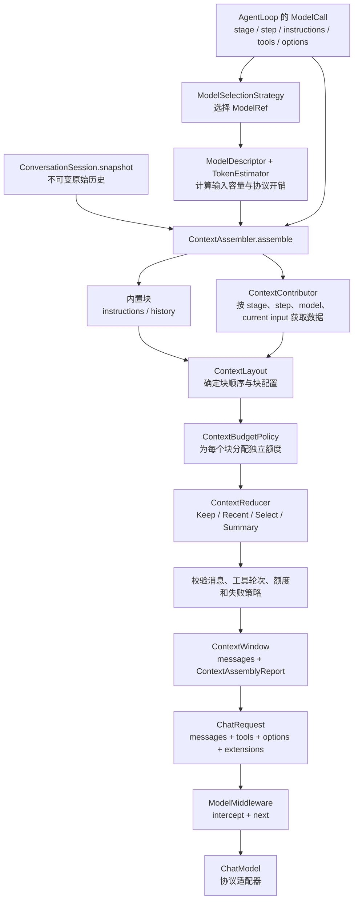
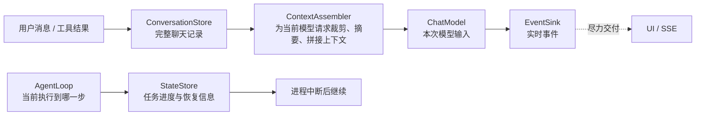
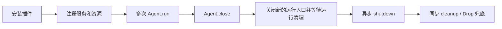

# Framework 架构

`eliteforge-agent-core` 定义公共数据、能力契约和可复用运行支撑；`eliteforge-agent-framework` 负责装配、Agent 与工作流执行、模型调度和资源关闭。
`eliteforge-agent-plugin-kernel` 负责插件装配与资源生命周期。模型协议、存储、MCP、用户交互、Skills 和遥测由配套插件提供。

本文只说明整体架构和运行语义。扩展点、默认行为以及现有实现见[Plugin 与扩展点](plugins.md)；可运行的场景和代码见[快速上手](quickstart.md)。

## 总体结构

上层应用负责业务边界，Framework 负责 Agent 运行时，插件负责接入外部能力。



### 模块职责

| 模块 | 职责 | 不负责的内容 |
|---|---|---|
| 上层应用 | 业务身份、权限、订阅、凭据、配置、HTTP/UI、业务路由 | 不把业务策略下沉到通用 Framework |
| `eliteforge-agent-plugin-kernel` | 插件依赖排序、类型服务注册、安装回滚、异步关闭和 Drop 兜底 | 不定义 Agent 执行语义 |
| `eliteforge-agent-core` | 模型/工具接口、请求/响应、上下文、状态、交互、能力包描述与宏导出 | 不依赖具体插件或 Framework |
| `eliteforge-agent-framework` | Agent、执行循环、能力包解析、服务装配、模型调度和运行控制 | 不包含供应商协议实现 |
| `eliteforge-agent-capability-tools` | 可选的文件系统读写、搜索、文本修改，以及独立的通用跨平台系统命令工具 | 不提供进程或文件系统沙箱，不定义上层应用的授权策略 |
| 配套插件 | 实现模型协议、存储、工具、Skills、上下文、摘要、附件、AG-UI 和遥测 | 不替上层应用管理业务权限和订阅 |

Framework 的默认 `genai` feature 依赖 `eliteforge-agent-official-plugin-model-genai`；该插件仅依赖 Core。关闭默认 feature 可移除 Genai。SQLite、MCP 和 OpenTelemetry 仍由应用显式安装；文件系统工具也需要应用显式选择对应能力包。DAG 使用 `petgraph` 校验拓扑，使用 Tokio 执行节点。
上层应用通过适配层接入 Framework，上层应用自己的业务类型留在上层应用内。

## 服务装配

`AgentBuilder` 有三类装配入口：`plugin` 添加单个插件，`plugin_pack` 展开兼容的
`PluginPack`，`capability_pack` 选择声明式业务能力包。三者最后都进入同一个依赖图；
`build().await` 才创建能力实例、安装插件并构造运行时服务。

能力包解析器只读取宏登记的静态描述。它先按根包和显式 `include(...)` 筛选，再预校验 ID、
依赖、环和共享实例声明；通过后按稳定拓扑顺序调用 factory，并将每项能力适配为普通 `Plugin`。
因此，未选包不创建业务对象。官方组合仍由独立的
`eliteforge-agent-official-plugin-pack` 的 `PluginPack` 提供，Framework 和 Core 不依赖它。

上下文内容由 `ContextProvider` 实现提供，能力包适配器或 `ContextPlugin` 都会将其注册为
`ContextService` 和通用扩展点。安装完成后，Builder 通过 `all::<ContextService>()` 汇总运行时
服务；插件在 `ready` 中也可通过 `extensions::<dyn ContextProvider>()` 查询完整集合。其他多贡献
接口同样保留兼容服务类型并进入通用扩展注册表。能力声明、配置、Skills 成员和生命周期见
[能力包与自动装配](capability-packs.md)。

```text
AgentBuilder.plugin(...) / plugin_pack(...) / capability_pack(...)
        │
        ▼
CapabilityPack（仅 capability_pack）
  ├─ 显式根包和 include 子包
  ├─ 描述筛选、ID/依赖/环预校验
  └─ 同步 factory → 适配后的 Plugin
        │
        ▼
PluginContainer.build
  ├─ 按依赖顺序安装全部插件
  ├─ 按安装顺序执行全部 ready
  ├─ 注册唯一服务和多个贡献
  ├─ 安装失败时回滚已安装资源
  └─ 注册关闭与清理回调
        │
        ▼
AgentBuilder 读取服务
  ├─ 创建 ModelInvoker / ToolInvoker
  ├─ 选择 AgentLoop
  ├─ 装配上下文、状态和事件服务
  └─ 返回可运行的 Agent
```

服务有两种数量语义：

| 语义 | 注册方式 | 读取方式 | 典型用途 |
|---|---|---|---|
| 唯一服务 | `provide(T)` | `get<T>()` | 一个会话存储、一个执行循环、一个模型选择策略 |
| 多个贡献 | `contribute(T)` | `all<T>()` | 多个模型连接、工具来源、Middleware、EventSink |

同一个服务类型不能同时使用两种注册语义。插件依赖、来源追踪、安装回滚和资源释放的具体入口见[Plugin 与扩展点](plugins.md)。

### 装配边界

Framework 根据已注册的服务构造运行时；需要 Chat 且没有自定义连接时，默认 Genai 插件读取模型环境配置。数据库和其他存储由应用显式安装。
内置执行器需要持久化状态时，上层应用必须显式安装对应存储插件。

```text
上层应用和插件注册运行所需服务
            │
            ▼
Framework 读取服务并构造运行时
            │
            ▼
Agent 开始执行
```

扩展点、默认行为和现有实现统一维护在[plugins.md](plugins.md)。

## 执行模型

一次运行从生命周期通知开始，经过执行循环和调用器，最后完成清理并发布终态事件。



`AgentLoop` 决定执行顺序；`ModelInvoker` 协调模型选择、Context Pipeline、预算、超时、取消和模型中间件；`ToolInvoker` 负责工具参数检查、撤销、超时、取消和工具中间件。
DAG 节点也必须通过这些调用器访问模型和工具。

| 执行器 | 执行结构 | 状态要求 | 适用场景 |
|---|---|---|---|
| `ReactAgentLoop` | 模型与工具循环 | `StateStore` + `ConversationStore` | 默认对话 Agent、问答和审批 |
| `WorkflowLoop` | 串行 ReAct 阶段 | `StateStore` | 固定阶段和阶段级模型选择 |
| `DagWorkflowLoop` | 节点、并行、条件分支和汇合 | `StateStore` | 多步骤任务和可恢复编排 |
| 自定义 `AgentLoop` | 由实现决定 | 由实现声明 | 其他执行模型 |

Middleware 使用 `intercept + next` 包装调用；生命周期 Hook 是独立的通知接口，不参与执行链。
调用顺序、错误处理和现有实现见[Middleware 与 Hook](extensions.md)。

两者的边界如下：

| 机制 | 接收内容 | 能否进入执行链 | 返回值语义 |
|---|---|---|---|
| `RunLifecycleHook` | 只读的 `RunLifecycleContext`；结束通知另外接收 `&Result<RunResult, AgentError>` | 不能，没有 `next` | 回调没有返回值；panic、超时和中断会被隔离并记录事件，不改变运行结果 |
| `RunMiddleware` | `RunRequest`、`RunContext` 和 `RunNext` | 可以，调用 `next.run()` 前后包裹一次运行 | 返回 `Result<RunResult, AgentError>`，可以拒绝执行、观察结果或处理清理错误 |

因此，“生命周期 Hook 只接收开始和结束通知，不替换执行结果”不是说 Hook 没有结束结果可读，而是说：

```text
on_started(context)
    │ 只读身份通知
    ▼
RunMiddleware → AgentLoop → ... → RunResult
    ▲                                  │
    └──── on_finished(context, &result) ┘
         只能观察，不能返回新的 result
```

Hook 的 `on_finished` 会看到成功结果或错误结果，但它没有 `RunNext`、可变结果或 `Result` 返回值；它适合统计、审计和通知，不适合鉴权、改写结果或实现清理。需要包裹执行、提前拒绝或参与清理时，应使用 Middleware 或资源生命周期接口。

### ReAct 与工具

```text
用户消息
   │
   ▼
模型生成
   ├─ 文本 → 保存回复并结束
   └─ 工具调用
        │
        ▼
参数 Schema 校验 → 策略检查/审批 → ToolMiddleware → Tool.call
        │                                      │
        └────────────── 工具结果保存 ◄─────────┘
                       │
                       ▼
                   回到模型生成
```

工具在真正派发前会再次检查撤销状态。已开始的外部副作用不能回滚；副作用发生后结果处理失败时，调用会标记为 `Indeterminate`，不能当作未执行。

### 一次模型步骤的 Context Pipeline

`ModelInvoker` 是模型步骤的编排者，但上下文处理由独立的 `ContextAssembler` 完成。它不是把历史直接交给模型，也不是把所有上下文规则藏在模型适配器中。



上下文处理按以下顺序发生：

1. `ModelSelectionStrategy` 根据阶段、步骤、尝试次数、工具和原始历史选择模型。
2. `ModelDescriptor` 和 `TokenEstimator` 计算模型输入容量，并预留工具定义和生成选项占用的协议空间。
3. `ConversationSession.snapshot()` 提供不可变的原始历史；本次模型调用不会改写它。
4. `ContextAssembler` 生成上下文块。简单 Agent 默认有 `instructions` 和 `history` 两个内置块；显式布局可以加入长期记忆、检索结果或上层应用数据块。
5. 每个 `ContextContributor` 在自己的额度内生成数据，`ContextBudgetPolicy` 为所有块分配独立预算，块之间不借用剩余额度。
6. 每个块交给自己的 `ContextReducer`，可以保留、按消息/轮次裁剪、选择条目或调用摘要模型压缩；工具调用和工具结果必须保持完整关系。
7. 组装器校验最终消息、指令不可变性、历史投影合法性和模型特定额度，输出 `ContextWindow` 与 `ContextAssemblyReport`。
8. 只有组装完成后的 `window.messages` 才会进入 `ChatRequest`，随后经过 `ModelMiddleware`，最后交给 `ChatModel`。

上下文失败、成功、压缩恢复都会发布对应事件；因此 UI、Telemetry 或调试工具可以观察每个块的原始额度、最终额度和处理结果，而不需要解析模型适配器内部状态。

相关代码入口：[context.rs](../crates/eliteforge-agent-core/src/context.rs)、[models.rs](../crates/eliteforge-agent-framework/src/models.rs)。配置层扩展点见[按场景选择扩展点](plugins.md#按场景选择扩展点)。

## 模型与订阅

`ModelConnection` 是 Framework 的标准模型接入结构。它复用协议客户端、地址和认证，并暴露一个或多个模型描述符；`ModelSelectionStrategy` 决定每个阶段实际使用哪个模型。即使应用只有一个模型，也只需要注册一个只包含该模型的 `ModelConnection`。

```text
ModelConnection
├─ ChatModel：协议客户端、地址、认证
├─ ModelDescriptor[]：可用模型及能力
└─ TokenEstimator：上下文估算与预算预留
        │
        ▼
ModelSelectionStrategy
├─ FixedModelStrategy：固定模型
├─ StageModelStrategy：按阶段选择
└─ RoutingStrategy：按候选顺序回退
        │
        ▼
ModelInvoker
```

`ChatModel` 是连接内部的协议适配器：它负责把 Framework 的 `ChatRequest` 转换成供应商请求，再把结果写回 Framework。`ModelConnection` 则负责把这个适配器、可用模型列表和 token 估算器放到模型目录中。也就是说，`ChatModel` 说明“怎么调用”，`ModelConnection` 说明“通过哪个连接可以调用哪些模型”。

应用直接创建 `GenaiPlugin`，或用 `ChatModelPlugin::new(adapter)` 注册自定义单模型实现。其他操作采用独立接口：EmbeddingModel、RerankModel、图片/视频生成、语音和实时会话。

```text
GenaiPlugin / 自定义 Plugin → Core 注册契约 → Framework 模型目录与执行器
```

请求指定优先于阶段规则和每项能力的默认模型，未配置规则时要求唯一兼容实现。协议绑定到具体连接/模型/操作；continuation 还绑定格式版本。详细调用示例见[模型插件](model-plugins.md)。

模型连接、模型目录和选择策略属于运行时配置；订阅归属、账号权限、计费和凭据轮换由上层应用管理。
`ModelInvoker` 协调 `ContextAssembler`，并负责超时、重试、预算预留和结果验证。模型已输出增量后不自动重试；不确定失败按已预留额度保守计入预算。

## 会话记录、任务进度与持久化

一次 Agent 运行同时产生三类数据。把它们分开，是为了让“聊天内容”“任务进度”和“实时输出”各自承担一种职责。



### 1. 完整聊天记录

`ConversationStore` 保存会话的原始消息，例如用户问题、模型回复、工具调用和工具结果。
这些消息是追加保存的源数据。为了控制模型输入长度，Framework 可以在发送给模型前裁剪旧消息、加入摘要或加入检索结果，但不会因此删除或改写原始会话。

### 2. 当前任务进度

`StateStore` 保存一次运行的进度，例如：

- 当前执行器、阶段或 DAG 节点；
- 已完成的模型步骤和工具调用；
- 正在等待的用户回答或工具审批；
- 预算、重试次数和恢复所需的运行身份。

这份数据不是聊天记录，而是“任务做到哪里了”。进程崩溃后，Framework 读取它判断应该继续、直接复用已完成结果，还是要求上层应用核对一个可能已经产生外部副作用的调用。

### 3. 本次模型输入和实时事件

Context Pipeline 每次模型调用都会重新运行：

```text
ConversationStore.snapshot()
        │
        ▼
ContextAssembler
  ├─ 加入固定指令、长期记忆或检索结果
  ├─ 为每个上下文块分配额度
  ├─ 裁剪历史、选择数据或调用摘要模型
  └─ 校验工具调用和工具结果仍然成组
        │
        ▼
ContextWindow → ChatRequest → ChatModel
```

`ContextWindow` 只是本次请求的临时输入，不是另一份会话历史。具体的块顺序、额度、Reducer 和摘要规则见[上下文窗口](context-windows.md)。

模型和工具产生的实时事件通过 `EventSink` 发给 UI、SSE 或观测系统。实时事件是“通知”，不是可靠的恢复依据；消费者过慢时可能丢事件。需要恢复时读取 `ConversationStore` 和 `StateStore`，而不是依赖实时事件流。

SQLite 中的职责对应如下：

| 数据 | 保存内容 | 主要用途 |
|---|---|---|
| `ConversationStore` | 完整会话消息 | 下次对话继续使用历史 |
| `StateStore` | 运行进度、节点状态、审批和预算 | 崩溃恢复、跨进程继续执行 |
| `SummaryStore` | 从历史生成的摘要 | 减少上下文长度，原始消息仍保留 |
| `ArtifactStore` | 大工具结果和附件 | 用引用替代超大的内联结果 |

`SqliteStoragePlugin` 可以一次注册这些存储，但不会把它们合并成同一种数据。

### 恢复运行：为什么需要“租约”

假设一个任务运行到一半，进程 A 崩溃了。进程 B 需要继续它。此时必须防止进程 A 的残留任务和进程 B 同时调用模型、执行工具或写回进度。

Framework 因此在数据库中记录一项短期的“执行权”，代码中称为 execution lease。它类似一个带过期时间的分布式锁：

```text
进程 A：取得执行权 → 读取进度 → 执行一步 → 写回进度
进程 B：                 拿不到执行权，等待或返回冲突

进程 A 崩溃
    │
    ▼ 执行权过期

进程 B：取得新的执行权 → 读取最新进度 → 继续执行
旧的进程 A：即使恢复运行，也不能再写入进度
```

这里有三个关键点：

- 同一个 `run_id` 同时只有一个进程可以推进状态；
- 进程正常运行时需要续期，进程崩溃后执行权最终会过期；
- 新进程取得执行权时会生成更高的 `generation`。旧进程写回时发现自己的 generation 已过期，写入会被拒绝。

因此，租约不是业务概念，也不是模型调用的一部分。它只解决“谁有权修改这次运行的持久化进度”。

会话追加也有类似保护：同一个会话同时只能有一个写入者，追加消息时会检查 `revision` 是否仍是读取时的版本。版本不一致表示另一个请求已经写入，当前追加会失败，而不会覆盖新消息。

如果取消一个 SQLite 写操作，不能直接假设数据库已经回滚。上层应用需要重新读取状态，确认这一步是未写入、已完成，还是处于需要人工核对的未知状态。

## 用户交互与审批

ReAct、Workflow 和 DAG 内置 ReAct 节点共用持久化交互机制。用户问题、选项、答案和原始调用保存在交互记录中，上层应用负责身份验证和 UI。

```text
ask_user / RequireApproval
          │
          ▼
保存交互与任务进度 → RUN_FINISHED(interrupt)
          │
          ▼
上层应用展示 UI，提交回答或审批决定
          │
          ▼
恢复同一 run → 保存答案 → 继续模型或执行工具
```

工具审批由 `ToolPolicy` 决定；执行器必须显式支持策略检查。数据库结构、默认问答工具和跨进程示例见[用户交互](interactions.md)。

## 事件、观测与身份

事件身份是 `(run_id, scope, sequence)`。`EventScope::Live { execution_id }` 区分每次执行或恢复尝试；持久化 Journal 使用独立序列，不能把实时流序号当作恢复游标。

`EventSink` 有三类观测入口：

| 入口 | 语义 | 约束 |
|---|---|---|
| `on_event` | 在有界异步队列中消费普通事件 | 消费者必须处理积压和丢失 |
| `on_diagnostic` | 同步记录上下文组装和最终发送元数据 | 必须快速，不能 I/O |
| `on_published` | 按实时发布顺序交接完整事件 | 不能 I/O 或再次发布事件 |

`TelemetryPlugin` 使用上层应用注入的 OpenTelemetry provider 记录 run、node、model、tool、关联关系、耗时、结果和用量；默认不输出提示词、参数、结果、session 或错误正文。
错误报告默认省略正文，可显式配置 `ErrorRedactor`。AG-UI 插件在 `on_published` 上转换输出事件和 SSE，HTTP 路由仍由上层应用提供。

## 资源生命周期

插件在安装时登记异步关闭和同步清理回调。`ResourceScope` 按注册顺序的逆序释放资源，并收集错误、panic 和超时。



`Agent::close` 关闭所有克隆的新运行入口，等待运行清理后关闭插件，并返回 `ShutdownReport`。
插件创建的 SQLite 和 MCP 连接在 `agent.close()` 时释放。应用只配置 `McpToolsPlugin::new`，无需单独连接或关闭 MCP client。
显式注入的共享组件（例如跨应用使用的 OTel provider）仍由其所有者管理；关闭 Agent 只清理本实例的观测状态。

## 延伸阅读

- [快速上手](quickstart.md)：按场景运行 Agent，并查看 Rust 代码。
- [Plugin 与扩展点](plugins.md)：扩展接口、默认行为、注册类型和现有实现。
- [Middleware 与 Hook](extensions.md)：执行拦截和生命周期通知的调用契约。
- [DAG 工作流](dag-workflows.md)：节点、并行、条件分支和恢复。
- [上下文窗口](context-windows.md)：上下文布局、预算、摘要和附件引用。
- [可观测](observability.md)：OTel span、metrics 和恢复身份。
- [执行约束](execution-contracts.md)：运行时行为保证与限制。
