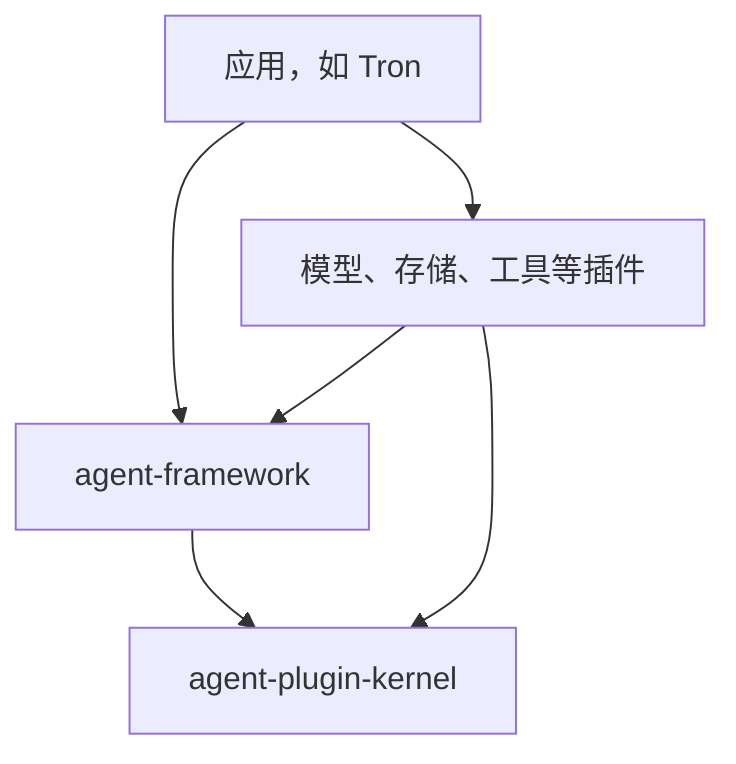

# Framework 架构

Framework 负责 Agent 的执行流程，内置 ReAct、串行工作流和 DAG，也支持自定义执行方式。
Plugin Kernel 管理插件安装与资源释放。模型协议、存储和外部工具由插件接入。

会话与上下文见[上下文窗口](context-windows.md)，问答与审批见[用户交互](interactions.md)，
SQLite 分层与平台适配见[SQLite 存储](sqlite-storage.md)。

## 分层

下图箭头表示依赖关系。



| 模块 | 职责 |
|---|---|
| 应用 | 身份、权限、订阅、凭据、配置和 UI |
| agent-plugin-kernel | 插件依赖排序、服务注册、安装回滚、资源关闭 |
| agent-framework | Agent 运行、模型和工具调用、上下文、预算、状态与交互 |
| 插件 | 实现模型适配、工具接入、存储、摘要和可观测功能 |

Framework 不依赖 genai、SQLite、MCP 或 OTel。DAG 使用 petgraph 检查拓扑，使用 Tokio
执行节点。Tron 通过适配层接入 Framework，业务类型留在 Tron。

## 创建 Agent

先配置模型和 SQLite 文件，其余使用默认实现。下面使用现成的 GenaiProvider，无需编写模型适配器或 Plugin。

```rust
use agent_framework::{AgentBuilder, ModelDescriptor, RunRequest};
use agent_model_genai::{AdapterKind, AuthData, GenaiProvider};
use agent_storage_sqlite::SqliteStoragePlugin;
use std::sync::Arc;

#[tokio::main]
async fn main() -> Result<(), Box<dyn std::error::Error>> {
    let provider = Arc::new(GenaiProvider::new(
        "default",                              // 连接名称
        AdapterKind::OpenAI,                     // 使用 OpenAI 协议
        std::env::var("MODEL_ENDPOINT")?,        // 接口地址
        AuthData::from_env("MODEL_API_KEY"),     // 从环境变量读取密钥
    )?);

    let agent = AgentBuilder::new()
        .plugin(SqliteStoragePlugin::new("agent.sqlite"))
        .plugin(provider.plugin(vec![
            ModelDescriptor::new(std::env::var("MODEL")?),
        ]))
        .build()
        .await?;

    let result = agent.run(RunRequest::new("chat-1", "你好")).await;
    let shutdown = agent.close().await;
    println!("{}", result?.output);
    if !shutdown.is_success() {
        return Err(format!("shutdown failed: {shutdown:?}").into());
    }
    Ok(())
}
```

设置 `MODEL_ENDPOINT`、`MODEL_API_KEY`、`MODEL` 后即可运行
[minimal.rs](../crates/agent-model-genai/examples/minimal.rs)：

```sh
cargo run -p agent-model-genai --example minimal
```

这个例子注册模型连接和 `SqliteStoragePlugin::new("agent.sqlite")`。存储插件创建会话、执行状态、交互、长期记忆、摘要和附件的 SQLite 表；ReAct 和单模型选择策略由框架补齐。缺少存储会在构建时报告错误。
运行会调用配置的模型接口。`run().await` 等待运行结束，只返回最终结果；
要边生成边显示，使用下面的[流式输出](#流式输出)示例。

`agent.close()` 关闭整个 Agent，不是结束一次对话。这个命令行示例只运行一次，所以随后关闭。
服务端通常复用 Agent 处理多次请求，在服务退出时再关闭。

### 流式输出

`run(request).await` 内部就是 `start(request)?.wait().await`。
需要接收中间事件时，先用 `start()` 启动，再用 `take_events()` 取得事件接收器。
将上面示例中从 `let result = agent.run(...)` 到 `Ok(())` 之前的代码替换为：

```rust
use agent_framework::AgentEvent;
use tokio::sync::broadcast::error::RecvError;

let mut handle = agent.start(RunRequest::new("chat-1", "你好"))?;
let mut events = handle.take_events();

let consume = async {
    loop {
        match events.recv().await {
            Ok(envelope) => {
                if let AgentEvent::TextDelta(text) = envelope.event {
                    // HTTP 接口可以在这里将文本片段转换为 SSE 消息。
                    println!("收到文本片段：{text}");
                }
            }
            Err(RecvError::Lagged(count)) => {
                eprintln!("消费过慢，丢失 {count} 条事件");
            }
            Err(RecvError::Closed) => break,
        }
    }
};

// 一边接收事件，一边等待最终结果；事件通道关闭后结束消费。
let (result, ()) = tokio::join!(handle.wait(), consume);
let shutdown = agent.close().await;
println!("最终结果：{}", result?.output);
if !shutdown.is_success() {
    return Err(format!("shutdown failed: {shutdown:?}").into());
}
```

GenaiProvider 读取模型的流式响应，并转换为 Framework 事件。
Framework 提供 Rust 事件订阅；`AgUiPlugin` 提供标准 AG-UI 事件及 SSE 编码，
HTTP 路由由应用层封装。需要接入 AG-UI 前端时，使用[AG-UI 示例](agui.md#注册与使用)。

```text
模型服务 → GenaiProvider → Agent 事件 → 应用 HTTP 接口 → SSE → 前端
```

`take_events()` 取得启动时已创建的接收器，保留启动后、调用此方法前产生的事件；
`subscribe()` 则只订阅调用之后的事件。两者都是有容量限制的实时通道，消费过慢时会丢失事件。
示例只打印丢失数量；应用需要通知前端输出不完整，并用最终结果校正展示。
`TextDelta` 是文本片段，工具执行和运行结束等信息通过其他事件类型传递。

### 运行中追加指令

`handle.control()` 返回可克隆的 `RunControl`。先取得控制句柄，再把 `RunHandle`
交给其他任务等待结果；接收用户消息的任务可以继续调用 `steer()` 或 `cancel()`。

```rust
let mut handle = agent.start(RunRequest::new("chat-1", "分析项目"))?;
let control = handle.control();
let events = handle.take_events(); // 可以交给上面的 SSE 消费逻辑
let waiting = tokio::spawn(handle.wait());

// 示例模拟收到用户的追加指令。
// 服务端可以按 run_id 保存 control.clone()，在收到消息时取出调用。
control.steer("重点分析插件注册流程")?;

let result = waiting.await??;
println!("最终结果：{}", result.output);
```

控制句柄还提供 `cancel()`、`revoke_tools(&ids)`、`budget_usage()` 和 `run_id()`。
原有 `handle.steer()` 等方法继续可用。

```text
RunHandle ── wait() ── 等待最终结果
    │
    └── control() ── RunControl ── clone() ── 接收用户操作
```

- 丢弃一个或全部外部 `RunControl` 不会取消运行；丢弃 `RunHandle` 或它的
  `wait()` future 会取消运行。控制句柄不会延长事件通道的生命周期。
- 控制句柄只控制获取时的那次执行。同一会话开始新 Run，或持久化 Run 恢复执行后，
  都需要从新的 Handle 获取控制句柄；宿主应在执行结束后移除旧句柄。
- `steer()` 成功只表示文本已进入内存队列。ReAct 和 Workflow 在模型/工具交互之间
  追加 `user` 消息；不会中断当前模型请求或工具调用。取消、失败、限额或进程退出
  仍可能使消息来不及被模型处理。
- `Steered` 表示消息已保存到历史。Workflow 在模型步骤前和最终回复后消费指令时，
  都先将消息与事件一起保存到 checkpoint，再发布实时事件；保存失败不发布。
  实时事件仍可能因消费过慢丢失，持久化事件可从 checkpoint 的 journal 读取。
- DAG 拒绝没有目标节点的文本 steering。当前没有等待下一次 Run 的 Queue 接口。

### 注册过程

`.plugin(...)` 将插件加入待安装列表；`.build().await` 才开始安装。

```text
provider.plugin(models)
  └─ 创建 ModelConnectionPlugin
       ↓
AgentBuilder.plugin(...)
  └─ 保存插件，尚未调用模型接口
       ↓
AgentBuilder.build()
  ├─ PluginContainer 按依赖顺序调用各插件的 install
  ├─ install 注册服务
  ├─ SqliteStoragePlugin 打开数据库，注册各个存储服务
  ├─ DefaultsPlugin 补齐 ReAct、空工具和上下文等默认实现
  └─ AgentBuilder 读取服务，创建 ModelInvoker 等组件
```

ModelConnectionPlugin 的 `install` 将连接注册到容器，内部代码如下：

```rust
async fn install(&self, context: &mut PluginContext<'_>) -> Result<(), PluginError> {
    context.contribute(ModelConnectionService(self.connection.clone()))
}
```

两种注册方式分别用于单个实现和多个实现：

| 注册 | 框架如何读取 | 例子 |
|---|---|---|
| `context.provide(ConversationStoreService(memory))` | `registry.get::<ConversationStoreService>()` | 一个 Agent 使用一个 ConversationStore |
| `context.contribute(ModelConnectionService(connection))` | `registry.all::<ModelConnectionService>()` | 一个 Agent 可以使用多个模型连接 |

存储组合插件内部用 `provide(...)` 注册服务，应用只需配置一次数据库路径：

```rust
let agent = AgentBuilder::new()
    .plugin(SqliteStoragePlugin::new("agent.sqlite"))
    .plugin(provider.plugin(vec![ModelDescriptor::new(std::env::var("MODEL")?)]))
    .build()
    .await?;

// 查询交互存储，例如恢复页面上的待回答卡片。
let service = agent.service::<agent_framework::InteractionStoreService>().unwrap();
let pending = service.0.pending("chat-1").await?;
```

`SqliteStoragePlugin` 自己打开并关闭数据库连接。若应用需要共享或替换某一种存储，
可以分别注册 `ConversationStorePlugin`、`StateStorePlugin`、`InteractionStorePlugin` 等。
组合插件与单项插件不能重复提供同一种服务。框架没有内存存储回退，也不隐式选择数据库路径。

后面的代码展示对创建代码的不同改法，`provider` 沿用上面的配置，不需要连续执行这些片段。

## 执行流程

```text
RunLifecycleHook.on_started
RunMiddleware
└─ AgentLoop
   ├─ ModelInvoker → ModelMiddleware → ModelProvider
   ├─ ToolInvoker  → ToolMiddleware  → Tool
   └─ DAG 节点     → WorkflowNodeMiddleware → WorkflowNode
RunLifecycleHook.on_finished
```

AgentLoop 决定执行顺序，模型和工具调用器负责参数检查、预算、超时和取消。
DAG 节点也通过这些调用器使用模型和工具。

Middleware 用 `intercept + next` 包装执行。Hook 只接收生命周期通知，不修改结果。
运行结束后完成资源清理和中间件处理，再调用结束 Hook、发送终态事件并返回结果。

| 执行器 | 用途 | 持久化 |
|---|---|---|
| ReactAgentLoop | 模型与工具循环，支持问答、审批和恢复 | StateStore 检查点，完整消息同步到 ConversationStore |
| WorkflowLoop | 串行 ReAct 阶段，支持交互和审批 | 需要 StateStore |
| DagWorkflowLoop | 并行节点、条件分支和汇合 | 需要 StateStore |
| 自定义 AgentLoop | 实现其他执行方式 | 由实现决定 |

DAG 内置 `ReactWorkflowNode`，类型名为 `framework.react`。路由、转换等节点通过
`WorkflowNodePlugin` 注册。更换整个执行器则使用 `AgentLoopPlugin`。

### 连续对话

同一个 session ID 使用同一份会话历史。在 Agent 创建后、调用 `close()` 前连续发送两条消息：

```rust
let first = agent.run(RunRequest::new("chat-1", "我叫小明")).await?;
let second = agent.run(RunRequest::new("chat-1", "我叫什么？")).await?;
println!("{}\n{}", first.output, second.output);
```

### 使用内置 DAG

需要固定执行顺序时，指定 DAG 和存储即可；节点仍使用内置 ReAct。
这个例子只有一个模型，两个节点共用它。

```rust
use agent_framework::{
    AgentLoopPlugin, DagEdge, DagNode, DagWorkflowDefinition, DagWorkflowLoop,
    Message, WorkflowStage,
};
let mut outline = WorkflowStage::new("outline");
outline.instructions.push(Message::system("根据用户主题列出文章提纲。"));
let mut write = WorkflowStage::new("write");
write.instructions.push(Message::system("根据前一个节点的提纲写出完整文章。"));
let definition = DagWorkflowDefinition {
    id: "write-article".into(),
    version: 1,
    nodes: vec![
        DagNode::react(outline),
        DagNode::react(write),
    ],
    edges: vec![DagEdge::new("outline", "write")],
    max_parallel_nodes: 1,
};
let agent = AgentBuilder::new()
    .plugin(SqliteStoragePlugin::new("agent.sqlite"))
    .plugin(provider.plugin(vec![ModelDescriptor::new(std::env::var("MODEL")?)]))
    .plugin(AgentLoopPlugin::new(DagWorkflowLoop::new(definition)?))
    .build()
    .await?;

let result = agent.run(RunRequest::new(
    "article-1", "写一篇介绍 Rust 的短文",
)).await;
agent.close().await;
println!("{}", result?.output);
```

两个节点依次执行，后一个节点会收到前一个节点的输出。
复杂分支见[完整 DAG 示例](../crates/agent-state-sqlite/examples/dag.rs)。

## 扩展点与默认实现

扩展接口是 Rust trait，自定义功能时实现对应接口。“默认行为”说明不配置时如何运行；
“框架提供的默认实现”列出 Framework 及配套插件已提供的实现，其中部分需要配置后启用。

| 功能 | 扩展接口（trait） | 默认行为 | 框架提供的默认实现 |
|---|---|---|---|
| 执行器 | `AgentLoop` | 使用 `ReactAgentLoop` | `ReactAgentLoop`、`WorkflowLoop`、`DagWorkflowLoop` |
| 工作流节点 | `WorkflowNode` | 节点注册表内置 `ReactWorkflowNode` | `ReactWorkflowNode` |
| 会话历史 | `ConversationStore` | 必须配置；SQLite 存储插件注册会话存储 | `SqliteConversationStore` |
| 长期记忆 | `LongTermMemory` | SQLite 插件注册；检索和写入按需接入 | `SqliteLongTermMemory` |
| 工具来源 | `ToolProvider` | 使用空的 `StaticToolProvider` | `StaticToolProvider`、`McpClient`、`MemoryTools` |
| 单个工具 | `Tool` | 不注册工具 | `AskUserTool`、`ArtifactReadTool`；MCP 工具由 `McpClient` 适配 |
| 固定上下文 | `ContextProvider` | 使用空的 `FixedContext` | `FixedContext` |
| 动态上下文 | `ContextContributor` | 贡献者列表为空 | `FixedContextContributor`、`MemoryContributor` |
| 上下文组装 | `ContextAssembler` | 使用 `DefaultContextAssembler` | `DefaultContextAssembler` |
| 块预算 | `ContextBudgetPolicy` | 使用 `IndependentBlockBudget`，各块额度独立 | `IndependentBlockBudget` |
| 事件处理 | `EventSink` | 使用 `NoopEvents`，不额外处理事件 | `NoopEvents`；`TelemetryPlugin` 提供诊断观测；`AgUiPlugin` 提供 AG-UI 事件与 SSE |
| 模型协议适配 | `ModelProvider` | 需要配置模型连接 | `GenaiProvider` |
| 模型发现 | `ModelDiscovery` | 不自动发现模型 | `GenaiProvider` |
| 模型选择 | `ModelSelectionStrategy` | 单模型时使用 `FixedModelStrategy`；多模型时需要配置策略 | `FixedModelStrategy`、`StageModelStrategy`、`RoutingStrategy` |
| Token 估算 | `TokenEstimator` | 使用 `ConservativeTokenEstimator` | `ConservativeTokenEstimator` |
| 执行状态 | `StateStore` | 内置执行器必须配置；SQLite 插件注册 | `SqliteStateStore` |
| 用户交互 | `InteractionStore` | 内置模型执行器必须配置；SQLite 插件注册独立交互表 | `SqliteStateStore` |
| 块处理 | `ContextReducer` | 历史使用 `RecentConversation`，其他块使用 `KeepContext` | `RecentConversation`、`KeepContext`、`SelectContextEntries`、`ModelCompressor` |
| 摘要保存 | `SummaryStore` | SQLite 插件注册；压缩按需启用 | `SqliteSummaryStore` |
| 工具策略 | `ToolPolicy` | 策略列表为空 | 无，需自行实现 |
| 运行拦截 | `RunMiddleware` | 中间件列表为空 | `TelemetryPlugin` 提供观测实现 |
| 节点拦截 | `WorkflowNodeMiddleware` | 中间件列表为空 | `TelemetryPlugin` 提供观测实现 |
| 模型调用拦截 | `ModelMiddleware` | 中间件列表为空 | `TelemetryPlugin` 提供观测实现 |
| 工具调用拦截 | `ToolMiddleware` | 中间件列表为空 | `ToolOutputOffloader`；`TelemetryPlugin` 提供观测实现 |
| 生命周期通知 | `RunLifecycleHook` | Hook 列表为空 | 无，需自行实现 |
| 附件存储 | `ArtifactStore` | SQLite 插件注册；转存和读取按需启用 | `SqliteArtifactStore`、`FileArtifactStore` |
| 错误正文脱敏 | `ErrorRedactor` | 使用 `OmitErrorMessages`，省略错误正文 | `OmitErrorMessages` |

`ModelConnection` 是组合模型适配器、模型目录和 Token 估算器的结构体；扩展协议实现的是
`ModelProvider`。旧的 `Model` 接口仍可通过 `ModelPlugin` 接入。
`TelemetryPlugin` 注册四类中间件和诊断事件观测，并不是中间件接口本身。
`ArtifactStore` 和 `SummaryStore` 定义在 `agent-context`；其他表中接口定义在 `agent-framework`。
各接口的注册类型和 Plugin 入口见 [Plugin 与扩展点](plugins.md#framework-服务扩展点)。

默认 ReAct 需要模型。纯计算执行器或 DAG 节点可以不使用模型。
多模型目录需要指定选择策略。SqliteStateStore 保存工作流检查点，SqliteConversationStore 保存原始会话，SqliteSummaryStore 保存派生摘要。
这些实现分别位于配套插件 crate，Framework 不依赖 SQLite。

例如，只想给默认 Agent 加一条系统指令，增加 ContextPlugin 即可：

```rust
use agent_framework::{ContextPlugin, FixedContext};

let agent = AgentBuilder::new()
    .plugin(SqliteStoragePlugin::new("agent.sqlite"))
    .plugin(provider.plugin(vec![ModelDescriptor::new(std::env::var("MODEL")?)]))
    .plugin(ContextPlugin::new("prompt", FixedContext::new("用简短的中文回答。")))
    .build()
    .await?;
```

这里仍使用默认 ReAct、ConversationStore 和模型选择策略。

分块预算、拼接顺序和工具结果引用见[会话与上下文窗口](context-windows.md)。

## 模型与订阅

```text
ModelConnection
├─ ModelProvider：共享客户端、地址和认证
├─ ModelDescriptor[]：可用模型
└─ TokenEstimator：Token 估算
```

一个连接可以包含多个模型，不必为每个模型创建客户端。应用可以手动配置模型目录，
也可以调用 ModelDiscovery 获取模型后再筛选注册。

FixedModelStrategy 固定使用一个模型，StageModelStrategy 按阶段选择，RoutingStrategy
在暂时性失败后按顺序切换模型。订阅归属、计费和账号配额由应用管理；Framework 管理运行预算。

例如，同一个连接注册两个模型，但当前 Agent 固定使用其中一个：

```rust
use agent_framework::{FixedModelStrategy, ModelRef, ModelStrategyPlugin};

let planner = std::env::var("PLANNER_MODEL")?;
let writer = std::env::var("WRITER_MODEL")?;
let agent = AgentBuilder::new()
    .plugin(SqliteStoragePlugin::new("agent.sqlite"))
    .plugin(provider.plugin(vec![
        ModelDescriptor::new(planner),
        ModelDescriptor::new(writer.clone()),
    ]))
    .plugin(ModelStrategyPlugin(Arc::new(FixedModelStrategy(
        ModelRef::new("default", writer),
    ))))
    .build()
    .await?;
```

两个模型名称应不同，且都能通过该连接访问。模型引用中的 `default` 要与连接名称一致。
按阶段选择不同模型见[shared_connection.rs](../crates/agent-model-genai/examples/shared_connection.rs)。

## 状态与观测

| 数据 | 作用 |
|---|---|
| Transcript | 完整对话历史 |
| 模型输入 | 根据预算裁剪历史、加入上下文或摘要；保留原始历史 |
| Checkpoint | 保存执行位置、节点结果、工具记录、交互和预算，用于恢复 |
| 实时事件 | 供 UI 等消费者订阅；可能丢失，需要处理积压 |
| Journal | 与检查点一起保存的事件，序列独立于实时事件 |
| OTel | 记录调用关系、耗时、用量和错误 |

TelemetryPlugin 生成以下 DAG 调用链。普通 ReAct 的模型和工具直接挂在 run 下。

```text
agent.run
└─ agent.workflow.node
   ├─ agent.model
   └─ agent.tool
```

恢复时保留 run ID，并记录本次和前次 execution / attempt 的关联。
工具结果不确定时，需要应用核对结果或明确重试。错误报告默认省略正文，可配置脱敏器。

### 读取检查点和恢复

沿用前面的 DAG 创建代码，将运行部分换成下面的代码：通过 `start()` 取得 run ID，
等运行结束后读取状态，最后再关闭 Agent 和存储。

```rust
use agent_framework::StateStore;

let handle = agent.start(RunRequest::new("article-2", "介绍 Rust"))?;
let run_id = handle.run_id;
let result = handle.wait().await?;
let checkpoint = store.load(run_id).await?;
println!("{:?}: {}", checkpoint.status, result.output);
```

重建同一 DAG Agent、重新打开同一数据库后，用原 session ID 和 run ID 恢复：

```rust
use agent_framework::ResumeRequest;

let mut request = RunRequest::new("article-2", "");
request.resume = Some(ResumeRequest { run_id, ..Default::default() });
let result = agent.run(request).await?;
```

已完成的运行直接返回保存的结果。等待审批的运行需要附上审批回复，不能只传 run ID；
见[审批示例](../crates/agent-state-sqlite/examples/durable_approval.rs)。

### 开启 OTel

先创建 TelemetryPlugin，然后把它放在其他中间件之前。下面把 span 保存在内存中，便于查看：

```rust
use agent_observability::{TelemetryConfig, TelemetryPlugin};
use opentelemetry_sdk::{
    metrics::SdkMeterProvider,
    trace::{InMemorySpanExporter, SdkTracerProvider},
};

let exporter = InMemorySpanExporter::default();
let traces = SdkTracerProvider::builder().with_simple_exporter(exporter.clone()).build();
let metrics = SdkMeterProvider::default();
let telemetry = TelemetryPlugin::new("telemetry", &traces, &metrics, TelemetryConfig::default())?;
let agent = AgentBuilder::new()
    .plugin(SqliteStoragePlugin::new("agent.sqlite"))
    .plugin(telemetry)
    .plugin(provider.plugin(vec![ModelDescriptor::new(std::env::var("MODEL")?)]))
    .build()
    .await?;

let result = agent.run(RunRequest::new("trace-1", "你好")).await;
agent.close().await;
traces.force_flush()?;
for span in exporter.get_finished_spans()? {
    println!("{}", span.name);
}
traces.shutdown()?;
metrics.shutdown()?;
println!("{}", result?.output);
```

此例使用默认 ReAct，会看到 `agent.run` 和 `agent.model`。加上 DAG 才有节点 span；
调用工具时才有工具 span。InMemorySpanExporter 需要 opentelemetry_sdk 的 `trace` 和 `testing` feature。

扩展接口和插件见 [plugins.md](plugins.md)。详细说明见
[Middleware 与 Hook](extensions.md)、[DAG](dag-workflows.md)、[可观测](observability.md)。
[执行约束](execution-contracts.md)和[测试记录](implementation-status.md)列出了行为限制与验证范围。

## 用户问答与工具审批

ReAct、Workflow 和 DAG 内置 ReAct 节点共用持久化执行代码及 `InteractionManager`。
`HumanInteractionPlugin` 注册默认 `AskUserTool`，`ToolPolicyPlugin` 注册审批规则。
问题、选项、答案和原始调用分别保存在交互记录中，应用负责身份验证和 UI。

```text
ask_user → 保存问题和工具结果 → RUN_FINISHED(interrupt)
                                   ↓ 用户提交答案
                              保存答案 → 新一轮执行 → 模型重新判断

RequireApproval → 保存原始调用 → RUN_FINISHED(interrupt)
                                   ↓ 用户提交 true / false
                              保存决定 → 执行原调用或记录拒绝 → 模型
```

数据库结构、默认工具、审批示例与恢复代码见[用户交互](interactions.md)。
