# Framework 架构

EliteForge Agent Framework 是可组装、可恢复的 Agent 运行时。它管理执行、状态、工具、协作和事件；
上层应用管理业务身份、权限、凭据、订阅和 UI。

本文使用中文解释概念。反引号内的英文是源码中的类型、方法、字段或枚举值。

## 1. 系统边界

框架只实现通用运行语义。模型协议、存储、MCP、技能、AG-UI 和遥测由插件提供。

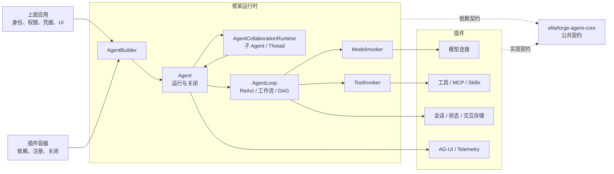

| 模块 | 职责 |
|---|---|
| `eliteforge-agent-core` | 定义模型、工具、状态、交互、协作和事件契约 |
| `eliteforge-agent-plugin-kernel` | 排序插件依赖，注册服务，回滚安装，关闭资源 |
| `eliteforge-agent-framework` | 组装 Agent，执行运行循环，管理预算、恢复、协作和关闭 |
| 配套插件 | 实现模型、存储、工具、AG-UI 和遥测 |
| 上层应用 | 实现业务权限、配额、路由、凭据和交互界面 |

## 2. 服务组装

`AgentBuilder` 接受单个插件、`PluginPack` 和 `CapabilityPack`。`build().await` 统一处理依赖、
安装、就绪回调和运行时构造。

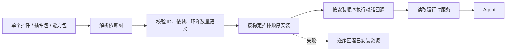

`CapabilityPack` 只创建已选能力。未选能力不运行构造函数，也不创建业务对象。

| 数量语义 | 注册 | 读取 | 示例 |
|---|---|---|---|
| 唯一服务 | `provide(T)` | `get<T>()` | `StateStore`、`ModelSelectionStrategy` |
| 多个贡献 | `contribute(T)` | `all<T>()` | `ToolProvider`、中间件、`EventSink` |

同一类型不能同时使用两种数量语义。详见 [插件与扩展点](plugins.md) 和
[能力包与自动装配](capability-packs.md)。

## 3. 执行模型

一次执行由四层组成：`Agent` 管理运行外壳，`AgentLoop` 推进状态机，调用器约束外部调用，
存储服务保存可恢复状态。

### 3.1 运行身份

| 身份 | 语义 |
|---|---|
| `session_id` | 上层应用定义的会话。同一 Agent 实例内同时只有一个活动运行 |
| `run_id` | 一次逻辑运行。恢复时保持不变 |
| `execution_id` | 一次实际执行尝试。每次 `start()` 都生成新值 |
| `ToolCall.invocation_id` | 框架分配的工具调用身份，跨审批、执行和恢复保持稳定 |
| `RunLineage` | 记录子 Agent 树的根运行、父运行和嵌套深度。独立 Thread 不进入该树 |

### 3.2 运行生命周期

`Agent::start` 先完成同步准入，再启动异步执行。

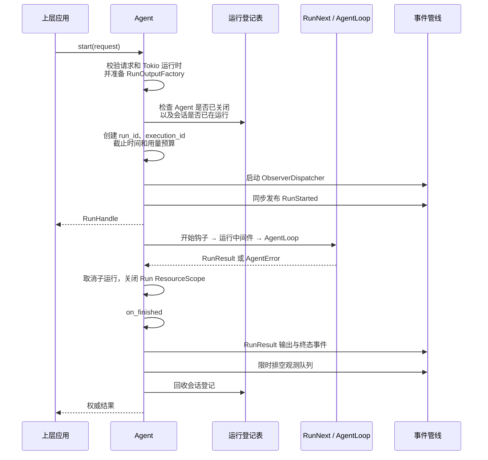

运行具有以下保证：

- `start()` 返回前已发布 `RunStarted`。
- `RunNext` 同时监听取消信号和截止时间。截止时间是本次执行允许运行到的最晚时刻。
- 执行停止后，`RunNext` 最多再等待 `cleanup_timeout` 指定的时间，让中间件和运行循环完成协作清理。
- 丢弃 `RunHandle` 会取消运行；丢弃 `RunControl` 不会。
- `RunLifecycleHook` 只观察开始和结束；`RunMiddleware` 才能包裹执行。

### 3.3 执行器

| 执行器 | 控制流 | 持久化依赖 |
|---|---|---|
| `ReactAgentLoop` | 单阶段模型—工具循环 | `StateStore`、`ConversationStore`、`InteractionStore` |
| `WorkflowLoop` | 多个串行 ReAct 阶段 | `StateStore`、`InteractionStore` |
| `DagWorkflowLoop` | 节点、并行、分支、汇合和节点恢复 | `StateStore`；内置 ReAct 节点还需要 `InteractionStore` |
| 自定义 `AgentLoop` | 由实现定义 | 由实现声明 |

### 3.4 ReAct 与工作流

`ReactAgentLoop` 和 `WorkflowLoop` 共用 `ModelExecutionLoop`。前者读写完整会话；后者把消息记录
保存在执行检查点中。两者使用同一恢复协议。

执行检查点记录当前进度、预算和待处理交互。状态存储会为同一个 `run_id` 发放一把带有效期的运行锁，
源码类型为 `ExecutionLease`。它不锁线程；只有获得锁的执行器才能修改该运行的状态。
执行器失联后，锁会自动过期，其他执行器才能接管。每次接管都会生成更大的锁版本号，
因此旧执行器即使恢复，也无法覆盖新状态。

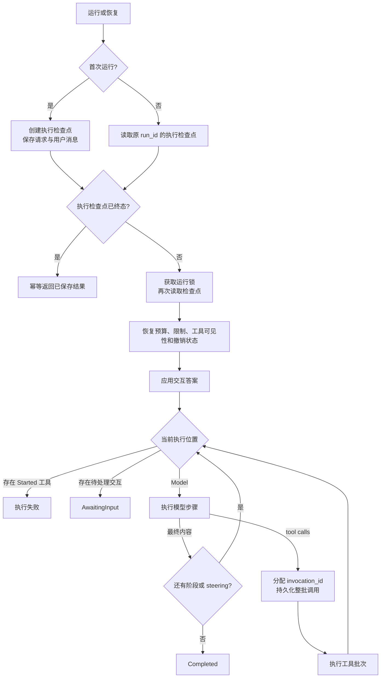

恢复不使用旧内存。执行器先获取运行锁，再重新读取执行检查点。存储只接受当前锁版本的写入，
因此旧执行无法覆盖新状态。
持久化的预算和限制是权威上限；恢复请求只能收紧它们。

### 3.5 模型调用

`ModelInvoker` 每次尝试都重新选择模型并组装上下文。

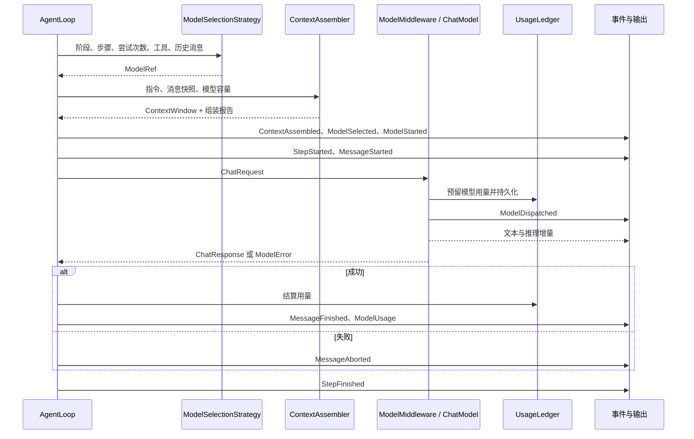

| 结果 | 处理 |
|---|---|
| 成功 | 校验输出，为工具调用分配框架级 `invocation_id` |
| 短暂错误 | 仅在未输出任何增量且未达重试上限时重试 |
| 上下文溢出 | 仅在未输出增量时重新组装；组装结果未变则失败 |
| 其他错误 | 立即返回，不重放已可见输出 |

`ContextAssembler` 按 `ContextLayout` 组织指令、历史消息和贡献块，再由 `ContextBudgetPolicy`
分配预算、`ContextReducer` 裁剪或摘要。原始会话不会因组装而被改写。

### 3.6 工具执行与大结果转存

工具批次和 `ArtifactStore` 解决不同问题。

| 机制 | 作用 |
|---|---|
| 工具批次 | 先保存执行意图，再调用可能产生副作用的工具 |
| `ArtifactStore` | 把过大的工具结果移出模型上下文，同时保留完整原文 |

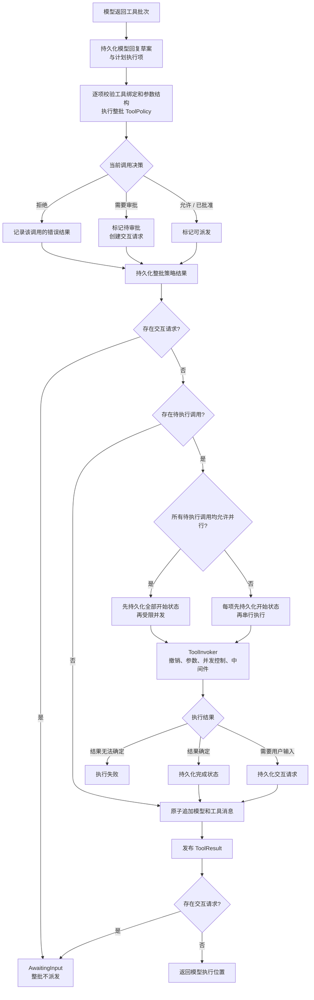

`Deny` 优先于 `RequireApproval`。任一调用等待审批时，整批工具都不派发。
工具派发后发生取消、超时或结果丢失时，运行以取消或错误结束，不自动重放工具。

#### 大结果如何转存

仅注册 `ArtifactStore` 不会改变工具结果。还必须安装 `ToolOutputOffloader` 数据转储中间件，并配置转存阈值。
工具执行完成后，中间件按以下流程处理 `ToolOutput`：

例如，工具返回 10 MB JSON 时，`ArtifactStore` 保存完整的 10 MB；会话只保存预览和
`artifact:<id>`。模型需要更多内容时，再按范围读取。

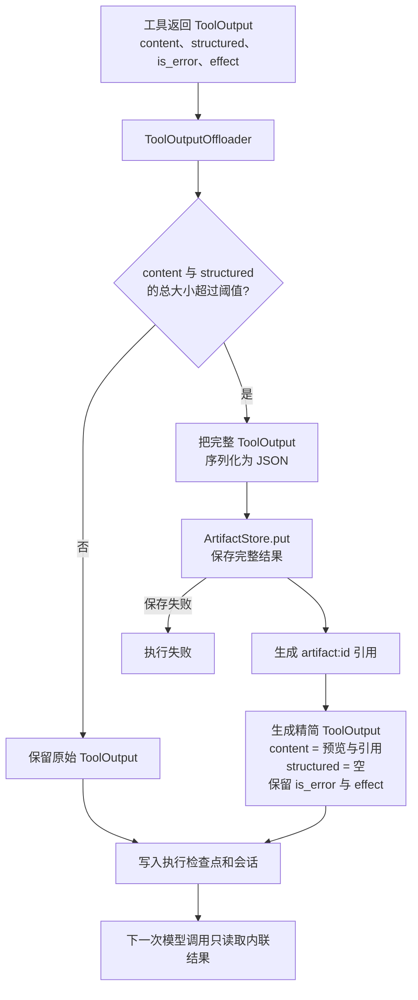

转存完成后，各位置保存的内容不同：

| 位置 | 保存内容 |
|---|---|
| `ArtifactStore` | 完整 `ToolOutput` JSON |
| 执行检查点和会话 | 预览、`artifact:<id>` 引用和 `is_error`；`structured` 为空 |
| 模型可见内容 | 预览与引用；不会自动读取完整结果 |

`result_reference` 保存 `artifact:<id>`、数据类型和字节数。它只是定位信息，不是访问凭据；
上层应用必须为每个 Agent 提供权限范围正确的 `ArtifactStore`。

#### 如何读取完整结果

需要读取原文时，应用必须注册 `ArtifactReadTool`。模型使用引用中的附件 ID 和读取范围调用该工具；
工具从同一个 `ArtifactStore` 分页读取数据。框架不会自动把完整结果重新放回模型上下文。

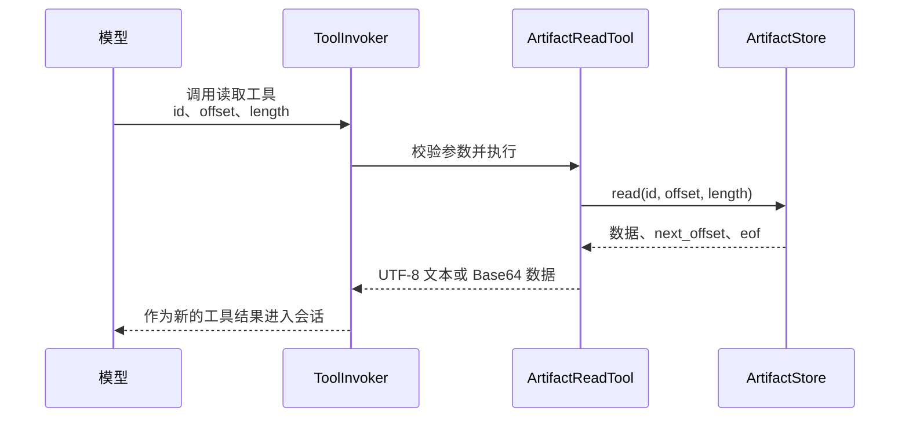

如果 `ArtifactStore.put` 失败，运行以错误结束，已执行的工具不会自动重放。

### 3.7 DAG 调度

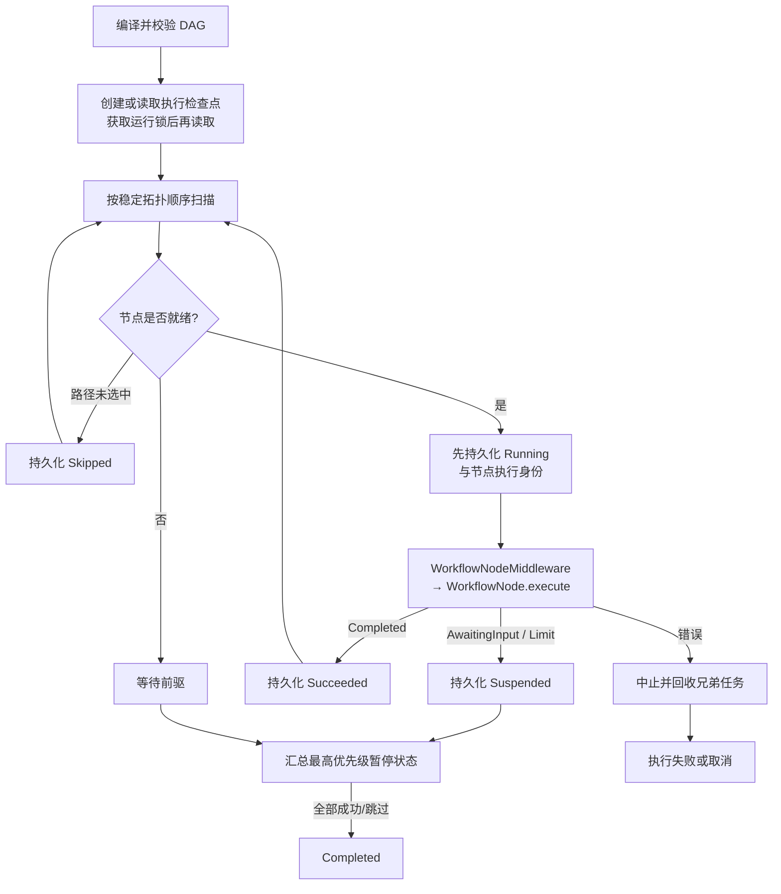

DAG 并发受 `max_parallel_nodes` 限制。内置 ReAct 节点把状态嵌入父 DAG 执行检查点，不单独获取运行锁。

### 3.8 终止状态

`RunFinished` 表示执行器返回了 `RunResult`，不等于任务成功。

| `RunStatus` | 语义 | AG-UI |
|---|---|---|
| `Completed` | 任务完成 | `RUN_FINISHED(success)` |
| `AwaitingInput` | 等待交互答案 | `RUN_FINISHED(interrupt)` |
| `StepLimit` | 模型步数达限，任务未完成 | `RUN_ERROR(AGENT_LIMIT_REACHED)` |
| `ToolCallLimit` | 工具调用数达限，任务未完成 | `RUN_ERROR(AGENT_LIMIT_REACHED)` |

`AgentError::Cancelled` 产生 `RunCancelled`；其他错误产生 `RunFailed`。`ThreadStatus` 保留上表所有状态，
不会把限额或等待输入状态压成 `Completed`。

## 4. 持久化与恢复

会话、运行状态和交互分别存储。实时事件不参与恢复。

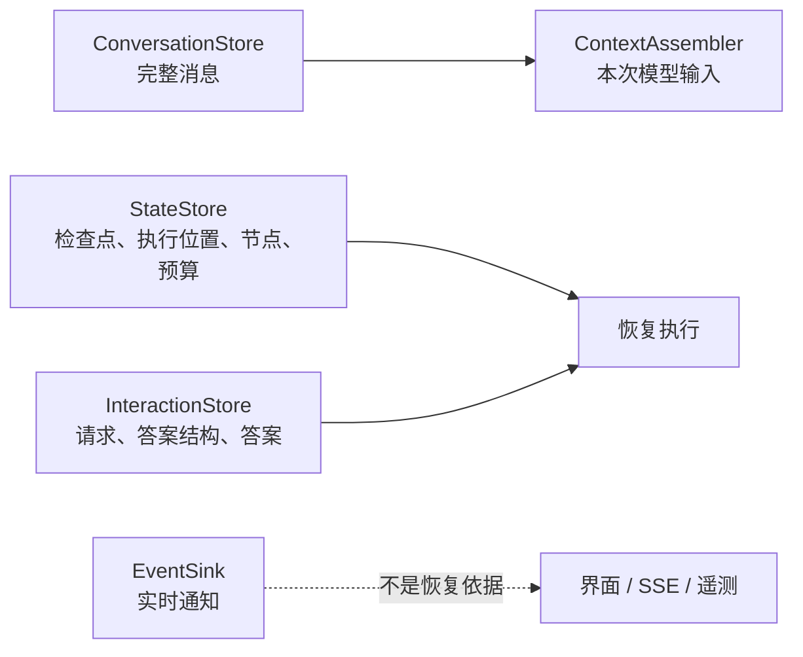

| 存储 | 内容 |
|---|---|
| `ConversationStore` | 完整会话消息。上下文裁剪不改写原始会话 |
| `StateStore` | 执行检查点、执行位置、节点/工具状态、预算和持久化事件日志 |
| `InteractionStore` | 问题、审批、`response_schema`、工具调用和答案 |
| `SummaryStore` | 由历史生成的上下文摘要；不替代原始会话 |
| `ArtifactStore` | 大结果和附件引用 |

运行锁解决一个问题：同一 `run_id` 不能被两个执行器同时修改。

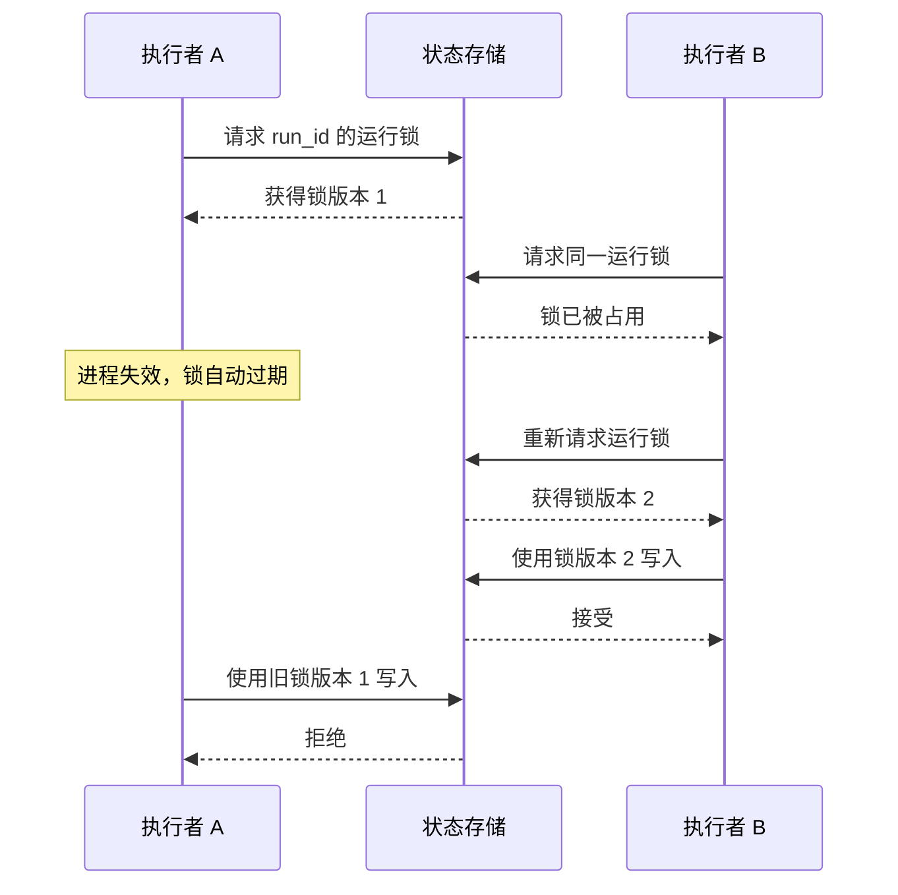

存储写入被取消时，框架不猜测事务是否已提交。再次执行时重新读取检查点；
若发现已开始但未保存结果的工具，运行以错误结束。

## 5. 用户交互

交互记录用于工具审批和运行中问答。回答先持久化，恢复再启动。

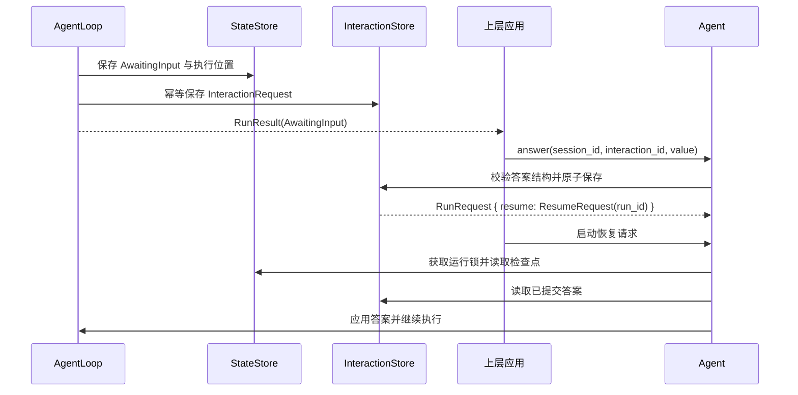

`Agent::answer` 只保存答案并返回带 `ResumeRequest` 的 `RunRequest`。调用方必须再次调用 `start()`。
这个边界使恢复失败可重试，而不重复提交答案。详见 [用户交互](interactions.md)。

## 6. Agent 协作

框架提供两种协作语义。

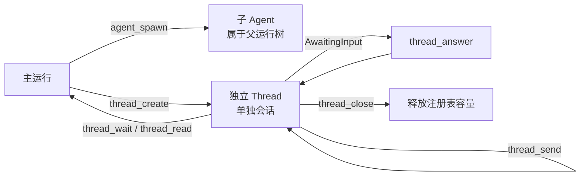

| 语义 | 子 Agent | Thread |
|---|---|---|
| 用途 | 一次性委派 | 后台、长时间或多轮任务 |
| 等待 | `agent_spawn` 同步等待 | 创建后后台运行，使用 `thread_wait` 等待 |
| 身份 | 进入父运行 `RunLineage` | 使用独立会话，不进入父子运行树 |
| 取消 | 继承父运行的取消信号和剩余运行时间 | 不继承发起运行的取消信号和截止时间；`Agent::close` 仍会关闭它 |
| 预算 | 占用父运行预算，由父运行分配预算 | 使用跟新开会话一样的独立预算 |
| 交互 | 没有单独的会话记录，结束后无法后续恢复 | `thread_answer` 恢复原 `run_id` |
| 结果 | 返回完整 `RunResult` | `thread_wait` 返回完整 `ThreadResult` |

### Thread 状态转换

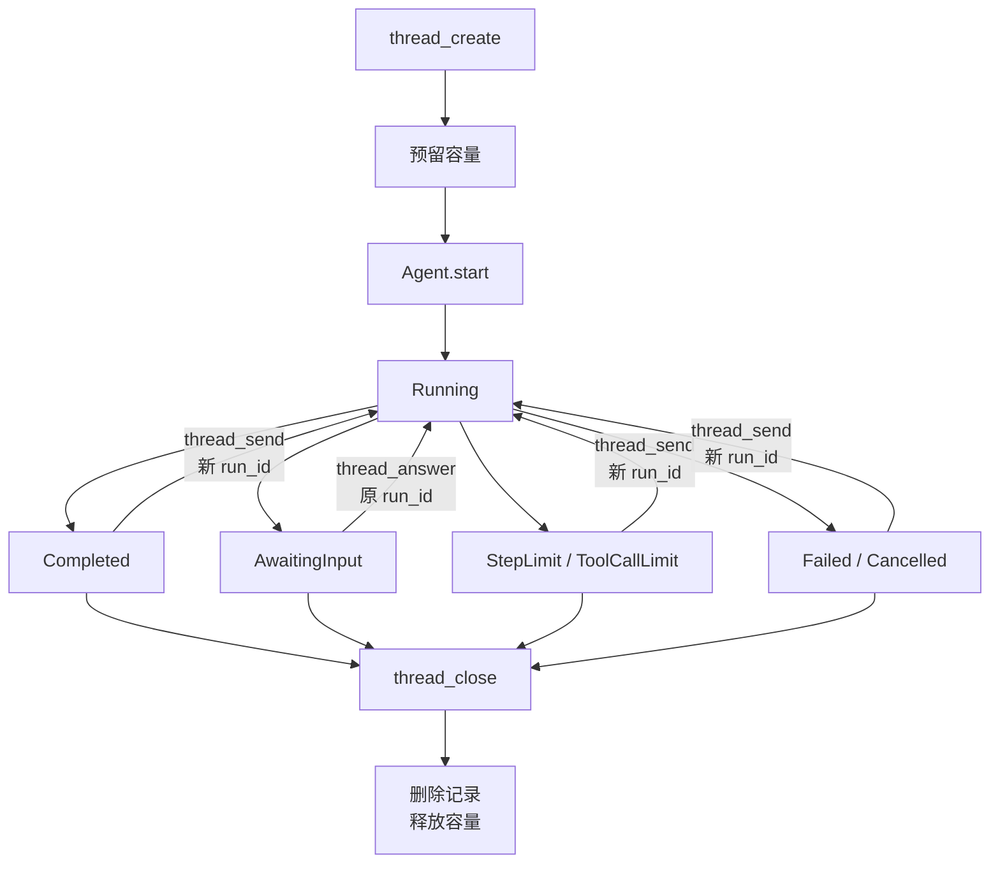

默认 Thread 运行时具有以下语义：

- `thread_create` 在 `Agent::start` 前预留容量；启动失败自动退还。
- 同一 Thread 的发消息和回答操作串行执行；活动运行期间拒绝新操作。
- `AwaitingInput` 只允许 `thread_answer`，不允许 `thread_send` 绕过答案结构校验。
- 旧运行只有在自己仍是 `latest_run_id` 时才能更新 Thread 摘要。
- 进程内 Thread 注册表上限为 128，运行结束不自动删除记录；`thread_close` 显式释放容量。
- Thread 注册信息仅存在当前进程。跨进程任务应替换 `AgentCollaborationRuntime`。

子 Agent 和 Thread 结果都保留 `content`、`structured`、`interactions`、`status`、`usage`、`steps` 和
`tool_calls`。详见 [Agent 协作](collaboration.md)。

## 7. 事件与 AG-UI

实时事件使用 `(run_id, EventScope::Live { execution_id }, sequence)` 定位。持久化事件日志使用独立序列。

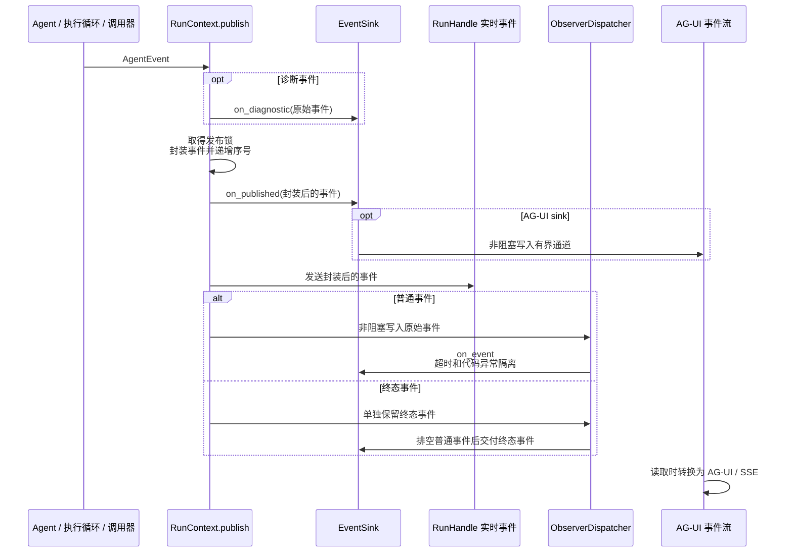

| 入口 | 语义 |
|---|---|
| `on_diagnostic` | 同步记录上下文组装和模型派发诊断；不保证跨生产者顺序 |
| `on_published` | 按实时发布顺序交接封装后的事件；必须快速，不得进行 I/O 或再次发布 |
| `on_event` | 有界、尽力的异步观测；队列满时可丢失普通事件 |

AG-UI 为每次执行尝试创建独立的有界通道。溢出、超大事件或顺序错误会终止输出流，
但不会取消 Agent。权威结果仍来自 `RunHandle::wait`。

| 协作事件 | AG-UI 映射 |
|---|---|
| 子 Agent 开始/结束/失败 | `SUBAGENT_STARTED / SUBAGENT_FINISHED / SUBAGENT_ERROR` |
| 子 Agent 暂停交互 | `framework.subagent.interactions` CUSTOM |
| Thread 创建/运行/结束/关闭 | `framework.thread.*` CUSTOM |

Thread 不是子运行，因此不映射为 AG-UI `SUBAGENT_*`。协作生命周期事件不包含任务正文、
Thread 消息或用户答案。详见 [AG-UI](agui.md)。

## 8. 资源关闭

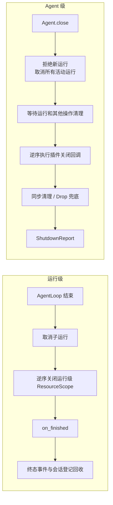

`Agent::close` 在所有 Agent 副本之间共享一次关闭。它先等待运行清理，再关闭插件容器。
插件创建的 SQLite 和 MCP 连接在此阶段释放；外部注入的共享组件仍由其所有者管理。

## 实现索引

| 主题 | 主要实现 | 详细文档 |
|---|---|---|
| Agent 组装、运行和 Thread 运行时 | [agent.rs](../crates/framework/eliteforge-agent-framework/src/agent.rs) | [快速上手](quickstart.md) |
| ReAct / 工作流状态机 | [model_execution.rs](../crates/framework/eliteforge-agent-framework/src/model_execution.rs) | [执行约束](execution-contracts.md) |
| DAG 调度 | [dag.rs](../crates/framework/eliteforge-agent-framework/src/dag.rs) | [DAG 工作流](dag-workflows.md) |
| 模型选择与调用 | [models.rs](../crates/framework/eliteforge-agent-framework/src/models.rs) | [模型插件](model-plugins.md) |
| 工具/模型中间件与 `ToolInvoker` | [middleware.rs](../crates/framework/eliteforge-agent-core/src/middleware.rs) | [中间件与钩子](extensions.md) |
| 交互契约 | [interaction.rs](../crates/framework/eliteforge-agent-core/src/interaction.rs) | [用户交互](interactions.md) |
| 协作契约 | [collaboration.rs](../crates/framework/eliteforge-agent-core/src/collaboration.rs) | [Agent 协作](collaboration.md) |
| 事件发布与观测 | [types.rs](../crates/framework/eliteforge-agent-core/src/types.rs)、[observers.rs](../crates/framework/eliteforge-agent-core/src/observers.rs) | [可观测](observability.md) |
| AG-UI 转换 | [adapter.rs](../crates/plugin/eliteforge-agent-official-plugin-agui/src/adapter.rs) | [AG-UI](agui.md) |
