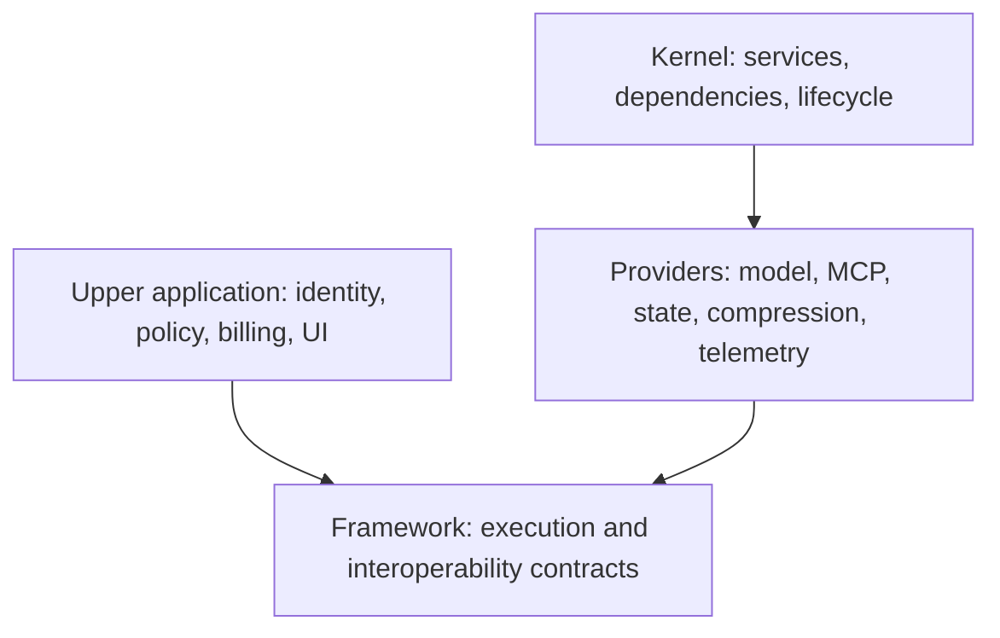

# Framework execution contracts

This framework is independent of any upper application. Upper applications resolve identity,
permissions, subscription ownership and business configuration before assembling
an agent. Tron is one consumer, not a compatibility target.

## Layers

The core defines messages, model/tool invocations, context composition, run state,
interactions and events. Plugins implement these contracts. Execution strategies
compose the same invokers; they must not bypass validation, cancellation, budgets
or tool policy. There are no upper-application workspace or scope types in the core.

## Invariants

1. Messages have ordered typed content. Text is a convenience constructor, not
   the canonical representation of every modality. Unsupported content fails
   explicitly at adapter boundaries; it must never disappear silently.
2. A model connection owns shared transport/authentication. Selection is per
   invocation and sees stage, attempt and capability requirements. Provider types
   and credentials do not enter serializable framework contracts.
3. Interceptors are ordered. Requests travel forward and responses unwind in
   reverse. Observers cannot grant permission. Tool policy runs before effects.
4. Context is composed for each model step. Trusted instructions and untrusted
   retrieved material remain distinguishable. Context reduction never rewrites
   the source transcript. Tool calls, results and provider continuation data form
   indivisible protocol exchanges.
5. Built-in executor run identity survives process restart. Durable state uses compare-and-swap
   revisions and session ownership. Stale executors cannot commit progress.
6. In built-in executors, tool intent is persisted before execution. Result persistence follows each
   execution. A crash between these writes leaves an explicit uncertain call;
   resumption cannot blindly repeat a side effect. Exactly-once external effects
   require cooperation from the external tool (for example an idempotency key).
7. A durable interaction has a stable ID, schema and resume position. Approval binds to
   the exact pending invocation. A free-text message does not approve a tool.
8. Cancellation propagates through model, tool and child execution. Cleanup is
   bounded and asynchronous where needed, with synchronous Drop fallbacks.
9. Streaming output is provisional until the model turn validates. Once output
   has been emitted, automatic retries must not duplicate it. Raw observation is
   distinct from durable execution state and reliable event replay.
10. Budgets are explicit: context capacity, accumulated model usage, execution
    steps, tool count, concurrency and elapsed time have separate meanings.

## Required delivery and evidence

This is the acceptance scope, not a completion claim. The implementation report
must link actual tests for every item before the work is considered complete.

| Area | Required implementation and verification |
| --- | --- |
| Messages/results | Ordered text/media/resource content, structured tool results, generation options, JSON Schema validation; serialization and real adapter wire tests |
| Extension points | Separate lifecycle hooks and run/node/model/tool interception, per-step context; order, denial, failures, cancellation and untrusted-context tests |
| State | Separate transcript/context/checkpoints, exclusive ownership and revision checks, durable tool journal and typed interaction resume; reopen, stale-write, ambiguous-effect tests |
| Strategies | Simple conversation, tools, configurable stages, human approval and child agents; real invoker paths with varying inputs, budgets and cancellation |
| DAG workflows | Versioned serializable graphs, cycle validation, node plugins, selected/all joins, bounded owned tasks, shared admission, durable routing/results and node reconciliation; parallel, fault injection, reopen and real process-crash tests |
| genai | Multi-model shared connection, options/content conversion, signed continuation roundtrip; local HTTP/SSE protocol fixtures |
| MCP | Official SDK transport, discovery/pagination, structured results, cancellation and lifecycle; actual local protocol client/server tests |
| Persistence | SQLite reference implementation, atomic writes and conflict semantics; reopen and competing-connection tests |
| Compression | Configurable model-backed compression, protected recent turns, artifacts, unchanged source transcript; budget and failure tests |
| Observability | Structured tracing and export integration without recording sensitive prompts by default; collected telemetry and lifecycle tests |

Unit and local protocol tests cannot establish live provider compatibility. Live
Anthropic testing is unavailable until the upper application supplies an account. That limit
must remain explicit and must not be disguised as a passing live integration.
