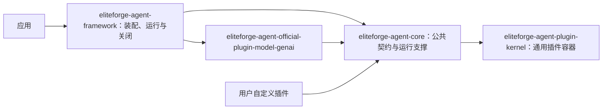

# Plugin 与扩展点

应用创建插件，`AgentBuilder::plugin(...)` 收集插件，`build().await` 按依赖顺序安装并校验服务。`GenaiPlugin`、`SqliteStoragePlugin`、`McpToolsPlugin` 都是插件；`GenaiChatAdapter` 是插件内部的模型协议实现。



箭头表示生产依赖。插件的集成测试和示例可以通过 dev-dependency 使用 Framework。`eliteforge-agent-core` 重新导出 `Plugin`、`PluginContext`、`PluginError`，自定义插件只需依赖 Core；Kernel 不依赖 Core，也不包含模型、Agent 或宿主业务类型。

## 默认装配

| 配置项 | 默认行为 | 显式配置场景 |
|---|---|---|
| 执行循环 | ReAct | 串行工作流、DAG、自定义循环 |
| Chat 模型插件 | 默认启用 `genai` feature；需要 Chat 且没有自定义连接时安装 Genai | 自定义适配器，或 `.default_models(false)` |
| 连接名 | `default` | 多账户、多个端点或独立连接 |
| 模型 ID | 从 `MODEL` 读取；不硬编码商业模型 | `GenaiPlugin::new(model)` 或请求指定模型引用 |
| 协议 | OpenAI Chat Completions | Responses、Anthropic、Gemini、Ollama 等 |
| endpoint | 协议预设地址 | 代理、兼容服务、私有部署 |
| auth | 对应供应商的凭据环境变量 | 自定义凭据来源 |
| Embedding | 仅注册显式配置的模型 | `.embedding_model(model)` 或环境变量 `EMBEDDING_MODEL` |
| 工具、上下文、事件 | 空工具、空固定上下文、NoopEvents | MCP、上下文块、遥测等 |
| 持久化存储 | 显式安装 | `SqliteStoragePlugin::new(path)` |

自动 Genai 读取 `MODEL`、可选 `EMBEDDING_MODEL`、`MODEL_ENDPOINT`、`MODEL_API_KEY` 和 `MODEL_ADAPTER`。`MODEL_ADAPTER` 可取 `openai`、`openai-responses`、`anthropic`、`gemini`、`ollama`、`cohere`；默认 `openai`。未设置 `MODEL_API_KEY` 时使用供应商预设变量，例如 `OPENAI_API_KEY`。这些环境配置只在安装自动插件或 `GenaiPlugin::default()` 时读取。`GenaiPlugin::new(model)` 使用显式 builder 配置和供应商预设。

自定义 Chat 连接已注册时，自动插件不读取上述环境变量，也不添加第二个 Chat 连接。`default-features = false` 可以从 Framework 的生产依赖中移除 Genai。需要的模型或存储缺失时，构建返回配置错误。

```rust
use eliteforge_agent_framework::{AgentBuilder, RunRequest};
use eliteforge_agent_official_plugin_storage_sqlite::SqliteStoragePlugin;

// MODEL 和 OPENAI_API_KEY 已配置；GenaiPlugin 自动装配。
let agent = AgentBuilder::new()
    .plugin(SqliteStoragePlugin::new("agent.sqlite"))
    .build().await?;
let result = agent.run(RunRequest::new("chat", "你好")).await;
agent.close().await;
println!("{}", result?.output);
```

需要显式配置时，直接创建插件：

```rust
use eliteforge_agent_official_plugin_model_genai::{GenaiPlugin, AdapterKind, AuthData};

let plugin = GenaiPlugin::new("chat-model")
    .connection("gateway")
    .adapter(AdapterKind::OpenAIResp)
    .endpoint("https://gateway.example/v1/")
    .auth(AuthData::from_env("GATEWAY_KEY"))
    .embedding_model("embedding-model");
let builder = AgentBuilder::new().plugin(plugin);
```

高级场景可先配置 `GenaiChatAdapter` 的共享 SDK client、超时、代理和 TLS，再使用 `GenaiPlugin::from_adapter(adapter, models)`。普通接入不需要构造 Adapter 或 ModelConnection。

## 模型能力

扩展点按操作定义，输入模态单独声明。没有统一的 `ModelProvider::generate`。

| 操作 | Core 扩展点 | 注册类型 | 应用调用 |
|---|---|---|---|
| 对话与工具调用 | `ChatModel` | `ModelConnectionService` | `Agent::run(RunRequest)` |
| 向量化 | `EmbeddingModel` | `EmbeddingModelService` | `agent.models().embed(...)` |
| 重排序 | `RerankModel` | `RerankModelService` | `.rerank(...)` |
| 生成图片 | `ImageGenerationModel` | `ImageGenerationModelService` | `.generate_image(...)` |
| 生成视频 | `VideoGenerationModel` | `VideoGenerationModelService` | `.submit_video(...)` / `.query_video(...)` / `.cancel_video(...)` |
| 语音识别 | `SpeechRecognitionModel` | `SpeechRecognitionModelService` | `.transcribe(...)` |
| 语音合成 | `SpeechSynthesisModel` | `SpeechSynthesisModelService` | `.synthesize(...)` |
| 实时会话 | `RealtimeModel` / `RealtimeSession` | `RealtimeModelService` | `.connect_realtime(...)` |

所有注册类型都是多贡献角色，可以注册多个实现。唯一键为 `(connection, model, operation)`；重复绑定在 build 时失败。同名模型可以分别提供 Chat 和 Embedding，不会混用请求格式。Chat 连接还可以为单个模型设置独立的 Adapter 和协议。

上述操作有各自的数据结构和实际调度路径。随仓库提供的 Genai 插件实现 Chat，以及 OpenAI、Gemini、Cohere 的文本 Embedding。Rerank、图片生成、视频生成、语音和实时会话由自定义能力插件提供；Framework 的运行时和测试覆盖这些扩展点，Genai 不会宣称或注册 SDK 没有提供的能力。

`ChatRequest` / `ChatResponse` 是 Framework 与模型适配器之间的协议无关格式。`RunRequest` / `RunResult` 是上层应用与 Agent 的交互格式。Embedding 等独立操作使用自己的 Request / Response，不通过 Chat 模拟。

## 选择模型

```text
请求指定 connection/model
          ↓ 未指定
当前操作的阶段规则
          ↓ 未设置
当前操作的默认模型
          ↓ 未设置
唯一满足输入能力的模型
          ↓ 没有或不唯一
明确返回错误
```

Chat 请求使用 `RunRequest.model` 和 `model_stage`；其他操作使用 `request.choice.model` 和 `request.choice.stage`。显式选择不兼容或未注册模型会失败，不会静默切换。最终组成的 ChatRequest 在中间件之后再次检查能力、工具权限和预算。

```rust
use eliteforge_agent_framework::*;

let routing = ModelRouting::default()
    .default_for(ModelOperation::Chat, ModelRef::new("gateway", "chat-model"))
    .default_for(ModelOperation::Embedding, ModelRef::new("gateway", "embedding-model"))
    .stage_for(ModelOperation::Chat, "review", ModelRef::new("gateway", "review-model"));
let builder = AgentBuilder::new().plugin(ModelRoutingPlugin(routing));

let mut request = RunRequest::new("session", "检查代码");
request.model = Some(ModelRef::new("gateway", "review-model"));
```

复杂 Chat 策略可以通过 `ModelStrategyPlugin` 安装 `FixedModelStrategy`、`StageModelStrategy`、`RoutingStrategy` 或自定义实现；显式请求仍然优先。只有配置 Chat 的有序回退策略才会切换候选模型。已经发布增量内容后，不自动重试。Embedding 等独立操作不自动重试，以免重复收费或改变向量空间。

## 多模态与协议

Chat 的文字、图片、音频、视频输入都由有序 `ContentBlock` 表达。模型用 `ModelDescriptor::with_input_modalities(...)` 声明能力，默认仅文本。图片/视频理解属于 Chat 输入能力，图片/视频生成属于独立操作。

```rust
let plugin = GenaiPlugin::empty()
    .adapter(AdapterKind::Gemini)
    .chat_model(ModelDescriptor::new("multimodal-model")
        .with_input_modalities([Modality::Text, Modality::Image, Modality::Audio, Modality::Video]));
```

模型声明还受 Adapter 实际支持范围约束。当前 Genai 对 Gemini 传递原生图片、音频和视频块；OpenAI、Responses、Anthropic、Ollama 的 Chat 路径开放文本和图片。媒体预算需要 `estimated_tokens` 或连接自定义 TokenEstimator。`ResourceReference` 只是资源引用，是否读取由宿主显式决定，不能据此声称模型已理解资源内容。

协议属于模型操作绑定。一个 Genai 连接中，Chat 可以使用 Responses，Embedding 仍调用 Embeddings endpoint；同连接不同 Chat 模型也可使用不同协议：

```rust
use eliteforge_agent_official_plugin_model_genai::OpenAiChatProtocol;
let plugin = GenaiPlugin::new("chat-model")
    .chat_model_with_protocol(ModelDescriptor::new("responses-model"), OpenAiChatProtocol::Responses)
    .embedding_model("embedding-model");
```

`ModelMessageContext` 保存模型原生 continuation，绑定连接、模型、协议和格式版本。只有完全匹配的绑定才能重放原生数据；切换模型或协议时使用公共消息内容，不把签名和私有状态跨协议复用。

## Embedding 与索引

```rust
let mut request = EmbeddingRequest::texts(["第一段文字", "第二段文字"]);
request.choice.model = Some(ModelRef::new("gateway", "embedding-model"));
request.dimensions = Some(1024);
let vectors = agent.models().embed(request).await?;
```

批量结果校验数量、输入索引、维度和有限数值，并按输入顺序返回。缺失用量保持 `None`。`EmbeddingPurpose` 区分 Query、Document 和 Similarity，Adapter 负责映射供应商的任务类型。

持久化向量索引还应记录 `EmbeddingSpace { model, revision, dimensions, preprocessing }`，并通过插件贡献 `EmbeddingSpaceService(space)`。查询使用 `embed_query(&space, request)`；运行时要求模型绑定及四项配置完全一致。框架不会自动更换向量模型、执行预处理或验证远端可变别名实际指向的权重；宿主应使用固定版本并按声明完成预处理。

## 调用控制和生命周期

独立模型操作支持 `ModelInvocationOptions` 的超时、取消、输入字节上限和批量上限。WorkflowNode 通过 `services.operations.with_options(ModelInvocationOptions::for_run(context, limits))` 共享运行取消；Embedding 同时使用运行 token 预算和持久化预留，未知用量保守记账。图像、视频和语音的计费单位没有折算成 Chat token。

Agent 关闭时停止接收新模型操作、取消在途请求并等待它们释放，随后关闭插件。取消本地 HTTP 请求不能撤销远端已执行的操作。视频返回包含模型、协议和 job ID 的可序列化句柄；查询和取消始终使用原绑定。视频取消仅在能力声明支持时调用。实时会话有独立的输入、事件、关闭接口，关闭 Agent 或丢弃会话会触发适配器的取消信号。

## 自定义插件

```rust
use eliteforge_agent_core::{Plugin, PluginContext, PluginError, EmbeddingModelService, ModelRef};
use async_trait::async_trait;
use std::sync::Arc;

struct MyEmbeddingPlugin;
#[async_trait]
impl Plugin for MyEmbeddingPlugin {
    fn id(&self) -> &str { "my.embedding" }
    async fn install(&self, context: &mut PluginContext<'_>) -> Result<(), PluginError> {
        // MyEmbeddingAdapter 实现 eliteforge_agent_core::EmbeddingModel。
        context.contribute(EmbeddingModelService::new(
            ModelRef::new("local", "my-embedding-model"), Arc::new(MyEmbeddingAdapter),
        ).protocol("my-provider/embed"))
    }
}
```

`provide(T)` 用于唯一角色，`contribute(T)` 用于多个贡献；同类型不能混用。插件可以声明依赖并注册资源清理回调。安装失败会回滚，正常关闭按依赖逆序清理。不要在 `install` 中开始业务模型调用。

## 其他扩展点

| 领域 | 公共契约 / 注册入口 | 配套实现 |
|---|---|---|
| 执行循环 | `AgentLoop` / `AgentLoopPlugin` | ReAct、WorkflowLoop、DagWorkflowLoop |
| 工作流节点 | `WorkflowNode` / `WorkflowNodePlugin` | ReactWorkflowNode、自定义节点 |
| 工具 | `Tool`、`ToolProvider` / `ToolProviderPlugin` | StaticToolProvider、MCP、人类交互 |
| 工具策略 | `ToolPolicy` / `ToolPolicyPlugin` | 审批、自定义规则 |
| 会话 | `ConversationStore` / `ConversationStorePlugin` | SQLite |
| 执行状态 | `StateStore` / `StateStorePlugin` | SQLite checkpoint、journal、租约 |
| 用户交互 | `InteractionStore` / `InteractionStorePlugin` | SQLite、HumanInteractionPlugin |
| 长期记忆 | `LongTermMemory` / `LongTermMemoryPlugin` | SQLite 检索与记忆工具 |
| 上下文 | ContextContributor、ContextLayout、ContextBudgetPolicy、ContextReducer、ContextAssembler | 固定块、历史、摘要、附件 |
| 执行拦截 | RunMiddleware、ModelMiddleware、ToolMiddleware、WorkflowNodeMiddleware | 遥测、转存、自定义拦截 |
| 生命周期通知 | RunLifecycleHook | 自定义通知 |
| 事件展示 | EventSink / EventPlugin | TelemetryPlugin、AgUiPlugin |

官方插件包使用 `eliteforge-agent-official-plugin-*` 命名；其他模块使用 `eliteforge-agent-*` 命名，通用插件内核为 `eliteforge-agent-plugin-kernel`；`eliteforge-agent-context`、`eliteforge-agent-memory`、`eliteforge-agent-state-sqlite` 是可复用组件库，组合插件为 `eliteforge-agent-official-plugin-storage-sqlite`。宿主的身份、授权、Space/Platform、配置继承和额度套餐不进入 Core 或 Kernel。
