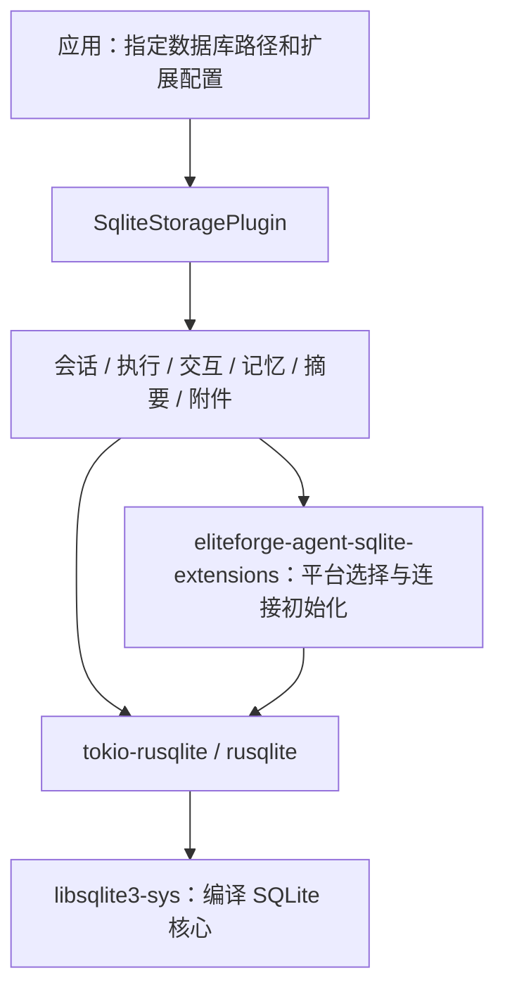

# SQLite 存储与平台适配

默认存储插件使用 SQLite 持久化。SQLite 本体和 SQLite 原生扩展分别处理：

| 层次 | 实现 | 平台差异如何处理 |
|---|---|---|
| SQLite 本体 | `rusqlite` 的 `bundled` 模式 | `libsqlite3-sys` 用目标 C 工具链编译 SQLite 源码；交叉编译需要对应工具链 |
| 中文分词、向量扩展 | 独立包 `eliteforge-agent-sqlite-extensions` | 按编译目标选择 `sqlite-simple`、`sqlite-vec` 动态库，逐连接加载 |
| 数据保存 | `eliteforge-agent-memory`、`eliteforge-agent-state-sqlite`、`eliteforge-agent-context` | 实现会话、状态、交互、长期记忆、摘要和附件存储 |
| 插件装配 | `eliteforge-agent-official-plugin-storage-sqlite` | 打开连接、初始化扩展、注册存储服务、关闭连接 |
| 执行 | `eliteforge-agent-framework` | 只使用存储抽象，不依赖 SQLite |

SQLite 核心的构建说明见 [rusqlite](https://github.com/rusqlite/rusqlite#notes-on-building-rusqlite-and-libsqlite3-sys)。
通常不需要再封装一层“不同 CPU 的 SQLite 驱动”；已有驱动负责这部分。



## 从 Tron 提取的部分

`eliteforge-agent-sqlite-extensions` 来自 Tron 的 `shared/eliteforge_agent_sqlite_extensions.rs`，保留扩展加载模式、
平台识别和能力探测。它不读取 `TRON_*` 环境变量，也不依赖 Tron 源码目录或业务表。

- 固定资源版本：`sqlite-simple v0.7.1`、`sqlite-vec v0.1.9`，保留许可证。
- 资源随包分发，编译时只嵌入目标平台的动态库；运行时从嵌入字节生成缓存文件。
- simple 资源已从对应上游发行包补齐，并与 Tron LFS 指针中的 SHA-256 核对。
  构建时校验 `resources/SHA256SUMS`，缺文件、LFS 指针或内容变化会导致构建失败。
- 缓存按内容哈希区分版本，使用临时文件原子发布，检查已有文件完整内容。
- 每个物理连接独立初始化。加载结束关闭扩展加载开关；失败通过错误或能力报告返回。

当前包与工作区统一使用 `rusqlite 0.37`。Tron 使用的 `rusqlite 0.32` 在后续接入这个包时
需要同步对齐，避免多个不同版本的 `libsqlite3-sys` 争用同一个 native link。此次未修改 Tron。

## 普通存储

会话、问答、审批等记录不需要中文分词或向量扩展。默认组合插件不加载这些原生资源：

```rust
let agent = AgentBuilder::new()
    .plugin(eliteforge_agent_official_plugin_storage_sqlite::SqliteStoragePlugin::new("agent.sqlite"))
    .plugin(eliteforge_agent_official_plugin_model_genai::GenaiPlugin::from_adapter(provider, models))
    .build()
    .await?;
```

这一次配置提供六种存储抽象，共用一个文件。执行与交互共用一个连接，其余存储各有连接。
默认会话不按空闲时间删除；条数和字节限制仍会阻止无限增长。附件默认不自动删除。
应用显式指定路径，不接受 `:memory:`，也不会在配置缺失时回退到内存。

## 开启分词和向量扩展

先为存储插件开启打包 feature：

```toml
eliteforge-agent-official-plugin-storage-sqlite = { path = "../eliteforge-agent-framework/crates/plugin/storage/eliteforge-agent-official-plugin-storage-sqlite", features = ["bundled-native"] }
```

再配置加载方式：

```rust
use eliteforge_agent_official_plugin_storage_sqlite::{
    ExtensionConfig, ExtensionMode, ReadSqliteCapabilities, SqliteStoragePlugin,
};

let mut extensions = ExtensionConfig::new("private-data/sqlite-native");
extensions.simple = ExtensionMode::Required;
extensions.vector = ExtensionMode::Preferred;

let agent = AgentBuilder::new()
    .plugin(SqliteStoragePlugin::new("agent.sqlite").with_extensions(extensions))
    .plugin(eliteforge_agent_official_plugin_model_genai::GenaiPlugin::from_adapter(provider, models))
    .build()
    .await?;

let capabilities = agent.execute(ReadSqliteCapabilities).await?;
for (store, report) in &capabilities {
    println!("{store}: simple={:?}, vector={:?}", report.simple, report.vector);
}
```

`Disabled` 不加载，`Preferred` 允许不可用并返回原因，`Required` 失败时中止安装并释放连接。
缓存目录由应用管理，应禁止不可信进程写入。

启用扩展只代表数据库连接具备相关 SQL 功能。默认 `SqliteLongTermMemory` 仍使用关键词检索，
不会自动创建向量索引或切换排序。分词索引、Embedding 生成和向量检索由相应存储或检索插件实现。

单独使用包时，对每个 `rusqlite::Connection` 调用 `ExtensionConfig::prepare_connection`；
异步存储实现通过 `SqliteExtensionHost::prepare_extensions` 在自身数据库线程中完成初始化。

## 平台与验证范围

平台选择同时考虑 OS、CPU、运行环境和 ABI；Linux musl 不套用 glibc 动态库，iOS 模拟器
与设备分别选择资源。各平台可用的扩展不完全相同，没有匹配资源时明确返回不可用。
32 位 Android ARM 暂未启用，避免把通用 ARM 目标误判为 ARMv7。
Linux 资源来自上游 Ubuntu 构建，除架构匹配外还依赖目标系统的 libc、C++ 运行库版本。
iOS 资源虽然保留，应用签名及动态库装载限制仍需在目标应用中验证。

本次在 macOS arm64 实际验证了中文 FTS 查询、向量函数、多连接初始化及数据库重开。
其余平台完成资源哈希及选择逻辑检查，尚未在对应系统运行。构建不需要联网下载扩展。
