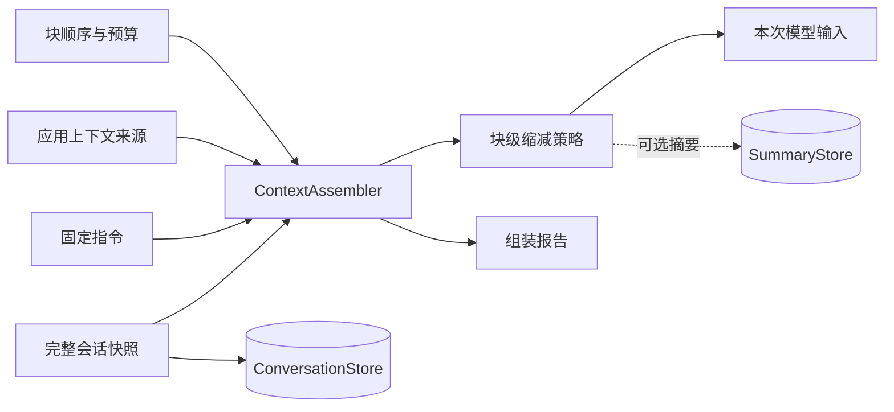

# 上下文与会话技术设计

## 1. 目标与边界

会话存储保存完整、可恢复的对话记录；上下文组装器根据当前模型容量和应用配置，生成单次模型调用所需的消息。裁剪、摘要和数据筛选只影响模型输入，不会删除或改写会话原文。

上下文窗口由以下部分组成：



Framework 定义会话、上下文来源、预算、组装和缩减接口；存储插件与上下文插件提供 SQLite、摘要、记忆和附件等实现。上层应用负责选择存储位置、模型、上下文来源、块顺序、额度及数据保留策略。

## 2. 会话存储模型

`ConversationStore.open(session_id)` 打开主分支，`open_branch(ConversationKey)` 打开指定会话分支。会话通过租约保证同一时刻只有一个有效写入者；`append_at(revision, messages)` 以预期版本追加，版本不匹配或不完整的工具调用批次会被拒绝。

| 字段 | 含义 |
| --- | --- |
| 会话 ID | 应用分配的会话标识 |
| 分支 ID | 同一会话中的独立对话分支 |
| generation | 当前历史生命周期标识；显式过期并重建后会变化 |
| revision | 当前最后一条消息的序号 |
| messages | 原始结构化消息，包括工具调用、结果、结构化输出和协议续接数据 |

消息 ID 由会话、分支、generation 和消息序号确定。新字段缺失的旧消息按空值读取。指定输出 Schema 时，模型可以只返回结构化值；若同时有 JSON 正文和结构化值，两者必须一致。

普通 ReAct 会同时写执行检查点和会话记录：检查点提交后按前缀同步完整消息；进程崩溃后先补齐尚未同步的会话历史，再恢复执行。Workflow 与 DAG 节点的历史由 `TranscriptProjection` 从检查点快照只读投影，节点状态与消息在同一检查点提交，不重复写入独立会话存储。

```rust
let key = ConversationKey::new("chat-1");
let snapshot = agent.conversation(&key).await?;
agent
    .append_conversation(
        &key,
        snapshot.revision,
        vec![Message::user("补充资料")],
    )
    .await?;
```

自定义 DAG 节点可用 `context.conversation_snapshot()` 读取快照，并用 `save_with_conversation(...)` 在一次检查点转换中保存节点状态和完整消息批次。纯计算节点不必接触会话接口；直接使用 ToolInvoker 也不会自动写入会话。

SQLite 会话存储默认最多 1024 个会话、每个会话 2048 条消息和 16 MiB 历史；默认不按空闲时间过期。配置非零 `session_ttl` 后，过期且没有活动租约的会话会在后续打开存储时清理。超过条数或字节限制时追加失败，不裁剪源历史。默认租约为 30 秒，可续期；进程退出后租约到期可重新获取，旧写入者会被拒绝。

## 3. 上下文块与装配顺序

上下文由固定指令块、会话历史块和应用提供的数据块组成。每个 `ContextContributor` 通过 `block_id()` 标识来源，并根据当前模型、用户输入、会话快照、取消信号和分配额度返回一个 `ContextBlock`。

块有两种信任类型：`Instruction` 对应系统指令，`Data` 对应用户数据。数据块不能夹带工具调用、工具结果或模型续接协议字段。历史缩减必须保留固定指令和最新完整用户轮次，不能把历史内容提升为系统指令。

```rust
let layout = ContextLayout(vec![
    ContextBlockConfig::new(INSTRUCTIONS_BLOCK, BlockBudget::tokens(1_000)),
    ContextBlockConfig::new("task", BlockBudget::tokens(2_000)),
    ContextBlockConfig::new(HISTORY_BLOCK, BlockBudget::tokens(9_000))
        .reduce_with(RecentConversation),
]);
```

显式配置 Contributor 时，布局必须同时声明内置指令块、历史块和每个 Contributor，且每个 ID 只能出现一次。布局顺序就是模型消息顺序，不代表超限时的保留优先级。未配置 Contributor 时，默认组装器按固定指令和历史两块处理；固定指令按实际估算占用额度，剩余输入容量作为历史额度。

## 4. 预算分配与配置项

选定模型后，组装器根据模型描述、运行限制、输出预留、工具定义和生成参数确定输入容量。工具定义和协议参数先从可用输入容量中扣除，再按布局分配上下文块额度。模型路由到另一模型时会重新组装；源会话快照不变。

| 配置 | 含义 |
| --- | --- |
| `BlockBudget::tokens(n)` | 为一个块指定固定 Token 上限 |
| `BlockBudget::ratio(bps)` | 按可分配输入容量比例分配额度，10,000 bps 表示 100% |
| 同时指定比例和 Token 上限 | 取两者中的较小值 |
| `max_messages` | 块消息条数上限，不能超过运行级消息上限 |
| `ContextLayout` 顺序 | 决定块进入模型上下文的顺序，不决定额度争用优先级 |
| `ContextBlockConfig::optional()` | 该块构建失败或无法满足约束时省略并记录原因；额度不转给其他块 |

默认 `IndependentBlockBudget` 为每个块独立计算额度，并校验额度总和不超过可用容量。它不会借用其他块未使用的额度，也不会联合压缩。内置指令块和历史块不能设为 optional。自定义预算策略必须返回与块数量一致且总量有效的预算，否则组装失败。

模型容量配置中，`context_window_tokens` 表示输入与输出共用的总窗口，需扣除本次输出预留；`max_input_tokens` 表示已经扣除输出预留的输入限制。两者同时配置时取更严格结果，并继续受 `RunLimits.max_context_tokens` 限制。`max_output_tokens` 和运行级输出额度决定输出预留。容量未配置时使用运行限制；估算结果超过容量时返回上下文预算错误。

## 5. 块缩减策略

| 策略 | 行为 | 适用场景 |
| --- | --- | --- |
| `KeepContext` | 原样保留；超过块预算时报错 | 固定指令或必须完整保留的数据 |
| `RecentConversation` | 按完整轮次裁剪旧历史，保留最新完整轮次 | 普通会话历史 |
| `SelectContextEntries` | 按来源顺序选择能装入额度的数据消息 | 检索结果、记忆条目等可选数据 |
| `ModelCompressor` | 调用摘要模型压缩历史块 | 需要保留较早对话要点的长会话 |

缩减器输出在发送前仍会校验消息结构、条数与 Token 额度。历史缩减不能修改固定指令或最新完整轮次，也不能破坏工具调用与结果的配对。失败的 Contributor 默认使组装失败；仅对显式标记 optional 的非内置数据块，才会省略且继续。

每个 Contributor 的默认来源处理超时为 30 秒，源数据上限为 4096 条消息和 16 MiB 序列化数据。超过上限会失败，不静默截断。

## 6. 摘要压缩与持久化

`ModelCompressor` 把历史数据作为不可信数据交给指定摘要模型，生成摘要并保留完整最新用户轮次和固定指令。摘要不能替代原始会话，也不能保证语义无损。

| `CompressionOptions` 配置 | 默认值 | 作用 |
| --- | --- | --- |
| `max_input_tokens` | 64,000 | 摘要模型一次辅助调用允许的输入 Token 上限，并受运行上下文额度约束 |
| `max_summary_bytes` | 4,000 | 摘要文本的最大 UTF-8 字节数 |
| `max_model_calls` | 16 | 一次压缩允许使用的摘要模型调用次数 |

所有压缩限制必须大于零。默认压缩器不持久化摘要；调用 `with_store(store, policy_version)` 后才能缓存并复用。策略版本必须为 1–256 字节；修改摘要语义或相同模型标识背后的模型时应升级该版本。

持久摘要以会话、分支、generation、块 ID 和策略配置摘要为键，记录源 revision、覆盖的消息范围及内容指纹。只有源范围和配置匹配时才复用；追加完整轮次时基于已有摘要增量更新，来源或配置变化时重新生成。并发保存采用版本比较，旧写入不能覆盖新摘要。摘要辅助模型调用会计入同一运行预算，生成后还要按目标模型的实际输入估算校验窗口。

摘要数据位于 `SummaryStore`。SQLite 实现由 `LocalStoragePlugin` 注册；只有显式配置 `ModelCompressor::with_store` 才会使用。上下文中手工配置历史 reducer 时直接绑定 compressor，不要同时注册独立 `ContextReducerPlugin`；重复配置会在 Agent 构建时报告冲突。

## 7. 长期记忆上下文

`LongTermMemory` 提供版本化的 `get`、`search`、`save` 和 `delete`。SQLite 存储插件注册持久化服务，但默认不会自动检索、写入，也不会自动把记忆提升为指令。

`MemoryContributor` 可在每次上下文组装时按当前用户输入检索指定 namespace，将结果作为用户数据块加入上下文。默认最多读取 20 条、64 KiB；可通过 `with_read_limits(max_results, max_bytes)` 修改，两个限制必须大于零。每次组装重新检索，记忆变更会反映到后续请求。

`MemoryTools` 默认只暴露搜索和读取工具；保存和删除属于写操作，必须显式调用 `allow_writes()` 才会开放。namespace 由应用绑定，不出现在模型工具参数中。默认 SQLite 搜索按关键词匹配，不提供中文分词、向量检索或语义排序；需要其他检索行为时应替换存储或检索实现。

检索条目带有来源和版本，作为数据消息参与块预算分配。相同 namespace 和 ID 的并发更新通过版本冲突阻止旧值覆盖；删除或过期后重建会获得新版本。长期记忆删除不会抹除已经写入会话历史的工具观察。

## 8. 工具大结果与附件

工具结果过大时，`ToolOutputOffloader` 可以把完整序列化结果保存到 `ArtifactStore`，再用预览和引用替换内联内容。结构化字段被置空，错误状态和副作用信息继续保留；引用不会在上下文组装时自动展开。`ArtifactReadTool` 可以按范围读取结果片段，片段作为新的工具结果进入会话。

SQLite ArtifactStore 将内容保存在 SQLite 文件中；`FileArtifactStore` 使用受控目录。附件 ID 只是标识，不是授权凭证，应用必须为不同访问范围提供隔离的存储实例和授权读取工具。

| `FileArtifactLimits` 配置 | 默认值 | 作用 |
| --- | --- | --- |
| `max_artifact_bytes` | 64 MiB | 单个附件大小上限 |
| `max_read_bytes` | 64 KiB | 单次读取范围上限，必须不大于附件上限 |
| `max_in_flight` | 8 | 同时处理的附件操作数 |

Offloader 另有 `threshold_bytes`（必须大于零）和 `preview_bytes`（不能超过阈值）两个参数。可使用 `excluding_tool(...)` 排除读取工具，避免其读取结果再次触发转存。存储不会自动过期或后台删除附件。

应用负责附件保留期限、引用追踪和清理调度。清理时应暂停对应存储范围的新写入，等待在途任务可核对，汇总会话、检查点、记忆和业务记录中的引用，再显式删除已确认过期且不再引用的附件。不能仅凭当前模型窗口裁剪结果判定附件无用。

## 9. 组装报告与运行诊断

成功组装产生 `ContextAssembled` 报告，包含模型、运行阶段、步骤、尝试次数、输入容量、协议估算、最终输入估算和每个块的顺序、来源版本、原始估算、分配额度、最终估算及处理结果；不包含上下文正文。

组装失败会产生 `ContextAssemblyFailed`，记录失败块位置、额度和脱敏错误报告；底层错误仍可从 `AgentError::ContextAssembly.source` 获取。`ModelDispatched` 记录中间件处理后实际发送的消息数、工具数、输入估算和输出额度。被发送前校验拒绝的请求不会产生模型发送事件。所有 Token 数是框架估算值，不等同于模型供应商账单用量。

Telemetry 插件可将组装摘要写入运行或节点 span，将发送数据写入模型 span，并将摘要辅助调用标记为独立操作。默认不导出上下文正文和来源标识。同步诊断回调应快速返回，不执行 I/O；普通事件通过有界异步队列处理。

## 10. 注意事项

- 会话历史是权威原文；窗口裁剪和摘要只生成模型输入投影，不能作为历史删除或附件回收依据。
- 预算来自模型容量和 Token 估算。供应商协议开销及模型实际分词可能不同，发送前仍会做框架内的最终容量校验。
- 检索结果、长期记忆、旧会话和工具输出应作为数据处理。缩减器不能把它们升级成系统指令；摘要模型也必须按不可信历史处理。
- 文件或来源可能在一个运行期间变化。默认文件 Provider 会检测发现后的内容变化并失败关闭；更新内容应开启新的逻辑运行。
- 持久摘要复用依赖稳定的会话标识、分支、generation、来源内容和策略版本。更改摘要模型或含义后，应更新策略版本。
- 同一 SQLite 文件由多个存储角色和连接共享。备份、并发进程访问、容量设置与附件清理应结合存储实现说明一并设计。
