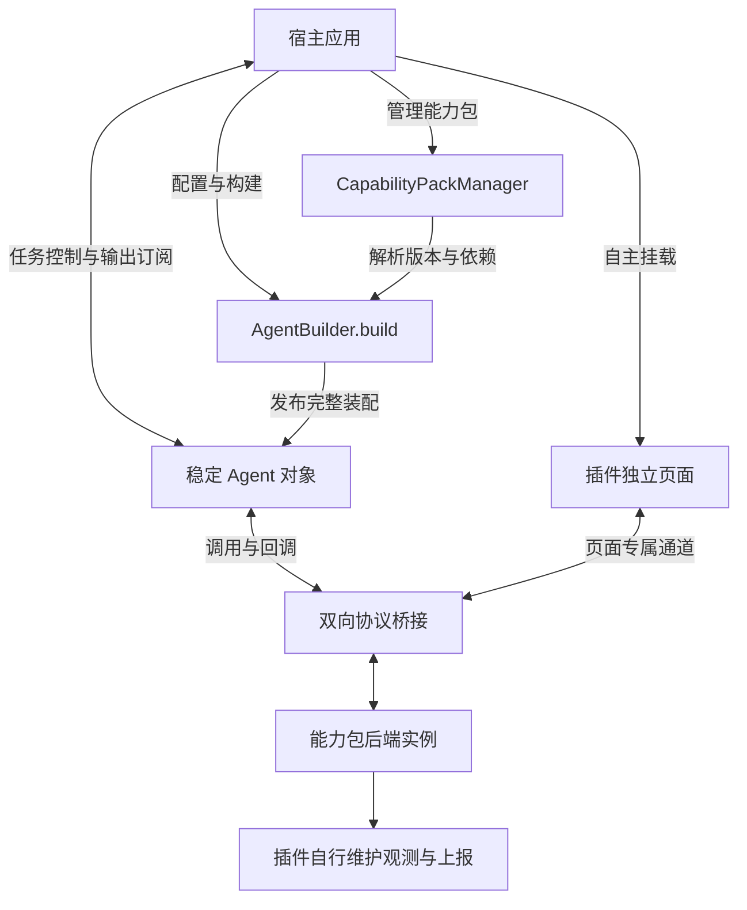

# 动态能力包运行时设计

能力包是安装、配置和版本管理单位。插件负责生命周期和服务注册；扩展点定义契约；扩展实现提供行为；页面由宿主挂载。能力包可以只包含其中一部分，也可以包含 Skills、MCP 和资源。没有独立的插件包层。

本文描述由 `CapabilityPackManager` 安装、选择的能力包，发布者可以是官方或第三方。
宿主编译、链接的 Rust 插件使用进程内 `Plugin::install`；管理器返回的 `ManagedCapabilityPack`
根据清单和贡献选择加载安装包，需要后端时使用独立进程和 RPC。
未声明后端的 Skills、静态页面或资源包不启动能力包后端。两条路径都由 Agent 管理装配与关闭。
目录、默认能力和进程边界见 [Crates 组织](../crates/README.md)。



## 安装和选择

`eliteforge-agent-capability-runtime` 提供 `CapabilityPackManager`、安装器、版本仓库、实例管理、协议和 Rust 后端 SDK；Framework 重导出公共 API。

它是可嵌入宿主或后端的 Rust 库，负责动态安装包基础设施。
`eliteforge-agent-capability-macros` 则在编译时生成原生能力声明；
原生包的发现和工厂调用位于 `agent-core`，插件安装与资源生命周期位于 `plugin-core`。
这些基础库都放在 `crates/framework/`，具体插件实现放在 `crates/plugin/<分类>/`。

```rust,ignore
use eliteforge_agent_framework::*;
use serde_json::json;

let manager = CapabilityPackManager::new("application/capabilities")?;
manager.trust_key("publisher", public_key)?;
manager.install_file("example.zip", InstallPolicy::Signed)?;
let selected = manager.select(
    "example.pack", &"=1.0.0".parse()?, "application.agent",
    "configuration.1", json!({}),
)?;
let agent = AgentBuilder::new().default_models(false)
    .capability_pack(selected).build().await?;
```

导入接口包括文件、字节和 HTTPS URL。安装先校验 ZIP 路径、解压容量、每个文件的 SHA-256、Ed25519 签名和清单，再写暂存目录并原子发布。正式导入必须签名；未签名包只允许显式 `InstallPolicy::Development`。读取安装内容时重新校验摘要和已有签名。版本目录不可原地覆盖。

### 发布来源与信任

包 ID、名称、目录和 `official` 字样都不是来源认证。宿主通过 `trust_key(key_id, public_key)`
维护受信密钥，安装器用 `signature.json` 中的 `key_id` 找到公钥并验签。
宿主要区分官方和第三方发布者，应将受信公钥与发布者身份对应。
当前运行时提供通用信任密钥和验签能力，没有自动识别官方身份的分类逻辑。

验签验证包内容是否由对应密钥签署，不改变加载路径，也不授予进程内执行资格。
官方和第三方安装包采用相同的后端启动规则；安装器不会临时编译或链接包内代码到宿主。
原生 Rust 插件的编译范围由宿主 Cargo 依赖、features 和代码依赖决定。

### 安装位置与选择

目录布局为 `packs/<id>/versions/<version>`、`data/<id>/<作用域摘要>`、`locks/`、`pins.json` 和 `trusted-keys.json`。包文件与业务数据分离，删除和代码回滚不会修改业务数据。版本选择采用完整依赖图求解，校验循环、契约兼容范围及契约定义包依赖。

这里的根目录由 `CapabilityPackManager::new(root)` 指定，独立于仓库 `crates/capability/`。
后者保存随仓库提供的 Rust 能力包装配入口。

`installed()` 返回能力包视图，`extension_catalog()` 返回按分类、契约版本和定义方组织的扩展点视图；`running_selections()` 返回具体实例的实际实现选择。内部适配器不属于清单的插件列表，宿主无需把它们当插件展示。

安装不改变运行中的选择。回滚通过重新选择已经安装的准确版本完成，仍走空闲切换。`remove()` 会检查运行引用、跨管理器版本文件锁和持久化任务引用。

`implementations(ids)` 选择实现，并补齐声明的实现依赖。`contributions(CapabilityContributionSelection)` 分别选择插件、实现、页面、MCP 和 Skills 目录；省略的列表保留当前选择，空列表表示不选。依赖要求的插件和 MCP 会补入选择。

依赖包不会继承根包配置。需要分别配置时，使用 `select_configured()` 和 `BTreeMap<String, CapabilityPackageConfiguration>`；每个包都有自己的配置版本、JSON 配置及可选贡献选择。配置 Schema 在装配资源创建前校验。

## 进程与装配

`RuntimePlugin::ready` 先检查 `manifest.backend`，再检查是否选中了扩展实现、插件或页面。
两者都满足时，调用 `BackendInstance::peer()`，按当前平台的入口启动包内可执行文件并建立 RPC。
仅声明后端但没有选中这些贡献时，ready 不启动后端；后续远程调用也通过 `peer()` 获取连接。
有后端的包只要选中了页面，也会触发启动，不能仅按包是否含工具或模型判断。
源码见[启动判断](../crates/framework/eliteforge-agent-capability-runtime/src/selection.rs)和
[进程创建](../crates/framework/eliteforge-agent-capability-runtime/src/process.rs)。

清单最多声明一个后端入口，可以按平台选择包内可执行文件。同一包、版本、Agent 作用域和配置版本中的实现共享实例。每次创建 Agent 会分配独立的物理作用域，逻辑命名空间用于业务数据和重启恢复。宿主必须为独立配置的业务实例选择独立逻辑命名空间。

未声明后端的静态能力包不启动能力包后端。所选 stdio MCP 由所属实例的生命周期管理，但使用自己的子进程；HTTP MCP 不启动本地进程。插件进程和 MCP 子进程使用进程组／Windows 进程树终止，并由异步监督任务等待退出。进程崩溃后不会偷偷重启或重放调用，必须显式重建。

```rust,ignore
let target = manager.select("example.pack", &"=2.0.0".parse()?,
    "application.agent", "configuration.2", json!({}))?;
agent.reconfigure(AgentBuilder::new().default_models(false)
    .capability_pack(target)).await?;
```

所有 `Agent` 克隆观察同一装配。切换先预检目标，再取得重配锁和包作用域锁，暂停旧实例准入并原子检查占用。有任务、未消费 RunHandle、独立操作、流、远程资源、协作任务、页面或持久化等待任务时，返回 `ReconfigureError::Busy` 和占用原因。

空闲后关闭旧的可重建成员，创建候选装配、握手、执行异步校验和 ready，成功才发布。失败返回 `Restored` 并重建旧配置；旧配置也恢复失败时返回 `Unavailable`。取消调用方的重配等待不会丢弃已经开始的清理。

静态动态成员用 `ConfiguredPluginFactory` 或 `.plugin_factory(...)` 注册。`.plugin(...)` 传入的成员保留原实例：不会重新 install/ready，也不能用同 ID 的另一个实例替换。保留成员不能依赖会被替换的成员。

Checkpoint 保存包 ID、版本和内容摘要。等待任务持久化 pin，保护原版本；恢复时校验版本要求，终态提交后解除 pin。没有自动业务数据迁移或数据回滚。

## 双向协议和 SDK

协议版本为 1，传输为 stdio 分帧 JSON-RPC 2.0。帧头为一字节类型加四字节大端长度；JSON 帧类型为 0，二进制帧类型为 1。JSON 单帧上限 8 MiB，二进制单帧上限 64 MiB。逻辑 RPC 载荷上限 64 MiB；超过 8 MiB 时发送 `$/payload` 描述帧，再用 `rpc:<UUID>:<sequence>` 二进制通道按 64 KiB 分块，接收端检查总长度和顺序。控制帧可插入块之间，取消会释放未完成的组装缓冲。二进制帧以两字节大端通道名长度、UTF-8 通道名和原始字节组成。标准输出只用于协议，日志应写到插件自己的日志渠道。

`initialize` 交换包身份、协议、配置和实现选择，返回握手元数据。扩展调用使用 `extension.call`，携带实现 ID、操作和参数；资源操作使用版本绑定的 `RemoteResourceHandle`。运行上下文、原生服务引用、闭包、`Any` 和 `TypeId` 留在宿主，不直接序列化。

读取循环独立于正在等待的请求。插件反向调用必须携带有效的调用 scope；宿主在等待结果时继续处理该 scope 的回调。`host.next` 仅在当前中间件调用中有效，消费一次。Host API 对权限、实现依赖、策略、预算和任务所有权做检查。模型与工具调用额度由本次执行的共享账本记录，嵌套扩展或新回调作用域不能重置额度。Framework 契约必须通过对应 Host API 调用，不能绕过工具审批直接走通用实现目录。

调用、结果／取消和二进制写入分别使用有界队列，结果和取消优先。反向回调也监听取消，关闭会话不会留下等待中的宿主调用。超时或连接退出后可能已经完成的操作返回 `Indeterminate`，没有写操作自动重试。流式文本回调等待确认，保持次序与背压。

Rust SDK 的入口是 `BackendServer`、`CapabilityBackend`、`TypedBackend` 和 `BackendCallContext`。`TypedBackend` 提供模型和存储原生适配器；其余版本化方法通过强类型 `.method(...)` 注册。后端应按初始化选择创建资源。`select_contributions(BackendContributions)` 在初始化前通知实现、插件和页面的精确选择；后端只能为选中的内容创建资源。进程环境的 `CAPABILITY_SELECTION` 提供实现列表，`CAPABILITY_CONTRIBUTIONS` 提供完整列表，便于构造原生后端时提前过滤连接。`BackendCallContext::register_resource()` 注册归属于当前实现的资源，失败或取消的调用会清理未提交分配。`TypedBackend::on_shutdown()` 注册异步清理；实例关闭先调用 SDK 的 `shutdown`，再按超时终止进程。原生存储适配器释放仍持有的执行租约，原生视频适配器取消未结束任务。

原生 ChatModel 适配器将 `BackendCallContext` 放入请求的宿主内 `extensions`，模型实现可取出它调用 Host API。宿主真实 `RunContext` 由作用域代理保存，不传到插件。SDK 的 `trace_context` 只携带 W3C traceparent/tracestate；插件可以把它交给自己的 OTel SDK。

摘要与附件契约位于 `eliteforge-agent-context-contracts`，原 `eliteforge-agent-context` 继续导出相同名称。外部实现使用 `context.summary-store` 和 `context.artifact-store`，通过 `TypedBackend::summary_store()`／`artifact_store()` 注册。摘要保留 CAS，附件保留不可变发布、字节范围和取消；附件二进制按 base64 进入分块 RPC，首版单个远程附件最多 32 MiB。

执行租约和未结束的视频任务单独登记占用。视频任务返回的 ID 是宿主句柄，实际 provider ID 留在原实例；查询、取消检查实现和实例，结果结束后释放运行占用。句柄容量为每实例 256，可通过取消释放；更新后旧句柄明确失效。

## 页面与事件

`PageSession` 绑定具体实例、版本和会话。宿主查询 `PageDescriptor`，创建会话并通过 `read_resource()` 读取固定版本资源；自行决定路由、标签页或窗口。插件不修改宿主已有页面。

`sdk/page` 包提供 `CapabilityPage` 和 `mountCapabilityPage()`，不依赖 React、Vue 或 Tauri。浏览器使用隔离 iframe 和一次性 nonce 握手，再转入专属 MessagePort；校验来源窗口、宿主 origin 和会话。页面支持初始化上下文、主题、语言、后端调用、声明主题订阅和关闭清理。宿主能力是页面声明与显式授予的交集。

`host.page.publish` 只发布当前页面清单声明的主题。示例宿主把它通过页面 SSE 连接转给对应 iframe，不加入任务输出或全局事件流。关闭会取消调用和订阅，迟到消息不能进入新会话；正式切换要求页面先释放。

插件内部日志、指标和追踪默认留在插件。观测实现只有显式声明 `metadata.subscriptions` 才接收 Framework 事件，其同步发布钩子只做有界入队；拥塞可丢弃观测样本并计数。输出实现使用单独队列：正文不能静默丢弃，溢出明确失败。控制、交互和最终状态以执行结果及持久化记录为准。

## 示例与开发宿主

`crates/tools/eliteforge-agent-capability-dev-host` 是插件开发用的调试应用，设置了 `publish = false`。
它帮助开发者先验证安装、后端调用、页面与空闲重配，再接入实际业务宿主。
正常应用直接使用 Framework／runtime API，不需要依赖或启动这个开发宿主。

| 可执行文件 | 用途 |
| --- | --- |
| `capability-host` | 本地 HTTP 调试宿主；提供安装、目录视图、Agent 构建／重配、调用和页面挂载，也提供打包与签名命令 |
| `capability-backend` | 离线 SDK 示例后端，用于验证跨进程模型、存储和回调链 |
| `capability-mcp` | 示例 MCP stdio 服务，用于验证 MCP 进程与能力包后端的独立生命周期 |

`crates/tools/` 按开发程序分类；`crates/plugin/tool/` 按 Agent 可调用的工具插件分类。
开发宿主是使用 Framework 的应用，所以不放进插件实现目录或核心基础库目录。

```sh
cargo build -p eliteforge-agent-capability-dev-host
pnpm --dir sdk/page install --frozen-lockfile
pnpm --dir sdk/page build
target/debug/capability-host --development --store .capability-dev/store
```

宿主默认监听 `http://127.0.0.1:4317`，提供能力包和扩展点视图、导入、Agent 构建／重配、任务执行及独立页面。`examples/capability-pack/manifest.json` 展示所有内置扩展类型，其中有互斥的上下文装配方式；应选择示例宿主的执行预设或测试中的具体实现列表，不要一次启用所有实现。

打包使用 `capability-host pack DIRECTORY ARCHIVE`。正式签名增加 `--sign-key FILE --key-id ID`，文件为 32 字节原始 Ed25519 私钥；签名者密钥由宿主的管理器显式信任。

自动刷新必须明确开启：

```sh
target/debug/capability-host --development --dev-refresh --store .capability-dev/store
node scripts/capability-dev.mjs
```

监视器先完成 Rust 和页面构建，再发布新的 `-dev.<timestamp>` 内容版本，通过正式安装格式和重配 API 切换。失败构建不会刷新或覆盖运行版本；任务占用会等待释放。仅这个显式开发模式允许关闭页面并重新挂载。开发目录与正式应用仓库应分开。

可设置 `CAPABILITY_DEV_HOST`、`CAPABILITY_DEV_SOURCE` 和 `CAPABILITY_DEV_IMPLEMENTATIONS`；`CAPABILITY_CARGO_ARGS` 接受额外 Cargo 参数的 JSON 数组。`--once` 用于一次构建和发布验证。

## 与 dbx 的关系

主要借鉴 [dbx 清单](https://github.com/t8y2/dbx/blob/dcd16e0d0ae39d92c6210898b8e8295e49d800a1/crates/dbx-plugin-runtime/src/plugins/manifest.rs)、[安装器](https://github.com/t8y2/dbx/blob/dcd16e0d0ae39d92c6210898b8e8295e49d800a1/crates/dbx-plugin-runtime/src/plugins/installer.rs)、[Sidecar 运行时](https://github.com/t8y2/dbx/blob/dcd16e0d0ae39d92c6210898b8e8295e49d800a1/crates/dbx-plugin-runtime/src/plugins/runtime.rs) 和 [开发宿主](https://github.com/t8y2/dbx/blob/dcd16e0d0ae39d92c6210898b8e8295e49d800a1/plugins/sdk/dev-host/runtime.mjs) 的分发、进程和页面边界。

Framework 保留自己的 Agent 扩展契约，增加完整装配的空闲替换、调用作用域、持久化版本要求和受策略约束的反向服务调用。安装版本、Agent 选择和运行实例分别管理。

扩展覆盖及尚未执行的平台验证见 [动态能力包验收](动态能力包验收.md)。
