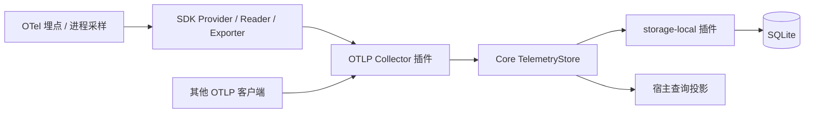

# 可观测性与恢复身份设计

Framework 定义执行中间件、身份和结构化错误契约；`eliteforge-agent-official-plugin-otel` 将这些契约转换为
OpenTelemetry span、事件和指标。上层应用可以提供 tracer/meter provider，也可以启用 OTel 插件的
`runtime` 功能，由插件管理 SDK、Exporter、Reader 和进程采样。独立 Collector 插件负责 OTLP 接收，
`storage-local` 实现通用 `TelemetryStore`。Core 只定义存储接口和模型，不依赖 OpenTelemetry 或 SQLite。
业务身份、授权策略、保留参数和查询界面由上层应用决定。

本文说明运行、工作流节点、模型与工具的观测关联方式，以及恢复身份和错误脱敏边界。

## 装配与链路

`EliteForgeOfficialCapabilityPack` 已默认安装 `TelemetryPlugin::default()`。它在 `build().await` 时
读取上层应用的全局 tracer/meter provider；上层应用应在 build 前配置 provider 和 exporter。
没有 exporter 时不导出数据。插件不会修改全局 provider，`agent.close()` 也不会关闭上层应用的 provider。
使用独立 provider 时，在官方包上调用 `.telemetry(TelemetryPlugin::new(...)?)` 替换默认遥测。

先安装 `TelemetryPlugin`，再安装其他执行中间件，让观测包装器看到内层执行和收尾的结果：

```rust,ignore
let telemetry = TelemetryPlugin::new(
    "telemetry", &tracer_provider, &meter_provider, TelemetryConfig::default(),
)?;
let framework = FrameworkBuilder::new()
    .plugin(eliteforge_agent_official_plugin_storage_local::LocalStoragePlugin::new("agent.sqlite", "agent-artifacts"))
    .plugin(telemetry)
    // StateStore、模型、工具、节点插件……
    .plugin(AgentLoopPlugin::new(ReactAgentLoop))
    .build().await?;
let agent = framework.agent(AgentSelection {
    agent_loop: Some("framework.loop".into()),
    ..AgentSelection::default()
}).build().await?;
```

```text
agent.run                     一次启动或恢复执行
├─ agent.model                模型调用
└─ agent.tool                 工具调用
```

模型和工具调用直接归属当前 `agent.run`。
上层应用可在请求 extensions 中传入 `TraceParent`，让 `agent.run` 归属现有请求链路。

节点包装器通过克隆后的 RunContext 显式传递父 span，并只在 future 被 poll 时附加 OTel
context。跨 Tokio 任务的模型和工具定位不依赖线程本地状态，也不依赖异步事件消费。
工具拦截器也在 poll 执行器时附加工具 span 上下文，工具内部的遥测可以继承它。
模型到工具的 Link 按节点 attempt 与供应商 call ID 关联；并行节点可以使用相同 call ID。
旧进程的模型 span 不会在恢复时伪造成当前工具的发起者，找不到当前执行的模型记录时省略 Link。

## 本地 Collector 与持久化



插件按存储、Collector、OTel runtime 的依赖顺序安装，关闭时按逆序执行。SDK 刷新剩余数据期间，
接收器和数据库保持可用；随后接收器与清理任务退出，最后关闭数据库。显式传入 Provider 的
`TelemetryPlugin` 继续由宿主管理 Provider 生命周期。

`TelemetryRetention` 配置链路年龄、指标年龄和可选的已结束链路数量上限。年龄或数量条件任一满足，
存储层就在事务中删除整条链路及其 Span；运行中链路不参与清理。指标只按年龄清理。写入与启动时
执行清理，Collector 定时调用相同接口。旧进程留下的未结束链路在重开数据库时标记为 abandoned。

Collector 提交成功后才确认接收，写入失败返回 503；同一 Span 和指标点的重试不会重复保存。
它接受 HTTP/protobuf 和 gzip，接收链路与指标。宿主指定监听地址和授权头，可以按租户或 Profile
分别创建容器。接收器和存储模型无需理解工作区、会话、运行或 Agent 编号。

进程采样由 `process_metrics` 显式启用，记录 `process.cpu.utilization`（单核比例）与
`process.memory.usage`（RSS 字节），通过标准 Metrics Reader/Exporter 导出。

配置和完整装配示例见 [OTel 插件](../crates/plugin/observe/eliteforge-agent-official-plugin-otel/README.md)、
[Collector 插件](../crates/plugin/observe/eliteforge-agent-official-plugin-otel-collector/README.md) 与
[运行时生命周期测试](../crates/plugin/observe/eliteforge-agent-official-plugin-otel/tests/managed_runtime.rs)。

## 跨恢复身份

`agent.run.id` 标识一次逻辑运行，恢复时保持不变；`agent.execution.id` 标识一次实际执行，每次恢复都会生成新值。模型和工具调用归属当前执行，工具 invocation ID 在审批和恢复期间保持稳定。

## 结构化错误和脱敏

`AgentError::report(&redactor)` 返回可序列化的 `ErrorReport`：

```json
{
  "kind": "run",
  "causes": [{"kind": "run", "truncated": false}],
  "cleanup": [{"kind": "state", "truncated": false}],
  "truncated": false
}
```

报告保留原始错误的原因链，并将 `WithCleanup` 的清理失败单独列出。
默认 `OmitErrorMessages` 删除全部错误文本。每份报告最多 16 个错误项，单项文本在脱敏后
截断为最多 2048 UTF-8 字节；脱敏器 panic 时省略正文。`truncated` 表示报告有截断。
不采集提示词、认证数据、完整请求或堆栈作为额外字段。

上层应用通过 `TelemetryPlugin::with_error_redactor(Arc<dyn ErrorRedactor>)` 允许经过处理的文本。
脱敏器能看到原始错误文本，应采用业务认可的允许列表或脱敏规则；返回 None 表示不导出。
该回调同步执行，不应进行 IO 或阻塞等待。报告大小限制在回调返回后生效。

遥测在发生错误的 span 上写入 `agent.error` 事件，事件字段包含 `error.type` 和 JSON 格式的
`agent.error.report`，天然带 trace/span ID；span 属性带执行身份。运行、节点、模型和工具均
支持该报告。将 `TelemetryConfig::record_error_reports` 设为 `false` 时，事件只记录错误类型，
省略详细报告。模型重试中途失败、工具返回 `is_error` 也会记录，即使外层运行最终成功。
清理失败可以作为错误事件附着在 cancelled run 上，不会将取消重新归类为普通失败。
这是一份关联到 trace 的错误事件；独立日志系统的转发和存储仍由上层应用提供。

脱敏只作用于结构化导出报告。调用者收到的类型化 AgentError、原有 RunFailed 事件及
检查点中的节点 error 文本保留执行语义；上层应用如要对外展示这些原始数据，需要另行应用
同一脱敏策略。启用 `record_identifiers` 仅允许导出工作流、节点、模型、阶段及工具名称，
不会自动允许错误正文。UUID 身份默认导出，仅作为 span 属性，不用作指标标签。
