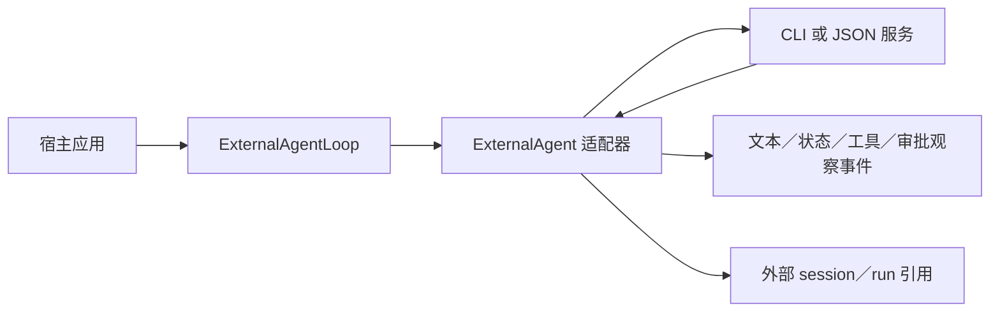

# 外部 Agent 接入

外部 Agent 不是 `ChatModel`。它自行运行决策循环、调用工具、处理审批并管理会话。Framework 只负责本地运行准入、取消与超时、事件转发，以及返回文本和外部会话引用。

`external_agent_pack(adapter)` 装配 `ExternalAgentPlugin` 和 `ExternalAgentLoop`。这个执行循环不要求 `ConversationStore` 或 `StateStore`；Framework 不执行外部工具、不保存外部对话，也不写外部 checkpoint。请求通过 `ExternalSessionRef` 传入已有外部会话；结果的 `RunResult.external_session` 返回外部引用。`resume` 不适用于这个循环，调用时明确拒绝。宿主需要保存外部引用，并由外部系统承担恢复语义。

官方适配器位于 `eliteforge-agent-official-plugin-agent-external`，提供 Codex／OpenCode CLI 传输和可配置的 JSON Bridge。工具调用、审批和状态作为观察事件发布，不会进入 Framework 的 ToolProvider 或审批执行链。输出事件不等于外部操作成功的确认，最终状态以适配器结果为准。

外部运行通过标准 `OutputEvent` 发布带唯一消息 ID 的文本和思考增量，因此 AG-UI 不必等待最终结果才显示内容。正常结束发布 `MessageFinished`；失败、取消、超时或执行 future 被丢弃时，清理守卫发布 `MessageAborted`。最终文本包含已输出前缀时只补齐后缀；过程文本与最终答复不同时保留两条消息，避免重复前缀或文本校验失败。

状态、工具、审批和 session 既保留原始观察事件，也通过 `framework.external_agent` 自定义输出事件交给 AG-UI。这些事件不会触发 Framework 的工具执行或审批流程。

Codex 新任务使用 `exec --cd`；续聊使用 `exec resume`，不传该子命令不支持的 `--cd`。两种方式都通过进程工作目录设置执行位置，外部 session 引用原样传递。

取消 CLI 运行时会清理本地进程树。JSON Bridge 在新任务执行中拿不到远端 run ID，因此取消只能保证本地不再等待；远端状态仍未知。只有宿主事先提供了远端 run ID，适配器才能尽力请求远端取消，HTTP 响应也不能当作远端已停止的证明。超时遵守同一边界。
