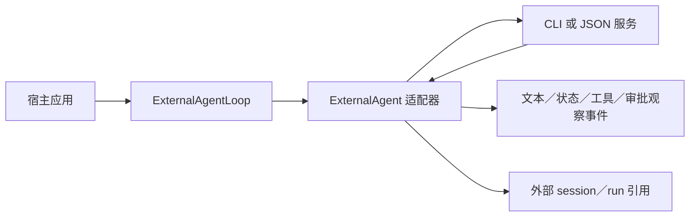
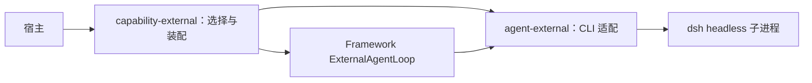

# 外部 Agent 接入

外部 Agent 不是 `ChatModel`。它自行运行决策循环、调用工具、处理审批并管理会话。Framework 只负责本地运行准入、取消与超时、事件转发，以及返回文本和外部会话引用。



`external_agent_pack(adapter)` 装配 `ExternalAgentPlugin` 和 `ExternalAgentLoop`。这个执行循环不要求 `ConversationStore` 或 `StateStore`；Framework 不执行外部工具、不保存外部对话，也不写外部 checkpoint。请求通过 `ExternalSessionRef` 传入已有外部会话；结果的 `RunResult.external_session` 返回外部引用。`resume` 不适用于这个循环，调用时明确拒绝。宿主需要保存外部引用，并由外部系统承担恢复语义。

官方适配器位于 `eliteforge-agent-official-plugin-agent-external`，提供 Codex／OpenCode／dsh CLI 传输和可配置的 JSON Bridge。工具调用、审批和状态作为观察事件发布，不会进入 Framework 的 ToolProvider 或审批执行链。输出事件不等于外部操作成功的确认，最终状态以适配器结果为准。

外部运行通过标准 `OutputEvent` 发布带唯一消息 ID 的文本和思考增量，因此 AG-UI 不必等待最终结果才显示内容。正常结束发布 `MessageFinished`；失败、取消、超时或执行 future 被丢弃时，清理守卫发布 `MessageAborted`。最终文本包含已输出前缀时只补齐后缀；过程文本与最终答复不同时保留两条消息，避免重复前缀或文本校验失败。

状态、工具、审批和 session 既保留原始观察事件，也通过 `framework.external_agent` 自定义输出事件交给 AG-UI。这些事件不会触发 Framework 的工具执行或审批流程。

Codex 新任务使用 `exec --cd`；续聊使用 `exec resume`，不传该子命令不支持的 `--cd`。两种方式都通过进程工作目录设置执行位置，外部 session 引用原样传递。

取消 CLI 运行时会清理本地进程树。JSON Bridge 在新任务执行中拿不到远端 run ID，因此取消只能保证本地不再等待；远端状态仍未知。只有宿主事先提供了远端 run ID，适配器才能尽力请求远端取消，HTTP 响应也不能当作远端已停止的证明。超时遵守同一边界。

## DeepSeek Harness（dsh）

`ExternalCliKind::Dsh` 由 `eliteforge-agent-official-plugin-agent-external` 实现，通过
`eliteforge-agent-capability-external` 重导出。`DshCliOptions` 控制是否恢复保存凭据；凭据内容由 dsh 读取。
供应商路由保存在各自 profile 中，恢复凭据不会自动读取桌面版的模型配置。
设置 `provider_profile: Some("desktop".into())` 后，适配器只从该 profile 的 `llm-pi-ai`
条目读取模型路由，合并 headless 和 home 层的同名路由覆盖，写入本次调用的临时 overlay。
桌面 UI、工具、权限、默认模型均不复制，也不改写原 profile；发现和执行使用同一套配置。
`DshModelProbe::discover` 在 20 秒内通过内嵌的 `eliteforge-dsh-model-catalog-probe` Cordis 插件读取目录，
不创建对话；同步宿主可使用 `discover_blocking`。探测返回模型和部分 provider 的错误。

宿主通过 `external_agent_pack_with_loop(adapter, loop_id)` 自定义循环插件 ID，默认入口仍使用
`framework.loop`。能力包 ID 和外部绑定插件 ID 均为 `framework.external-agent`，属于不同命名空间。



宿主保存原生 session 引用；dsh 自行管理工具、权限和会话。调用使用 stdin 传任务，临时 overlay
选择 provider/model、推理强度并按选项恢复保存凭据。进程取消时清理进程树和临时目录。
JSON 模式的思考、工具和状态按步骤转发，正文使用成功运行的无损 `final.text`，中间的截断正文不拼入答案。

### 工作区分组与实际目录

`DshCliOptions.workspace: Some(DshWorkspaceOptions { directory, title })` 可把不同任务的会话放进一个原生 dsh 工作区；目录与名称由宿主指定。未设置时保留 dsh 的常规目录行为，模型探测始终不创建工作区或会话。

```text
宿主传入：共享分组目录 + 实际任务目录
    → 共享目录作为原生会话 header.cwd / workspace.path
    → 等待 agent/created：workingDirectory.set(实际目录)
    → 持久化目录绑定、登记工作区 → 释放登记锁
    → 原生 headless runner 提交任务 → 工具与 AGENTS.md 使用实际目录
```

适配器在 dsh 子进程加载内嵌 Cordis 插件，使用原生工作区、会话和目录服务，不改写用户 profile 或手工修改会话头。沙箱策略复用 dsh 的模式、会话覆盖和审批逻辑，将共享分组目录对应的写入边界替换为该任务的原始实际目录；切换工作目录不会扩大此边界。目录在运行中消失时明确失败，不自动退回共享父目录。

分组会话在日志中保存原始任务目录，续聊须匹配这份绑定，并保留 dsh 已保存的当前目录。未采用分组的旧会话经只读探测后仍在原目录续跑，不迁移会话头或重新分组；目录不匹配时拒绝接管。探测和首次目录绑定各有 20 秒超时，取消或失败清理子进程树及临时资源。

dsh JSON 工作区存储不提供跨进程合并，适配器用 dsh home 下的文件锁串行化启动至登记确认这一段，模型执行不持锁。该锁协调使用本适配器的进程；原生桌面进程不参与这把锁，桌面的缓存与刷新行为仍由 dsh 管理。
