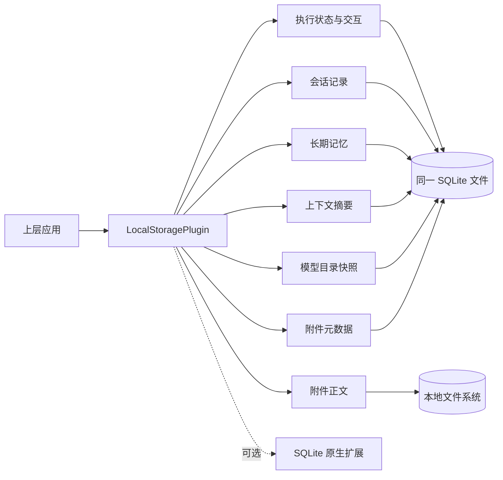

# 本地存储插件：SQLite 与文件系统

## 1. 目标与边界

本文说明 `storage-local` 如何实现 Framework 的存储接口。它面向单机 local-first 应用：SQLite 保存结构化数据，文件系统保存附件正文。

存储接口由 Framework Core 和 Context Contracts 定义。`memory`、`context` 提供能力，不包含 SQLite 或文件存储实现。宿主选择数据库文件与附件目录，设置容量限制，并决定是否启用可选 SQLite 扩展。



## 2. 存储覆盖范围

`LocalStoragePlugin::new(database_path, artifact_root)` 注册下列存储服务。执行状态与交互共用一个 SQLite 连接；其他结构化存储按各自的连接与事务规则工作。附件正文写入宿主预先创建的受保护目录。

| 存储抽象 | 保存内容 | 主要用途 |
| --- | --- | --- |
| 执行状态 | 执行检查点、会话当前执行位置及执行事件 | 保存 Agent 执行进度，并支持中断后的恢复 |
| 交互记录 | 待回答的问题、审批状态和用户答复 | 暂停任务等待用户输入，随后继续执行 |
| 会话记录 | 会话分支、消息历史、版本及并发租约 | 保存对话历史并协调同一会话的写入 |
| 长期记忆 | 按命名空间组织的记忆条目、版本和过期时间 | 跨会话保存和检索应用提供的记忆内容 |
| 上下文摘要 | 与会话版本关联的摘要记录 | 缓存上下文整理结果；原始会话仍是权威内容 |
| 模型目录快照 | 最近一次成功同步的模型描述和账号作用域 | 冷启动时恢复目录，随后异步刷新 |
| 附件与大型结果 | SQLite 中的元数据、文件系统中的正文 | 保存较大的结果，并由授权的读取方按需读取 |

这些服务实现 Framework 的存储接口。Framework 的执行逻辑依赖接口，不直接依赖 SQLite 类型。插件安装时会打开数据库、检查或创建各自的 schema，并注册服务；Agent 关闭时按注册顺序的逆序关闭存储连接。

数据库路径必须是文件系统路径。插件拒绝空路径、`:memory:` 和 SQLite URI。附件目录须由宿主预先创建并保护。会话、检查点、记忆、摘要和附件各有容量限制；达到限制时存储操作返回错误。

## 3. 组件划分

| 组件 | 职责 |
| --- | --- |
| `eliteforge-agent-official-plugin-storage-local` | 实现全部本地存储接口，管理 SQLite、附件目录、模型目录缓存和可选原生扩展 |
| `eliteforge-agent-memory` | 提供记忆注入、保存和读取能力，依赖存储接口 |
| `eliteforge-agent-context` | 提供上下文压缩、大型结果转存与读取能力，依赖存储接口 |

每个 SQLite 存储实现都在自己的数据库工作线程中执行数据库操作。各连接启用 WAL 与完整同步；执行状态连接还启用外键约束。插件默认会对连接应用忙等待超时，并使用有界并发限制，避免无限排队。

## 4. 插件装配与存储参数

默认值适用于一般开发和单实例使用。容量及并发限制可由上层应用通过插件公开的字段调整：

```rust
use eliteforge_agent_official_plugin_storage_local::LocalStoragePlugin;

// data/artifacts 由宿主预先创建；Unix 下目录权限不能开放给组和其他用户。
let mut storage = LocalStoragePlugin::new("data/agent.sqlite", "data/artifacts");
storage.config.conversations.max_sessions = 2048;
storage.config.execution.max_checkpoint_bytes = 48 * 1024 * 1024;

let agent = AgentBuilder::new()
    .plugin(storage)
    .build()
    .await?;
```

| 配置项 | 默认值 | 作用 |
| --- | --- | --- |
| `conversations.max_sessions` | 1024 | 数据库中允许保留的会话数量上限 |
| `conversations.max_messages` | 2048 | 单个会话允许保留的消息数量上限 |
| `conversations.max_bytes` | 16 MiB | 单个会话历史允许占用的字节数上限 |
| `conversations.session_ttl` | 0（不自动过期） | 会话空闲保留时间；大于零时，过期会话在后续打开存储时清理 |
| `conversations.lease_duration` | 30 秒 | 会话写入租约时长，用于协调并发写入者 |
| `conversations.max_pending_operations` | 64 | 会话存储允许排队等待执行的操作数 |
| `memory.max_entries` | 10,000 | 长期记忆条目总数上限 |
| `memory.max_entry_bytes` | 16 KiB | 单条长期记忆内容大小上限 |
| `memory.max_search_results` | 100 | 一次记忆检索允许返回的结果数上限 |
| `memory.max_search_bytes` | 256 KiB | 一次记忆检索结果允许返回的总字节数上限 |
| `memory.max_pending_operations` | 64 | 记忆存储允许排队等待执行的操作数 |
| `summaries.max_records` | 10,000 | 摘要记录数量上限 |
| `summaries.max_record_bytes` | 64 KiB | 单条摘要大小上限 |
| `summaries.max_pending_operations` | 64 | 摘要存储允许排队等待执行的操作数 |
| `execution.busy_timeout` | 5 秒 | SQLite 遇到数据库锁时等待的最长时间 |
| `execution.max_pending_operations` | 64 | 执行状态存储允许排队等待执行的操作数 |
| `execution.max_checkpoint_bytes` | 32 MiB | 单个执行检查点允许保存的最大字节数 |
| `artifacts.max_artifact_bytes` | 64 MiB | 单个附件或大型工具结果的大小上限 |
| `artifacts.max_read_bytes` | 64 KiB | 单次附件读取允许返回的最大字节数 |
| `artifacts.max_in_flight` | 8 | 附件存储允许同时处理的操作数 |

所有容量值必须为正数；附件单次读取上限不能大于单个附件上限。存储会在创建时校验参数，超出边界或为零的配置会导致插件安装失败。

## 5. `ExtensionConfig` 配置

分词和向量扩展不是普通会话存储所必需。默认情况下插件不会加载原生扩展；需要相关 SQL 功能时，通过 `LocalStoragePlugin::with_extensions` 显式配置。

| 配置项 | 类型 | 说明 |
| --- | --- | --- |
| `cache_dir` | `PathBuf` | 原生扩展和分词词典的缓存目录。目录应由应用预先创建并保护，禁止不可信进程写入。 |
| `simple` | `ExtensionMode` | 控制 `sqlite-simple` 中文分词扩展的加载策略。 |
| `vector` | `ExtensionMode` | 控制 `sqlite-vec` 向量扩展的加载策略。 |

`ExtensionMode` 有三种取值：

| 模式 | 行为 |
| --- | --- |
| `Disabled` | 不尝试加载扩展；这是默认值。 |
| `Preferred` | 尝试加载扩展；若当前构建未携带资源、目标平台无匹配资源或加载失败，则记录不可用原因并继续安装。 |
| `Required` | 要求扩展成功加载；若无法加载，插件安装失败并释放已打开的存储连接。 |

示例：

```rust
use eliteforge_agent_official_plugin_storage_local::{
    ExtensionConfig, ExtensionMode, ReadSqliteCapabilities, LocalStoragePlugin,
};

let mut extensions = ExtensionConfig::new("data/sqlite-native");
extensions.simple = ExtensionMode::Required;
extensions.vector = ExtensionMode::Preferred;

let agent = AgentBuilder::new()
    .plugin(LocalStoragePlugin::new("data/agent.sqlite", "data/artifacts").with_extensions(extensions))
    .build()
    .await?;

let reports = agent.execute(ReadSqliteCapabilities).await?;
```

扩展配置会应用到插件管理的每条 SQLite 连接，因此报告按存储角色分别记录。`ReadSqliteCapabilities` 可读取各连接上的 FTS5、分词扩展、向量扩展和平台能力状态。构建存储插件时需启用 `bundled-native` feature，才会把原生扩展资源打包进程序；未启用时，`Preferred` 会报告不可用，`Required` 会导致安装失败。

启用原生扩展只表示连接具备相应 SQL 函数或虚拟表能力，不会自动创建向量索引、生成 Embedding 或改变记忆检索策略。实际索引和检索行为由上层存储或检索逻辑实现。

## 6. 注意事项

- 数据库文件及其 WAL/SHM 文件应放在应用专属、权限受控的目录中；备份时应采用 SQLite 感知的备份方式，避免只复制正在使用的主数据库文件。
- 附件正文先原子发布，再写 SQLite 元数据；删除时先删元数据，再删文件。安装存储插件时会清理至少滞留 24 小时的孤儿文件。旧 `agent_artifacts` BLOB 附件不迁移，也不会通过新插件回读。
- 同一数据库文件由这些存储角色共用，但每个角色有自己的连接。部署多个进程共享数据库时，应合理设置容量与忙等待参数，并评估磁盘性能及 SQLite 写入串行化带来的影响。
- Agent 停止接收新任务并完成当前存储操作后，再关闭 Agent。插件负责关闭自身连接，不应由应用同时关闭这些连接。
- 原生扩展资源依赖目标操作系统、CPU 架构和 ABI。生产环境应在实际目标平台验证所需扩展；若能力不是必需的，优先使用 `Preferred` 并检查能力报告。
- `cache_dir` 参与释放本地动态库和词典文件，应使用应用独占的可信目录，避免符号链接替换、目录穿越或其他进程篡改缓存内容。
- 默认长期记忆使用关键词检索。开启向量扩展本身不会自动将记忆切换成向量检索。
- 新附件先发布到文件系统，再写入 SQLite 元数据；删除时先删除元数据，再删除文件。崩溃留下的孤儿文件在宽限期后清理。
- 旧 `agent_artifacts` 表中的 BLOB 附件不会自动迁移或回读。结构化存储仍沿用可兼容的表；升级前需要保留旧附件的应用应自行导出。
- 这一实现不提供多节点一致性或分布式高可用。备份时应同时保存 SQLite 数据库和附件目录，并保持两者对应。
