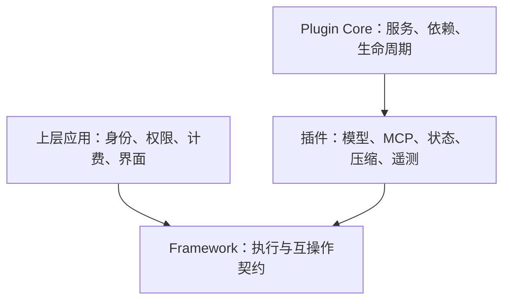

# Agent Framework 执行契约

## 1. 目标与边界

本文列出 Agent Framework 的核心运行保证，供执行器、插件和上层应用在实现功能时共同遵守。框架负责模型调用、工具调度、上下文组装、运行状态、交互和事件；上层应用负责身份、权限、订阅归属和业务配置。

执行策略可以组合相同的模型与工具调用入口，但不得绕过输入校验、取消、预算和工具策略。Core 中不定义应用专属的工作区或访问域类型。

## 2. 分层

Core 定义消息、模型与工具调用、上下文、运行状态、交互和事件等公共契约。插件实现这些契约；Plugin Core 负责服务注册、依赖顺序和资源生命周期；Framework 通过执行器组合插件提供的能力。

## 3. 必须保持的运行约束

1. **消息保留结构。** 消息内容按顺序保存文本、媒体和资源引用。文本只是便捷构造方式，不代表所有内容。适配器遇到不支持的内容时必须明确报错，不能静默丢弃。
2. **模型连接与选择分离。** 模型连接负责共享传输和认证；每次调用根据阶段、尝试次数和能力要求选择模型。可序列化的 Framework 契约中不包含供应商类型或凭据。
3. **拦截器按序执行。** 请求按注册顺序经过中间件，响应按反向顺序返回。观测组件不能授予权限；工具策略必须在副作用发生前运行。
4. **每次模型调用重新组装上下文。** 指令与检索数据保持不同信任级别。缩减窗口不得改写源会话；工具调用、结果及供应商续接数据属于不可拆分的协议交互。
5. **内置执行器保留稳定运行身份。** 持久化状态通过版本比较和会话所有权保护；过期执行器不能提交进度。同一 ReAct 执行租约内，模型历史、工具结果、延迟子调用记账共用一个 checkpoint 提交入口，串行推进版本；阶段结束后保留的预算上下文不能继续提交旧快照。跨执行器的版本校验和租约校验仍由存储执行，冲突不能靠重跑工具规避。
6. **工具意图先于工具副作用持久化。** 内置执行器先记录调用意图，再执行工具并记录结果。崩溃发生在两次写入之间时，恢复状态必须标记为结果不确定，不能盲目重放。外部副作用要实现恰好一次语义，需要工具自身配合幂等键等机制。
7. **持久化交互绑定具体执行点。** 交互具有稳定 ID、输入结构和恢复位置；审批必须绑定确切的待执行调用。普通文本消息不能代替审批。
8. **取消覆盖完整调用链。** 取消应传递到模型、工具和子执行。异步清理应有时限，并保留同步 Drop 兜底。
9. **流式输出在模型轮次校验前属于暂定结果。** 输出已经发送后，自动重试不能重复发送已输出内容。观测事件不等同于持久化执行状态，也不保证事件可重放。
10. **不同预算分别计量。** 上下文容量、模型累计用量、执行步数、工具调用数、并发和运行时长具有不同含义，不能混为一个限制。

## 4. 实现与验收范围

以下能力的实现与验收证据应记录在[实现状态与验收证据](实现状态与验收证据.md)：

| 能力 | 实现要求 | 关键验证 |
| --- | --- | --- |
| 消息与结果 | 有序文本/媒体/资源内容、结构化工具结果、生成参数和离线 JSON Schema 校验 | 序列化回环及真实适配器协议测试 |
| 扩展点 | 生命周期 Hook 与运行/节点/模型/工具拦截分离，支持逐步上下文贡献 | 顺序、拒绝、失败、取消和不可信上下文测试 |
| 状态 | 会话、上下文和检查点分离；所有权、版本和持久工具调用记录明确 | 重开、过期写入、执行结果不确定场景 |
| 执行策略 | 对话、工具、分阶段执行、人工审批和子 Agent 共用真实调用入口 | 变化的输入、预算和取消场景 |
| DAG 工作流 | 可序列化版本图、环校验、节点插件、分支汇合、有界任务和检查点续跑 | 并行、故障注入、重开及真实进程崩溃恢复 |
| 模型插件 | 多模型共享连接、请求转换、协议续接数据保持 | 本地 HTTP/SSE 协议样例 |
| MCP | SDK 传输、发现、分页、结构化结果、取消和生命周期 | 本地 MCP 客户端/服务端协议测试 |
| 持久化 | SQLite 参考实现、原子写入和冲突语义 | 重开及并发连接测试 |
| 压缩 | 可配置摘要模型、最新轮次保护、附件引用且源会话不变 | 预算边界和失败场景 |
| 可观测 | 结构化追踪和导出，默认不记录敏感提示正文 | 实际收集到的遥测及生命周期测试 |

## 5. 注意事项

- 单元测试和本地协议测试不能证明线上模型供应商兼容。真实供应商验证应单独记录，并注明使用的账户、接口和模型。
- 持久化工具意图只能说明 Framework 记录了执行尝试，不能证明外部系统没有副作用。遇到结果不确定时，应先核对外部状态再决定是否重试。
- 上层应用仍负责设置身份、访问授权和业务隔离；Framework 的工具策略接口不会自动成为操作系统沙箱。
- 容量和 Token 数是框架估算或配置边界，不等于供应商账单中的实际用量。
