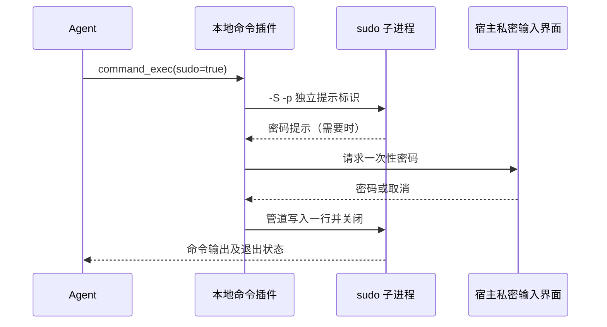

# 本地命令执行与命令清单设计

## 目标与边界

本地命令插件在 Agent 宿主进程内管理受控子进程。应用通过官方能力包的 `.system_commands(config)` 或 `SystemCommandPlugin` 显式启用。
模型入口 `command_exec` 只接受一个完整的 `command` 字符串，始终交给宿主配置的 Shell（未配置时使用 `default_shell_program()`）解释，因此支持 `&&`、管道、重定向和含空格路径。底层 `CommandRequest`／`SystemCommandConfig::invocation(command, Some(args))` 仍支持直接启动程序并分开传递参数，能力包、插件和已有内部调用继续使用该接口。

`default_shell_program()` 在 macOS/Linux 选择本地 POSIX Shell，在 Windows 优先选择 PowerShell，并支持 cmd 回退。命令字符串使用所选 Shell 的语法，不在不同系统之间自动翻译脚本。PowerShell 命令使用 UTF-16LE 编码传递，避免引号、管道和 Unicode 内容被 Windows 参数转义改变。

## 工具与命令生命周期

| 工具 | 用途 |
| --- | --- |
| `command_exec` | 执行完整命令字符串，默认等待最多 10 秒；未完成则返回 `taskId` |
| `command_exec_list` | 查看当前会话的命令清单；`includeCompleted: true` 包含保留的已结束记录 |
| `command_exec_read` | 按 stdout／stderr 字节游标续读，查询运行状态；`waitMs` 最多 10 秒 |
| `command_exec_write` | 向已打开的 stdin 写入；`closeStdin: true` 在写入后发送 EOF |
| `command_exec_stop` | 请求停止受管命令及其进程组，返回状态和输出 |

## 调用状态与命令结果

`command_exec`、`command_exec_read`、`command_exec_stop`、`command_exec_write`、`command_exec_list` 的外层工具调用状态只表示是否完成了执行、写入或查询请求：

- 同步执行完成（退出码为零或非零）、异步任务成功启动、成功查询到任务状态，都返回成功的工具结果。
- 参数无效、权限拒绝、命令解释器或程序无法启动、任务无法提交、stdin 无法写入或查询机制故障，才返回工具失败。
- `command_exec_write` 只要 stdin 写入成功就是工具成功；命令随后以非零退出仍只是结果。命令已经结束导致写入无法交付属于底层失败。
- 输出、错误输出、退出码、运行状态、超时或取消原因都在结果 JSON 中。非零退出码的 `success` 为 `false`，但工具调用本身仍是成功。
- 运行中的异步任务返回 `taskId` 和 `status: "running"`，`success` 与 `exitCode` 保持 `null`，不会伪造 `exitCode: 0`。
- 批处理的外层错误只由某项工具调用失败触发；单条命令非零退出仍保留该项完整结果。

## 交互输入与 PTY

启动交互式命令：

```json
{"command":"python3 -u script.py","interactive":true}
```

向返回的命令 ID 写入：

```json
{"taskId":"cmd-实际返回的ID","data":"下一行输入\n","waitMs":1000}
```

需要终端行为时在启动参数中加入 `tty: true`，可设置 `rows`／`cols`（默认 24／80，各为 1–1000）。
PTY 自动保持输入打开，stdout 和 stderr 合并在 `stdout`；`stderr` 为空。
普通命令默认不保留 stdin；只传初次 `stdin` 时，写完会关闭，与此前行为一致。

命令返回 `pid`、`tty`、`stdinOpen` 和运行状态；命令清单还返回记录年龄 `ageMs`。
每次输入最多 64 KiB，输入队列有界。写入失败或等待超时可能已交付部分内容，返回不确定错误，
调用者应先读取输出判断进度，不能无条件重发。游标单位是字节，截断时同时返回保留范围的起始游标。

## sudo 密码输入

以下能力需要 Framework Git tag `1.1.0` 或更新版本。

在 macOS/Linux 上设置 `sudo: true`，并传入需要提权的实际命令：

```json
{"command":"id -u","sudo":true}
```

工具使用 `sudo -S` 和每次命令独立的密码提示标识。只有检测到 sudo 密码提示时，才调用宿主注入的 `SudoPasswordProviderService`；有效缓存或 NOPASSWD 规则不会触发密码输入。宿主必须实现 `SudoPasswordProvider`，通过私密界面获取 `SudoPassword::new(value)`，并将服务放入 `RunRequest.extensions`。返回 `None` 表示用户取消。没有输入服务的宿主仍可执行免密命令，需要密码时明确失败。

密码不能放入 `command`、`stdin`、`env`、普通问答或交互历史。服务仅在内存中交付答案，命令插件将密码加换行写入管道，随后关闭 stdin；密码对象与输入队列在释放时清零。等待用户输入最多 45 秒，取消、过期或工具调用被丢弃时停止对应进程。密码错误由 sudo 返回失败，不自动重试或重新执行命令。

`sudo` 模式不支持同时传入 `stdin`、`interactive: true` 或 `tty: true`，也不接受 `command_exec_write` 输入。实际命令通过固定的 `/bin/sh` 包装器执行，stdin 指向 `/dev/null`，因此缓存和免密执行同样得到 EOF；模板不拼接模型文本，命令字符串仍由所选 Shell 解析。sudoers 需要允许该包装器调用。配置了可执行文件白名单时，Shell 与 `sudo` 都必须获准。



## 命令清单和资源限制

命令清单只包含当前会话的命令，其他会话无法读取、输入或停止它们。
每个 Agent 最多 32 个运行命令、256 条记录，旧的已结束记录按创建顺序淘汰。
默认最长运行 30 分钟；记录不跨 Agent 重建或宿主重启恢复。

Unix 命令各自建立进程组，PTY 建立独立会话；停止、超时、主命令退出、Agent 关闭都会清理受管组。
Windows 使用 PTY 后端和 Job Object 管理。进程组和 Job Object 是生命周期管理措施，不构成 OS 沙箱。
主动脱离 Unix 进程组的程序不在该清理范围内；部署前应在目标操作系统验证进程清理和终端行为。

## 注意事项

- 模型入口只提交完整 `command` 字符串，由宿主 Shell 解释；它不再接受 `args`。旧调用携带非空 `args` 时会得到明确的参数不兼容提示。
- 底层直接执行接口保留 `command + args` 形式，供能力包、插件和已有内部调用使用；不要把它重新暴露为模型参数。
- 进程组和 Job Object 管理子进程生命周期，不是操作系统沙箱，也不限制命令访问主机资源。
- 命令清单按 Agent 会话隔离，Agent 重建后不会恢复旧命令记录或继续旧进程。
- 输入或等待超时可能发生部分交付；先读取当前输出和状态，再判断是否重试。
