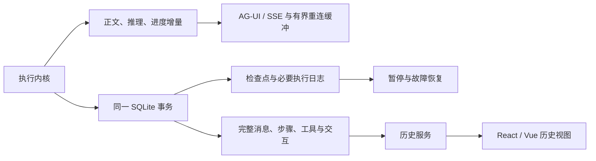
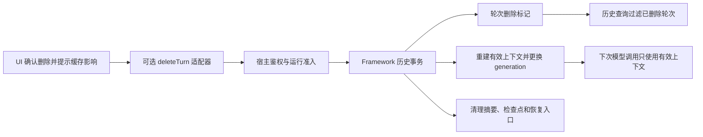

# 结构化会话历史

实时输出、恢复状态和用户历史分别处理。正文与推理增量只通过输出总线发送；执行内核在模型、工具、等待和结束边界提交完整记录。历史查询直接读取 Framework 的结构化表。



## 写入与恢复

`RunContext::emit()` 只发布事件，不再把每个增量写成 `EXECUTION_EVENT`。必要的执行日志由内核在检查点提交时显式保存。

每次实际模型调用使用独立的消息和步骤身份。重试会新建尝试记录，因此不会覆盖先前内容。一次调用返回完整内容、模型实际返回的推理、工具请求和用量后，内核先把消息、工具意图和完整待消费响应与检查点一起提交，再推进工作流游标。恢复时先消费已提交的响应，避免重复请求模型。

工具执行前保存调用身份、完整参数及状态，执行后保存经过 `ToolResultProcessor` 处理的结果、错误、耗时及附件引用。处理器不能把失败变成成功。工具已经开始但没有可靠结果时标记为 `Unknown`，保留既有执行身份和恢复保护；恢复不能自动重复执行该工具。

取消、失败和等待输入都会提交已有内容。生成中断的消息使用 `Interrupted`，不会被当成完整消息。进程突然退出时，只能保证最后一次可靠提交的内容；本次没有加入生成中的定时快照。

启动恢复和归档检查还会核对检查点的执行锁：锁仍被旧执行者持有但已过期时，即使运行的最长执行时限尚未到，也标为 `RecoveryRequired`，保留已有内容和工具的未知结果。该运行不再算活动运行。仍有效的执行锁、已经正常释放的锁，以及恢复请求尚未重新领取的旧锁，都不会被误清理；归档时的恢复与归档写入在同一事务内完成。

公开历史来自执行内核的完整输出。`ChatResponse.public_content` 可用于宿主明确提供公开内容投影；未提供时使用普通内容。推理由独立的 `reasoning` 字段或已收到的推理增量聚合。模型私有 `model_context`、上下文压缩结果和恢复 transcript 不会作为历史响应返回，压缩也不修改原始历史记录。

外部 Agent 的内部调用属于外部运行时。Framework 保存其实际暴露的公开消息与工具观察，并将缺少可靠结果的工具标记为 `Unknown`；外部运行时没有提供的内部模型调用无法重建。

## 存储与读取

存储插件负责建表：`ef_history_versions`、`ef_history_runs`、`ef_history_steps`、`ef_history_messages`、`ef_history_tools`、`ef_history_interactions`。运行生命周期和交互答案沿用现有记录，并在对应事务中更新历史投影。消息、步骤、工具和交互记录带运行身份，完成后的记录不能被后续尝试覆盖。

```rust,ignore
let page = framework.history()?
    .read_session("session-id", HistoryQuery {
        limit: 20,
        cursor: None,
    })
    .await?;
```

页大小为 1 至 100 个根运行组，默认 20。同一根运行及其子运行的消息、步骤、工具调用与结果一起返回。会话、根运行、运行内顺序及活动运行均有索引，普通读取不访问 `ef_events` 或解析检查点。

每页在一个 SQLite 一致性读取事务中取得版本、记录、待处理交互和活动运行。若宿主已有事务，读取加入该事务。游标绑定会话、版本和顺序；写入使版本变化后，旧游标返回冲突，UI 重新加载最新页，避免混合不同版本。

宿主负责认证、工作空间关系校验和 HTTP 错误映射。

## 删除轮次

`HistoryService::delete_turn(session_id, root_run_id, expected_version)` 删除指定会话内的一个根运行组。页面通过 `canDeleteTurns` 判断当前历史是否支持删除；外部 Agent 管理的原生上下文不支持删除，也不会重建其原生会话。关联子会话有自己的权限与上下文，本操作不修改其他会话。

删除仅在会话空闲时执行。存储插件在同一事务中校验历史版本，写入 `ef_history_deleted_turns`，按检查点记录的 transcript 区间重建有效 conversation，并更换 conversation generation。对应的用户消息、Agent 答复和工具过程都从公开历史与后续模型上下文中排除。历史和执行事件保留用于审计；这不等于物理擦除数据，也不撤销工具已经产生的外部影响。



历史版本冲突或运行未结束时拒绝删除；重复删除同一轮次返回已有修订号。无法可靠确定 transcript 区间时拒绝修改，防止误删其他轮次。删除会改变模型输入前缀，因此后续请求的缓存命中率可能下降，并增加耗时和费用。仍保留的后续消息可能引用先前内容，删除也不修改独立保存的长期记忆。

Framework 只负责历史和上下文一致性，A2UI 插件按删除的运行身份过滤已发布界面。宿主负责鉴权、HTTP 错误映射及其派生视图；UI 可通过能力字段和可选适配器方法接入。

## UI

React 和 Vue 直接渲染历史消息、完整推理、工具、步骤和已回答交互。会话打开后立即显示加载状态，记录就绪后一起展示；长会话可继续读取更早的运行组。运行期间继续消费 AG-UI，完成或等待后按 Framework 的稳定运行身份替换实时内容，协议运行别名也不会造成重复。

本次不回填旧事件或兼容旧历史 API，也没有删除用户当前数据库或重启用户现有服务。验收使用独立服务和临时数据库；旧库需要按宿主的数据生命周期清理后开始使用新历史。

## 本机验收，2026-10-09

环境为 macOS arm64、安装版 Chrome、宿主 Vite 开发服务及 Rust 调试服务。HTTP 和模型传输均经过真实适配器；模型供应端使用本地可控协议服务。

先真实执行两轮聊天，验证 4,000 次推理增量最终成为一个 4,000 字符推理块，并保留完整正文。第二轮产生工具问答，刷新后恢复问题、提交答案并继续模型调用，最后保留两次模型调用、工具参数、处理后的结果和回答。历史中没有宿主内部推理包装或模型私有上下文。

性能数据由其中一个真实完成的运行组复制扩展为 1,000 轮，每轮包含两次模型调用、一次工具调用和一次已回答交互。扩展数据只写入隔离数据库的历史表；这不是 1,000 次真实模型执行。每页 20 轮，包含 60 条消息、40 个步骤、20 次工具调用和 20 个交互，响应约 164 KiB。

| 测量 | 样本与边界 | 结果 |
| --- | --- | --- |
| 历史 HTTP | 预热 10 次，采样 100 次；含认证、工作空间校验、数据库读取、传输和 JSON 解析 | P95 24.5 ms，最大 26.9 ms |
| 点击到完整展示 | 20 次；先关闭已有会话页，再从侧栏打开；计时到本页全部消息、工具和交互进入 DOM 并经过两帧绘制 | P95 538.9 ms，最大 579.0 ms |
| 即时加载状态 | 同上 20 次 | 20 次均出现 |
| 分页完整性 | 遍历 50 页 | 1,000 个运行组无重复、无遗漏 |

以上是本机热加载测试结果，满足 P95 ≤ 300 ms 和点击到完整展示 ≤ 1 秒的目标。它不代表其他机器、远程网络或更大单条输出的性能承诺。原始样本见 [验收数据](./structured-session-history-acceptance.json)。

自动检查覆盖完整中间模型消息、推理聚合、处理后工具结果、部分失败、事务失败回滚、完成记录不可变、宿主事务读取、版本游标、稳定身份替换、加载竞态和进程崩溃恢复。存储测试还删除事件表并损坏检查点，确认历史仍可独立读取。

Framework 与本地存储回归 343 项通过，Agent UI 四个包共 402 项测试通过；模型 HTTP / genai 检查、宿主前后端检查和 7 项 AG-UI 测试通过。真实浏览器的聊天恢复与中文上下文预览两条端到端回归均通过。缓存配置同步后，UI 的五个构建任务全部命中共享 Turbo 缓存。

