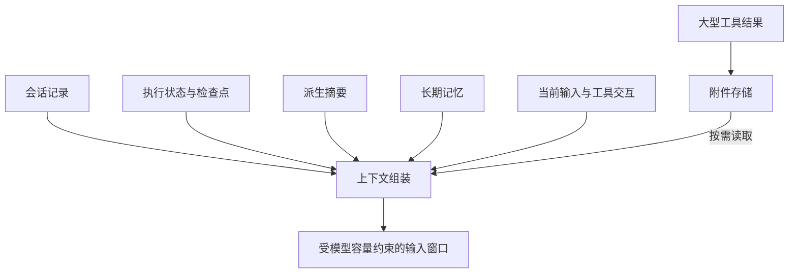

# 记忆与上下文技术设计

## 1. 设计目标

Agent 需要保留完整的会话和执行记录，同时把有限的模型输入容量用于当前任务最相关的信息。框架因此将“长期保存的数据”和“单次模型调用的输入”分开管理：存储保留来源记录，上下文组装器生成只读投影，缩减和摘要不会覆盖源数据。

## 2. 数据类别与权威来源

| 数据类别 | 职责 | 是否权威来源 |
| --- | --- | --- |
| 会话记录 | 保存消息、工具调用及结果、结构化输出和协议续接数据 | 是；保存完整对话事实 |
| 执行状态 | 保存运行位置、检查点、待处理交互和恢复信息 | 是；保存任务执行事实 |
| 长期记忆 | 由应用选择写入的跨会话条目，带来源和版本 | 对该记忆条目是权威来源；不会自动从会话提取 |
| 摘要 | 对部分历史的派生概述，可供后续组装复用 | 否；必须能由源历史重新生成 |
| 上下文窗口 | 为一次模型调用准备的、有预算限制的输入消息 | 否；是临时投影，不作为删改历史的依据 |
| 附件 | 保存从模型窗口转出的完整工具结果或大块内容 | 对附件原文是权威来源；读取需经过授权存储实例 |

短期任务状态、近期会话和摘要共同构成模型可见的工作上下文；它们不等同于长期记忆。记忆的写入、更新和删除由独立接口及应用策略控制，不会因为一次对话或摘要生成而自动发生。

## 3. 会话与执行状态的一致性

普通 ReAct 在执行过程中维护持久化检查点，并按已提交消息前缀同步会话记录。恢复时先修补尚未同步的前缀，再继续执行。会话以会话 ID、分支、generation 和 revision 标识历史版本；写入需要租约和预期 revision，避免并发写者覆盖彼此内容。

Workflow 和 DAG 的检查点包含各执行节点的历史投影。节点历史按运行、工作流和节点身份隔离；内置 ReAct 节点通过投影读取检查点，不重复写入会话存储。自定义节点可选择在同一个检查点事务中保存节点状态和消息；纯计算节点不必产生会话记录。

会话存储负责持久化和版本一致性，不负责决定当前模型窗口、历史裁剪或摘要策略。SQLite 插件实现的六类存储服务及参数详见[SQLite 存储实现](存储抽象层Plugin-sqlite实现.md)；执行器和模型调用路径详见[上下文与会话技术设计](上下文与会话设计.md)。

## 4. 上下文投影与信任边界

一次模型调用的窗口由固定指令、当前输入、会话历史和应用 Contributor 提供的数据块组成。布局决定顺序，每块独立声明 Token 和消息预算，并选择自己的处理策略。组装器在模型选定后运行，先扣除工具定义和协议开销，再计算各块预算。

| 输入来源 | 上下文处理原则 |
| --- | --- |
| 固定系统或开发者指令 | 按指令信任级别保留，不允许历史缩减器修改 |
| 会话历史 | 作为数据处理；可按完整轮次裁剪或摘要，但完整源记录继续保留 |
| 长期记忆和检索结果 | 作为数据块加入，遵循独立额度和来源顺序 |
| 工具结果 | 保留调用与结果关系；大结果可保存附件并仅在需要时读取 |
| 摘要 | 作为不可信历史数据加入，保留源范围和配置版本供校验 |

预算不会在块间自动借用；缩减后再次估算并校验。失败的必要块中止组装，标为可省略的非内置块可以跳过并记录原因。组装报告记录每块的来源版本、额度和缩减结果，不包含上下文正文。

缩减器必须保持完整最新用户轮次、固定指令和工具调用/结果配对。历史、记忆和工具观察不能被升级为系统指令。消息裁剪只用于本次窗口，不能清除会话存储或作为附件清理依据。

## 5. 长期记忆接口

长期记忆通过 `LongTermMemory` 提供读取、检索、保存和删除操作。条目包含稳定 ID、内容、来源、版本及可选有效期；namespace 是由应用绑定的访问范围。

| 组件 | 默认行为 |
| --- | --- |
| 存储实现 | SQLite 插件注册持久化服务；也可由应用替换后端 |
| 上下文 Contributor | 默认不自动装配；应用显式配置后按当前输入检索 |
| 记忆工具 | 默认只提供搜索和读取；保存、删除需应用显式开启 |
| 检索策略 | 默认关键词匹配；不自动进行事实提取、中文分词或向量检索 |

默认 Contributor 每次组装都会重新查询，返回内容作为普通数据块参与预算。记忆工具的 namespace 由宿主固定，不由模型选择。更新和删除需要提供当前版本；过期或删除后的重建会获得新版本，避免旧写入覆盖新记录。

## 6. 摘要与派生缓存

`ModelCompressor` 将历史块中的旧轮次交给单独指定的摘要模型，并保留最新完整轮次和固定指令。摘要调用受输入 Token、摘要字节数、调用次数和运行预算约束。摘要提示将旧消息、工具输出和先前摘要都视为不可信数据。

摘要缓存键包含会话身份、分支、generation、块 ID、摘要策略版本、模型和预算等配置。记录保存已覆盖的消息范围、源 revision 和内容指纹。只有来源范围、内容及配置相符时才复用；新历史可在现有摘要上增量更新，策略变化则重新生成。并发写入使用版本比较，迟到结果不能覆盖更新的摘要。

持久化摘要由 `SummaryStore` 提供，SQLite 插件可注册该服务；应用需显式将它传给 `ModelCompressor::with_store`。更改摘要模型实际配置或摘要语义时，应升级策略版本。摘要无法替代源会话，缓存不可用时必须仍能从原始记录重新计算。

## 7. 大型结果与附件生命周期

工具结果转存器同时检查文本内容和结构化内容。结果超过配置阈值时，先将完整结果写入 `ArtifactStore`，成功后再以预览和资源引用替代内联数据；结构化结果置空，错误状态和副作用信息保留。历史保存引用，模型通过受限读取工具按范围取回原文，附件不会自动展开进上下文。

附件 ID 不代表访问权限。每个读写工具只能持有与授权范围对应的存储实例。SQLite ArtifactStore 与文件系统 ArtifactStore 均不自动过期或后台清理。应用负责整理会话、检查点、记忆和业务记录中的引用，确认没有在途写入后，再按保留策略删除附件。

## 8. 注意事项

- 任何窗口裁剪、摘要或检索结果都不是源记录，不能据此直接删除会话消息或附件。
- Token 估算用于框架内容量管理，不等于模型服务账单中的实际 Token 数；模型切换后必须重新计算窗口。
- Contributor 和记忆检索应遵守取消信号、读取额度和超时限制；来源返回的数据必须保持数据角色。
- 持久摘要依赖会话标识、generation、消息内容及策略版本的一致性。不可验证来源指纹时应重新生成，不应静默复用。
- 文件附件清理必须考虑活动读取者和检查点引用；只看当前模型窗口会误删仍需恢复的结果。
