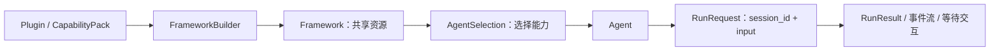

# EliteForge Agent Framework 使用手册

本技能的 API 基线为 Git tag `1.0.0`。正文和随附章节包含实现所需的代码，无需先取得 Framework 仓库或阅读 `docs/`。仅在目标项目使用其他版本、接口不匹配或需要修改框架内部实现时，查实际锁定版本的源码。

执行任务时，先读目标项目的 Cargo 清单与装配入口，再按下方教程实现。已有应用沿用其配置、目录和身份体系，不照搬示例的数据和全局作用域。

## 1. 五个核心对象

| 对象 | 用途 | 创建时机 |
| --- | --- | --- |
| `Framework` | 持有数据库、模型连接和插件资源 | 应用启动，按隔离范围创建 |
| `Plugin` | 注册服务，管理初始化和关闭 | 加入 `FrameworkBuilder` |
| `CapabilityPack` | 组合插件、声明式实现和 Skills | 加入 `FrameworkBuilder` |
| `Agent` | 选择已安装的模型、工具、上下文 | 创建角色或配置不同权限时 |
| `RunRequest` | 在某个会话下发起一轮执行 | 每次提交输入时 |



安装提供候选，选择决定 Agent 能用什么。默认 Agent 没有工具、技能和额外上下文。`agent.close()` 关闭单个 Agent；应用退出时调用 `framework.close().await` 释放共享资源。

## 2. 第一个能对话的 Agent

准备支持 edition 2024 的 Rust 工具链，以及一个 OpenAI Chat Completions 兼容服务的端点、模型名和凭据。其他协议见[模型接入](references/models.md)。

新项目 `Cargo.toml`：

```toml
[package]
name = "my-agent"
version = "0.1.0"
edition = "2024"

[dependencies]
eliteforge-agent-framework = { git = "https://gitee.com/person-ai/eliteforge-agent-framework.git", tag = "1.0.0", default-features = false }
eliteforge-agent-official-capability-pack = { git = "https://gitee.com/person-ai/eliteforge-agent-framework.git", tag = "1.0.0" }
tokio = { version = "1", features = ["macros", "rt-multi-thread"] }
```

`src/main.rs` 完整内容：

```rust
use eliteforge_agent_framework::{AgentSelection, FrameworkBuilder, RunRequest};
use eliteforge_agent_official_capability_pack::{
    EliteForgeOfficialCapabilityPack,
    model::{AdapterKind, AuthData, GenaiPlugin},
};

#[tokio::main]
async fn main() -> Result<(), Box<dyn std::error::Error>> {
    let model = std::env::var("ELITEFORGE_SKILL_AGENT_FRAMEWORK_MODEL")?;
    let endpoint = std::env::var("ELITEFORGE_SKILL_AGENT_FRAMEWORK_ENDPOINT")?;
    std::fs::create_dir_all("agent-data/artifacts")?;
    #[cfg(unix)]
    {
        use std::os::unix::fs::PermissionsExt;
        std::fs::set_permissions(
            "agent-data/artifacts", std::fs::Permissions::from_mode(0o700),
        )?;
    }
    let framework = FrameworkBuilder::new()
        .default_models(false)
        .capability_pack(
            EliteForgeOfficialCapabilityPack::new(
                "agent-data/state.sqlite", "agent-data/artifacts",
            ).model(
                GenaiPlugin::new(model)
                    .adapter(AdapterKind::OpenAI)
                    .endpoint(endpoint)
                    .auth(AuthData::from_env("ELITEFORGE_SKILL_AGENT_FRAMEWORK_API_KEY")),
            ),
        )
        .build().await?;
    let outcome = async {
        let agent = framework.agent(AgentSelection::default()).build().await?;
        agent.run(RunRequest::new("chat-1", "用中文介绍你的用途")).await
    }.await;
    // 创建 Agent 或运行失败时，也要执行关闭路径。
    let shutdown = framework.close().await;
    let result = outcome?;
    if !shutdown.is_success() {
        return Err(format!("关闭失败：{shutdown:?}").into());
    }
    println!("状态：{:?}\n{}", result.status, result.output);
    Ok(())
}
```

通过用户的配置或秘密管理方式设置下方三个环境变量，再执行 `cargo run`。`ENDPOINT` 是服务根地址，例如服务商给出的 `/v1/` 地址，不是完整 `/chat/completions` URL；`MODEL` 填实际型号。程序会请求真实模型、打印结果，在 `agent-data/` 保存状态和工件。

下一次输入沿用 `chat-1` 就能延续会话；换 `session_id` 会使用另一份历史。服务端复用 Framework 和 Agent，不要每个 HTTP 请求都重新安装插件。

## 3. 从对话到业务操作

要让模型查询订单，使用随技能分发的[订单助手模板](assets/order-agent/Cargo.toml)。目录含完整 `Cargo.toml`、`src/main.rs`、`src/orders.rs`，可以复制为新项目，也可以合入现有应用。

模板包含真实模型配置、声明式能力包、查询工具、系统指令、Agent 选择和关闭路径。演示订单为 `A100 → 已发货`；把 `orders.rs` 中的内存查询替换成宿主已授权的订单服务。逐步讲解见[扩展开发](references/extensions.md)。

| 要实现什么 | 教程 | 章内内容 |
| --- | --- | --- |
| 多 Agent、装配和权限选择 | [装配与配置](references/integration.md) | 默认项、选择字段、共享范围、重配置 |
| 模型端点、多连接、Embedding、自定义模型 | [模型接入](references/models.md) | 配置、ModelRef、策略、直接调用 |
| 自定义工具、插件、业务能力包 | [扩展开发](references/extensions.md) | 订单实现、宏、配置、服务与生命周期 |
| 文件/命令、MCP、Skills、Web/Media | [官方工具与技能](references/tools.md) | 启用代码、Provider ID、调用参数 |
| 系统指令、RAG、历史预算、记忆 | [上下文与存储](references/context.md) | Contributor、布局、SQLite、记忆接法 |
| SSE、取消、问答审批、恢复 | [运行与交互](references/runtime.md) | 请求处理、状态流转、恢复与排错 |
| Workflow/DAG、协作、PersonAI、动态包 | [进阶能力](references/capabilities.md) | 接入步骤、API、输入输出、宿主职责 |

按任务读取相关章节即可。章节是技能内的完整教程；代码片段会说明所需依赖和已有变量，标有文件名的完整文件可直接复制。

## 4. 编写应用时的规则

- Framework crate 使用相同 Git URL 和 tag；内部 path 依赖由 Cargo 在同一 checkout 解析。业务 crate 可以使用本项目的 path 依赖。
- 替换官方包中的模型或存储用 `.model(...)` / `.storage(...)`；重复安装同 ID 插件或第二套唯一存储会失败。
- `tool_providers` 填插件 ID，`tools` 填工具内部 ID，`skills` 填技能名，`context_sources` 填来源插件 ID。`call_name` 是模型调用名，不能替代内部 ID。
- 宿主从已认证身份绑定会话、工作目录、数据范围和凭据。模型参数不能授予新权限；文件目录限制和工具审批不是 OS 沙箱。
- `AwaitingInput` 表示等待交互。恢复沿用保存的 run/interaction，不重新执行原始请求；结果不明的写操作先核对外部状态。
- 完成后运行目标项目已有编译检查。真实模型、外部服务调用遵循任务授权；编译通过不能证明供应商运行兼容。是否写测试遵循用户要求。

## Environment Variables

以下变量用于入门程序和订单模板；合入现有应用时可改用宿主配置对象。

- `ELITEFORGE_SKILL_AGENT_FRAMEWORK_MODEL` [required] 服务实际提供的 Chat 模型 ID。
- `ELITEFORGE_SKILL_AGENT_FRAMEWORK_ENDPOINT` [required] 模型协议基础 URL，包含服务所需的版本前缀。
- `ELITEFORGE_SKILL_AGENT_FRAMEWORK_API_KEY` [required] 模型服务凭据；从秘密管理或环境读取，不写入代码或日志。

## Output Path

依次采用：用户指定的项目与文件 → 当前项目已有 Cargo 清单、配置入口和 Agent 装配模块。需要新项目时才复制 `assets/order-agent/`；目录参数视为项目根，不覆盖已有同名文件。现有项目按其模块布局合入示例，不修改 Cargo 依赖缓存。
